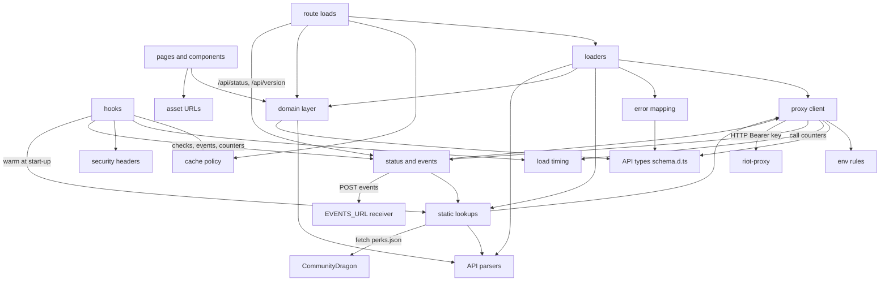

# Components

The modules inside ninjagoldfinch.lol, what each is responsible for, and which way the dependencies run.

## Layers

The code is split so that anything holding the riot-proxy key stays on the server, and anything that shapes data is a pure function with a unit test (`CLAUDE.md:34-47`, `docs/IMPLEMENTATION.md:172`).

| Layer             | Path                                                                   | Runs on           | Responsibility                                                                                                                                                                                                                                                                                                                                                                                                                                              |
| ----------------- | ---------------------------------------------------------------------- | ----------------- | ----------------------------------------------------------------------------------------------------------------------------------------------------------------------------------------------------------------------------------------------------------------------------------------------------------------------------------------------------------------------------------------------------------------------------------------------------------- |
| hooks             | `src/hooks.server.ts`                                                  | server            | At start-up (`init`, `:21-30`): logs the build's identity, starts loading the current patch and its lookups, starts the status checks and the events (ADR-062, ADR-063). On each request (`handle`, `:37-54`): times it and logs it when slow, counts it for `/api/status`, forces cache policy on errors and posts, `no-store` where none was set, and sets the security headers. Turns unexpected errors into a generic message (`handleError`, `:59-64`) |
| env rules         | `src/env.ts`, `src/lib/server/env.ts`                                  | server, start-up  | Declares and validates `PROXY_URL`, `PROXY_KEY`, `CDRAGON_URL`, `PUBLIC_SITE_NAME`, `STATUS_TOKEN`, `STATUS_ALLOW_CIDR`, `STATUS_CHECK_INTERVAL_S`, `EVENTS_URL` and `STATE_DIRECTORY`                                                                                                                                                                                                                                                                      |
| route loads       | `src/routes/**/+page.server.ts`, `+server.ts`                          | server            | Parse the URL, redirect to the canonical URL, call a loader, set `Cache-Control`                                                                                                                                                                                                                                                                                                                                                                            |
| loaders           | `src/lib/server/{profile,match,champions,champion-page,front-page}.ts` | server            | Make the riot-proxy calls for one page, decide which are essential, build the page's data                                                                                                                                                                                                                                                                                                                                                                   |
| proxy client      | `src/lib/server/proxy.ts`                                              | server            | One openapi-fetch client factory, `createProxyClient`: base URL, bearer key, deadlines, failure and slow-call logging, call counting. Three clients: `proxy` for pages, `frontClient` with the front page's 2 s deadline (ADR-066), `probeClient` for the status checks                                                                                                                                                                                     |
| load timing       | `src/lib/server/timing.ts`                                             | server            | Records each request's riot-proxy calls (`timeCalls`) and logs a request slower than 100 ms (`timeLoad`, ADR-046)                                                                                                                                                                                                                                                                                                                                           |
| error mapping     | `src/lib/server/errors.ts`                                             | server            | Maps riot-proxy errors to 404, 429 or 503; `optional()` for calls a page can do without; `early()` for calls started before they are awaited                                                                                                                                                                                                                                                                                                                |
| cache policy      | `src/lib/server/cache.ts`                                              | server            | The seven `Cache-Control` policies (`profile`, `match`, `analytics`, `live`, `static`, `notFound`, `none`) and the rule for errors and posts                                                                                                                                                                                                                                                                                                                |
| static lookups    | `src/lib/server/{patch,static-data,cdragon}.ts`                        | server            | Current patch (refreshed in the background after 5 min), Data Dragon names and CommunityDragon stat shards (two patches each), held in memory and loaded at start-up                                                                                                                                                                                                                                                                                        |
| status and events | `src/lib/server/{status,status-access,events,metrics,version}.ts`      | server            | The background checks behind `/api/status` and who may read it (ADR-062), events to `EVENTS_URL` (ADR-063), request and riot-proxy counters, the build's identity (ADR-061)                                                                                                                                                                                                                                                                                 |
| security headers  | `src/lib/server/security.ts`                                           | server            | The CSP directives and the security headers on every response (ADR-055)                                                                                                                                                                                                                                                                                                                                                                                     |
| API types         | `src/lib/api/schema.d.ts`                                              | both (types only) | Generated from `openapi/riot-proxy.json` by `just gen`; never edited by hand                                                                                                                                                                                                                                                                                                                                                                                |
| API parsers       | `src/lib/api/{match,ddragon,cdragon,riot,json}.ts`                     | both              | Type and check the Riot and Data Dragon payloads the spec leaves untyped; project the fields the site uses; `record()` for reading untyped JSON                                                                                                                                                                                                                                                                                                             |
| domain layer      | `src/lib/domain/*.ts`                                                  | both              | Pure functions: Riot ID parsing, regions, filters, match rows, builds, timeline maths, champion tables, the front page's cards, recent searches                                                                                                                                                                                                                                                                                                             |
| asset URLs        | `src/lib/assets.ts`                                                    | both              | The only place image URLs are built (Data Dragon CDN, CommunityDragon); exports the two hosts' origins, `DDRAGON_ORIGIN` and `CDRAGON_ORIGIN`, for `<link rel="preconnect">` (`:12-19`)                                                                                                                                                                                                                                                                     |
| components        | `src/lib/components/*.svelte`                                          | both              | Rendering; Svelte 5 runes only                                                                                                                                                                                                                                                                                                                                                                                                                              |
| pages             | `src/routes/**/+page.svelte`, `+layout.svelte`, `+error.svelte`        | both              | Compose components; the layout carries the search form, the Riot legal notice and a preconnect to Data Dragon; the profile and match pages add one to CommunityDragon                                                                                                                                                                                                                                                                                       |
| browser helpers   | `src/lib/recent-storage.ts`                                            | browser           | Recent searches in `localStorage`                                                                                                                                                                                                                                                                                                                                                                                                                           |

SvelteKit refuses to bundle `src/lib/server/` into client code, and no `.svelte` file imports it (checked with `grep -rn "lib/server" src --include=*.svelte`: no hits).

## Dependency diagram

This shows which layer imports which. Arrows point from the importer to what it imports.

The server-only boxes are route loads, hooks, loaders, static lookups, status and events, security headers, proxy client, load timing, error mapping, cache policy and env rules. Pages and components reach only the domain layer, asset URLs and API types, which are shared.

## Loaders

Each page has one loader that owns its riot-proxy calls. Essential calls fail the page; optional calls are wrapped in `optional()` and degrade one section (`src/lib/server/errors.ts:41-58`); the front page has no essential call. Calls that do not depend on each other start together: the current patch and its lookups run alongside the page's own calls, not after them (SPD-08). A chain started before the call that can fail the page is wrapped in `early()`, so it leaves no unhandled rejection when the page fails first (`src/lib/server/errors.ts:60-68`).

| Loader             | Page                 | Essential calls                                       | Optional calls                                                                                          | Source                                    |
| ------------------ | -------------------- | ----------------------------------------------------- | ------------------------------------------------------------------------------------------------------- | ----------------------------------------- |
| `loadProfile`      | `/summoner/{riotId}` | profile; current patch                                | match page; Data Dragon names (`namesOrFallback`, fallback `NO_NAMES`)                                  | `src/lib/server/profile.ts:71-155`        |
| `loadMatch`        | `/match/{matchId}`   | match; patch versions                                 | timeline; Data Dragon names; CommunityDragon shards                                                     | `src/lib/server/match.ts:34-85`           |
| `loadChampions`    | `/champions`         | champion table; current patch                         | patch list; Data Dragon names                                                                           | `src/lib/server/champions.ts:33-62`       |
| `findChampionPage` | `/champions/{key}`   | current patch; Data Dragon names (to resolve the URL) | —                                                                                                       | `src/lib/server/champion-page.ts:82-101`  |
| `loadChampionPage` | `/champions/{key}`   | champion detail                                       | set builds; matchups; patch list                                                                        | `src/lib/server/champion-page.ts:111-175` |
| `loadFrontPage`    | `/`                  | —                                                     | analytics; free rotation; server status (each with a 2 s deadline); current patch and Data Dragon names | `src/lib/server/front-page.ts:67-120`     |

The search page (`src/routes/search/+page.server.ts:18-47`) has no loader module: it redirects a Riot ID without calling riot-proxy, and for a champion name it uses the static lookups only.

## Domain modules

| Module                | Main exports                                                                                                                                                                                                     | Used by                                                                                                                                          |
| --------------------- | ---------------------------------------------------------------------------------------------------------------------------------------------------------------------------------------------------------------- | ------------------------------------------------------------------------------------------------------------------------------------------------ |
| `riot-id.ts`          | `parseRiotIdInput`, `parseRiotId`, `profilePath`, `riotIdKey`, `sameRiotId`                                                                                                                                      | search, profile, match pages; the front page's examples and recent searches                                                                      |
| `regions.ts`          | `REGIONS` (15 platforms), `regionForPlatform`, `regionForMatchId`, `findRegion`                                                                                                                                  | profile and match loaders, legacy redirects, the front page's region, recent searches                                                            |
| `match-filters.ts`    | `FILTER_QUEUES`, `MATCHES_PER_PAGE` (10), `parseMatchFilter`, `filterQuery`                                                                                                                                      | profile                                                                                                                                          |
| `matches.ts`          | `toMatchRows`, `isCustomGame`, `patchOf`, `itemSlots`, `loadoutOf`                                                                                                                                               | profile, match                                                                                                                                   |
| `match-detail.ts`     | `toMatchDetail`, `isMatchIdFor`, `matchPath`, `selectBuild`, `asMatchDetail`                                                                                                                                     | match page, profile rows                                                                                                                         |
| `builds.ts`           | `playerBuild`, `skillOrder`, `skillColumns`, `shopVisits`                                                                                                                                                        | match page (port of riot-proxy BLD-04, ADR-032)                                                                                                  |
| `timeline.ts`         | `objectiveKills`, `goldLead`, `goldAxis`, `nearestFrame`                                                                                                                                                         | timeline chart                                                                                                                                   |
| `champion-stats.ts`   | `DEFAULT_PATCH`, `MIN_GAMES`, `LOW_SAMPLE_GAMES`, `ROLES`, `LANES`, `TIERS`, `parseChampionFilter`, `analyticsQuery`, `toChampionTable`                                                                          | champion pages                                                                                                                                   |
| `champion-page.ts`    | `toChampionStats`, `toSetBuilds`, `toMatchups`, `parseVsPick`, `vsChoices`                                                                                                                                       | champion page                                                                                                                                    |
| `champion-search.ts`  | `champKey`, `findChampion`, `championPath`, `championNames`                                                                                                                                                      | search, champion pages                                                                                                                           |
| `champion-summary.ts` | `summariseChampions`                                                                                                                                                                                             | profile side panel                                                                                                                               |
| `front-page.ts`       | `topWinRates`, `gamesAnalysed`, `pickRegion`, `frontQuery`, `parseRotation`, `rotationChampions`, `parseStatus`, `statusView`, `statusHeadline`, `allRunning`, `riotStatusUrl`, `fetchedAge`, `EXAMPLE_SEARCHES` | the front page's loader and cards (ADR-066, ADR-071, ADR-075)                                                                                    |
| `ranks.ts`            | `describeRanks`, `soloRankLabel`                                                                                                                                                                                 | profile; `soloRankLabel` gives the rank a recent search records (ADR-068)                                                                        |
| `error-view.ts`       | `describeError`                                                                                                                                                                                                  | error page, profile match-history notice                                                                                                         |
| `recent.ts`           | `RecentSearch`, `addRecent`, `parseRecent`, `MAX_RECENT` (8)                                                                                                                                                     | `src/lib/recent-storage.ts`, for the profile, which records each view and refresh, and the home page's `RecentSearches` cards (ADR-068, ADR-073) |
| `age.ts`              | `formatAge`, `ageSince`                                                                                                                                                                                          | profile header and the home page's status card (`formatAge`); the home page's recent searches (`ageSince`)                                       |
| `names.ts`            | `itemName`, `queueName`, `championName` (fallbacks when the lookups lack an id)                                                                                                                                  | the domain modules above                                                                                                                         |

Each has a test in `tests/unit/` with the same base name.

## Components

23 components in `src/lib/components/`. The larger ones: `TimelineChart` (hand-written SVG gold chart, ADR-029/031), `SetBuilds` (champion build tabs), `BuildPanel` (one player's build in a dialog, ADR-028), `Scoreboard`, `MatchRow` (a profile row, with the inline teams view that uses `preloadData`, ADR-030), `ProfileHeader` (refresh form with `use:enhance`, ADR-012). The front page's cards are `TopWinRates`, `RotationCard` and `StatusCard`, the last two with a `RegionPicker` (ADR-071), and `RecentSearches` (ADR-068). Every component that shows an image builds its URL through `src/lib/assets.ts`. Every `` has `width`, `height` and `decoding="async"`, and is `loading="lazy"` except the main images below and `MatchRow`'s lane badge, which has no `loading` attribute. `ChampionIcon` takes a `priority` prop for a page's main image (`loading="eager"`, `fetchpriority="high"`), used for the champion page's header icon; `ProfileHeader`'s profile icon is eager with `fetchpriority="high"` (SPD-10).

---

**Sources:** `src/hooks.server.ts:L1-L64`, `src/env.ts:L21-L63`, `src/lib/server/env.ts`, `src/lib/server/patch.ts:L46-L146`, `src/lib/server/static-data.ts:L22-L51`, `src/lib/server/cdragon.ts:L1-L37`, `src/lib/server/proxy.ts:L1-L177`, `src/lib/server/timing.ts:L1-L95`, `src/lib/server/errors.ts:L41-L68`, `src/lib/server/cache.ts:L5-L38`, `src/lib/server/{status,status-access,events,metrics,version,security}.ts` (exports and imports), `src/lib/server/profile.ts:L71-L155`, `src/lib/server/match.ts:L34-L85`, `src/lib/server/champions.ts:L33-L62`, `src/lib/server/champion-page.ts:L82-L175`, `src/lib/server/front-page.ts:L67-L120`, `src/routes/search/+page.server.ts:L18-L47`, `src/routes/**/+page.server.ts` and `+server.ts` (imports), `src/lib/api/*.ts`, `src/lib/domain/*.ts` (exports and importers), `tests/unit/*.test.ts` (one per domain module), `src/lib/recent-storage.ts:L1-L22`, `src/lib/components/*.svelte` (imports, `` attributes), `src/lib/assets.ts:L12-L19`, `src/lib/components/ChampionIcon.svelte:L1-L24`, `src/lib/components/ProfileHeader.svelte:L44-L54`, `src/routes/+layout.svelte:L7-L54`, `CLAUDE.md:L34-L47`, `docs/IMPLEMENTATION.md:L172`
**Last verified:** 2026-11-10 against commit `4986766` with #147's changes; the `front-page.ts` rows against `91c83d3` with FIX-17's and FP-04's changes
