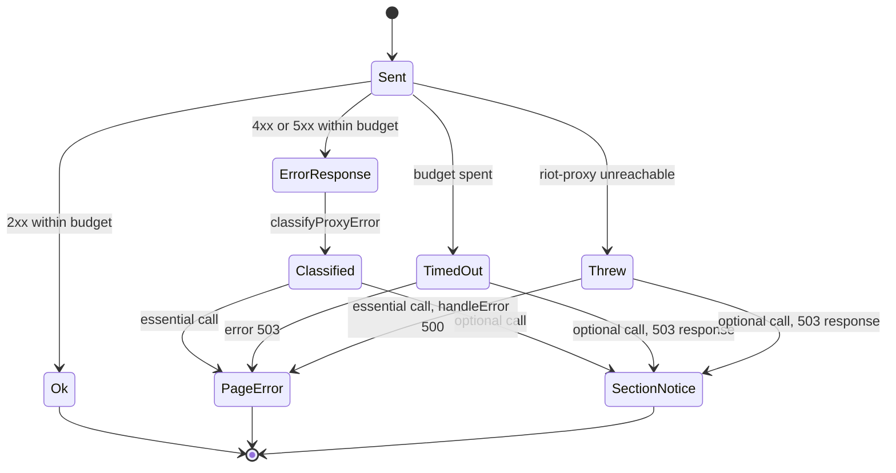

# Concurrency and rate limiting

How ninjagoldfinch.lol runs riot-proxy calls in parallel, bounds how long they take, shares in-memory fetches, and behaves when riot-proxy or Riot says "slow down".

## Process model

The site is one Node process (`/usr/bin/node build` under systemd, owner-supplied unit) with no worker pool, queue or background job. Concurrency is the Node event loop: each request's load awaits its riot-proxy calls, and many requests can be in flight at once. Nothing in the repo limits how many concurrent requests the site accepts; adapter-node's timeouts (`SHUTDOWN_TIMEOUT` 30 s, `IDLE_TIMEOUT` 0, and the unset `KEEP_ALIVE_TIMEOUT` and `HEADERS_TIMEOUT`) are left at their defaults (`build/server/adapter-node-env.js:4-19`, inventory section 7).

## Parallel calls per page

Within one page, independent calls run together with `Promise.all`:

| Page              | Calls in parallel                                                      | Then                                                            | Source                                    |
| ----------------- | ---------------------------------------------------------------------- | --------------------------------------------------------------- | ----------------------------------------- |
| profile           | — (profile first, it supplies the `puuid` and platform)                | match page + current patch, in parallel; then Data Dragon names | `src/lib/server/profile.ts:78-111`        |
| match             | match + timeline + patch versions                                      | Data Dragon names + CommunityDragon shards, in parallel         | `src/lib/server/match.ts:37-65`           |
| champion table    | table + patch list + current patch                                     | Data Dragon names                                               | `src/lib/server/champions.ts:37-51`       |
| champion page     | detail + builds + matchups + patch list (after resolving the champion) | —                                                               | `src/lib/server/champion-page.ts:119-138` |
| Data Dragon names | `champion`, `item`, `summoner`, `runesReforged`, `queues`              | —                                                               | `src/lib/server/static-data.ts:45-51`     |

ADR-039 measured a cold champion page at about the sum of its four riot-proxy reads rather than the slowest one, which suggests riot-proxy serialises them or they compete for CPU; it was not confirmed (`docs/DECISIONS.md:529`).

## Shared fetches

Three lookups are held in process memory and shared by concurrent requests. Each stores the promise, not the result, so callers that arrive while a fetch is in flight wait on the same request. A failed fetch is dropped so the next page tries again.

| Lookup          | Key   | Lifetime                | Source                                |
| --------------- | ----- | ----------------------- | ------------------------------------- |
| `patchVersions` | none  | `PATCH_TTL_MS` = 5 min  | `src/lib/server/patch.ts:47-68`       |
| `staticNames`   | patch | until the patch changes | `src/lib/server/static-data.ts:27-39` |
| `statShards`    | patch | until the patch changes | `src/lib/server/cdragon.ts:9-28`      |

Riot player data and analytics are never held by the site (`docs/DECISIONS.md:560`, ADR-041).

## Deadlines and failures

Every riot-proxy call carries a deadline from `proxyBudget`: 5 s for `/v1/lol/analytics/*` and `/v1/static/*`, 30 s for everything else. The body is read inside the deadline, and a caller's own abort still applies (`src/lib/server/proxy.ts:55-87`). There are no retries in the site. The 30 s budget leaves room for riot-proxy's own Riot client, which allows 25 s per request (`riot-proxy:src/riot/client.rs:22-24`). CommunityDragon's `perks.json` fetch has no deadline (`src/lib/server/cdragon.ts:18`).

This state diagram shows what one riot-proxy call can end as, and what the page does with it.

`optional()` turns a thrown or timed-out call into a 503 response for that call alone, so the loader's "not ok" branch handles it (`src/lib/server/errors.ts:41-58`). Essential calls go through `toHttpError`, which throws a SvelteKit error with status 404, 429 or 503 (`src/lib/server/errors.ts:16-39`). An essential call that throws (riot-proxy down) reaches `handleError`, which logs it and shows "Temporarily unavailable" with status 500, SvelteKit's status for an unknown error (`src/hooks.server.ts:15-20`; observed 2026-10-20: connection refused gave 500, a hung riot-proxy gave 503 after 5.0 s on `/champions` and 30.0 s on profile and match pages).

> **TODO (unverified):** On 2026-10-20 one match page request against a riot-proxy that accepted connections but never answered did not finish at all (still pending after 4.5 minutes): its match and timeline calls hit their 30 s deadline and were logged, but its `/v1/static/versions` call never logged a timeout, so `Promise.all` never settled. The flaky unit test in [workflows/testing.md](../workflows/testing.md#known-flaky-test) shows the same symptom. If a deadline can fail to fire, a hung riot-proxy can hold site requests until Cloudflare gives up. Reproduce and fix in `withTimeout` (`src/lib/server/proxy.ts:73-87`); a code task.

## Rate limits that apply to the site

The site has no rate limiter of its own. Three limits act on its traffic:

| Limit                                        | Where      | What happens                                                                                                                                                      | Source                                                                      |
| -------------------------------------------- | ---------- | ----------------------------------------------------------------------------------------------------------------------------------------------------------------- | --------------------------------------------------------------------------- |
| Consumer quota for `ninjagoldfinch-lol-prod` | riot-proxy | Sliding 60 s window of `quota_per_min` requests (default 600). Over quota: `QUOTA_EXCEEDED`, HTTP 429, `Retry-After`. Held in memory, reset on riot-proxy restart | `riot-proxy:src/http/quota.rs:1-8,97-135`, `riot-proxy:src/consumers.rs:14` |
| Riot API rate limits                         | riot-proxy | Per routing value and method. An interactive request waits up to 2 s; then a cached copy is served as `STALE`, or `RATE_LIMITED` (HTTP 503)                       | `riot-proxy:src/config.rs:716`, `riot-proxy:src/fetcher.rs:455-466`         |
| Refresh window                               | riot-proxy | One `refresh=true` per player and part per 60 s; inside the window the cached copy is returned with `refreshAvailableIn`                                          | `riot-proxy:src/routes/players/refresh.rs:17-18,43-71`                      |

Each riot-proxy call counts against the quota, including static and analytics calls, because every read route is metered (`riot-proxy:src/http/auth.rs:318-343`, `riot-proxy:src/routes/docs.rs:118-126`). A cold profile view costs two to eight calls (profile, match page, versions, and the five Data Dragon files on the first view of a patch); a warm one costs two.

> **TODO (unverified):** the `quota_per_min` actually set for `ninjagoldfinch-lol-prod`. Run `riot-proxy key list` on `ngf-prod-syd1`. Code default is 600.

How the site reacts, from `classifyProxyError` (`src/lib/server/errors.ts:16-33`):

- `QUOTA_EXCEEDED` and `RATE_LIMITED` (and any HTTP 429) become a **429** page, "Too many requests … Try again in N seconds". N comes from the error body's `retryAfter`, else the `Retry-After` header; without either the page says "a minute" (`src/lib/domain/error-view.ts:15-17`). riot-proxy sends `RATE_LIMITED` as HTTP 503, so the site goes by the code, not the status.
- On the profile, a rate-limited match page shows the same message in the match-history section while the header still renders (`src/lib/server/profile.ts:119-124`).
- The Refresh button is disabled while `refreshAvailableIn` is above zero (`docs/DECISIONS.md:155`).
- Error and form-post responses are never cached at the edge, so a passing rate limit is not served to later visitors (`src/lib/server/cache.ts:24-34`).

At the edge, the plan calls for a Cloudflare rate-limiting rule on `/summoner/*` and `/match/*` (`docs/IMPLEMENTATION.md:387`, P5-02).

> **TODO (unverified):** whether that Cloudflare rate-limiting rule exists in production. P5-02 is not ticked in `docs/PROGRESS.md`; check the Cloudflare dashboard.

## Backpressure

There is none in the site beyond the deadlines: a slow riot-proxy holds each affected request for at most 5 s or 30 s before the visitor sees an error. The edge cache is the main shield: repeat views within `s-maxage` never reach the host (`src/lib/server/cache.ts:5-11`).

---

**Sources:** `src/lib/server/proxy.ts:L55-L106`, `src/lib/server/errors.ts:L16-L58`, `src/lib/server/patch.ts:L47-L68`, `src/lib/server/static-data.ts:L27-L51`, `src/lib/server/cdragon.ts:L9-L28`, `src/lib/server/profile.ts:L78-L124`, `src/lib/server/match.ts:L37-L65`, `src/lib/server/champions.ts:L37-L51`, `src/lib/server/champion-page.ts:L119-L138`, `src/lib/server/cache.ts:L5-L34`, `src/lib/domain/error-view.ts:L7-L31`, `src/hooks.server.ts:L15-L20`, `build/server/adapter-node-env.js:L4-L19`, `docs/DECISIONS.md:L155,L529,L560`, `docs/IMPLEMENTATION.md:L387`, `riot-proxy:src/http/quota.rs:L1-L135`, `riot-proxy:src/consumers.rs:L14`, `riot-proxy:src/http/auth.rs:L318-L343`, `riot-proxy:src/config.rs:L716`, `riot-proxy:src/fetcher.rs:L455-L466`, `riot-proxy:src/routes/players/refresh.rs:L17-L71`, `riot-proxy:src/riot/client.rs:L22-L24`
**Last verified:** 2026-10-20 against commit `85d9cf8`
