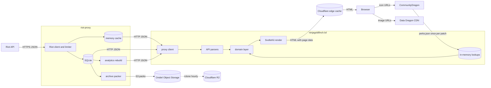

# Data flow

How League data travels from Riot to a visitor's screen, which transformations ninjagoldfinch.lol applies on the way, and where each copy is kept.

## End to end

This diagram follows one piece of match data from Riot to the Browser, with every store along the way.

Everything left of the site belongs to riot-proxy and is summarised here only so the flow is complete; its own documentation is canonical. riot-proxy caches Riot responses in memory and SQLite, packs archived match and timeline bodies into objects on Onidel Object Storage (`riot-proxy:src/archive/pack.rs:124-133`), and an `rclone` job copies them to Cloudflare R2 (`riot-proxy:deploy/README.md:14-18`). The site never reads those buckets; it receives the same bodies through riot-proxy's HTTP routes (see [../integration/object-storage.md](../integration/object-storage.md)).

## Transformations inside the site

| Step                | Input                                                          | Output                                                                              | Code                                                                  |
| ------------------- | -------------------------------------------------------------- | ----------------------------------------------------------------------------------- | --------------------------------------------------------------------- |
| Typed call          | riot-proxy JSON                                                | `data` typed by the generated `paths` (`schema.d.ts`), or `error`                   | `src/lib/server/proxy.ts:137-154`                                     |
| Riot DTO projection | `SummonerDTO`, `LeagueEntryDTO`                                | Only the fields shown: icon id, level; queue, tier, rank, LP, wins, losses          | `src/lib/api/riot.ts:11-35`                                           |
| Match parse         | match-v5 body (`unknown` in the spec)                          | `Match`: id, queue, times, version, participants, teams; or `undefined`             | `src/lib/api/match.ts:159-212`                                        |
| Timeline parse      | match-v5 timeline (about 1.6 MB for a ranked game)             | Per-frame gold, item and skill events, objective kills                              | `src/lib/api/match.ts:214-…`, `docs/DECISIONS.md:272`                 |
| Data Dragon reduce  | `champion`, `item`, `summoner`, `runesReforged`, `queues` JSON | `StaticNames`: names and ids for icons, item catalogue for builds                   | `src/lib/api/ddragon.ts:1-141`, `src/lib/server/static-data.ts:53-76` |
| Stat shards         | CommunityDragon `perks.json`                                   | Shard names and icon paths, ids 5001–5013                                           | `src/lib/api/cdragon.ts:1-34`                                         |
| Policy filters      | match list, match                                              | Custom games (queue 0 or none) dropped or 404                                       | `src/lib/domain/matches.ts:156-162`, `src/lib/server/match.ts:69`     |
| Page shaping        | parsed data + names                                            | `ProfileData`, `MatchDetail`, `ChampionsPage`, `ChampionPage`                       | `src/lib/server/*.ts`, `src/lib/domain/*.ts`                          |
| Render              | page data                                                      | HTML, with the page data embedded for hydration; `__data.json` on client navigation | SvelteKit                                                             |

What does not leave the server:

- **PUUIDs.** The profile's `puuid` is used to ask for the match page (`src/lib/server/profile.ts:99-101`), and each participant's `puuid` to find their build in the timeline (`src/lib/domain/match-detail.ts:145`). Neither is in the page data (ADR-032, `docs/DECISIONS.md:402`).
- **The proxy key and raw proxy error bodies.** Errors become one of three messages (`src/lib/server/errors.ts:11-33`).
- **riot-proxy's cache headers.** `X-Cache` is logged for slow analytics calls only (`src/lib/server/proxy.ts:42-63`).

`ProfileData` is documented as "everything the profile page renders, and nothing more: it is embedded in the HTML" (`src/lib/server/profile.ts:17`). The page data models are described field by field in [../data/models.md](../data/models.md).

## Where copies live

| Copy                               | Owner                            | Lifetime                                                            | Source                                                                   |
| ---------------------------------- | -------------------------------- | ------------------------------------------------------------------- | ------------------------------------------------------------------------ |
| Riot responses                     | riot-proxy                       | Per-endpoint TTLs; matches and timelines immutable                  | `riot-proxy:src/riot/endpoints.rs:93-234`                                |
| Archived match and timeline bodies | riot-proxy                       | Packs kept forever on Onidel and R2                                 | `riot-proxy:deploy/README.md:31-36`                                      |
| Analytics responses                | riot-proxy                       | In memory until the next rebuild                                    | `riot-proxy:src/routes/analytics/cache.rs:1-19`                          |
| Current patch                      | ninjagoldfinch.lol               | In process memory; refreshed in the background after 5 min          | `src/lib/server/patch.ts:62-129`                                         |
| Data Dragon lookups, stat shards   | ninjagoldfinch.lol               | Two patches, in process memory                                      | `src/lib/server/static-data.ts:22-51`, `src/lib/server/cdragon.ts:10-37` |
| Rendered pages                     | Cloudflare                       | Per `Cache-Control`: 60 s profiles, 1 day matches, 10 min analytics | `src/lib/server/cache.ts:5-18`                                           |
| Recent searches                    | the Browser                      | `localStorage`, up to eight Riot IDs                                | `src/lib/recent-storage.ts:6-22`, `src/lib/domain/recent.ts:6`           |
| Images                             | Data Dragon CDN, CommunityDragon | Fetched by the Browser directly                                     | `src/lib/assets.ts:9-73`                                                 |

A restart of the site loses only its in-memory lookups, which the `init` hook reloads at start-up, before most first page views need them (ADR-048). Details: [../data/caching.md](../data/caching.md).

---

**Sources:** `src/lib/server/proxy.ts:L42-L154`, `src/lib/api/riot.ts:L1-L35`, `src/lib/api/match.ts:L159-L217`, `src/lib/api/ddragon.ts:L1-L141`, `src/lib/api/cdragon.ts:L1-L34`, `src/lib/server/static-data.ts:L22-L76`, `src/lib/server/cdragon.ts:L10-L37`, `src/lib/server/patch.ts:L62-L146`, `src/hooks.server.ts:L11-L13`, `src/lib/server/profile.ts:L17,L99-L101`, `src/lib/server/errors.ts:L11-L33`, `src/lib/server/cache.ts:L5-L16`, `src/lib/domain/match-detail.ts:L145`, `src/lib/domain/matches.ts:L156-L162`, `src/lib/recent-storage.ts:L6-L22`, `src/lib/assets.ts:L9-L73`, `docs/DECISIONS.md:L272,L402`, `riot-proxy:src/archive/pack.rs:L124-L133`, `riot-proxy:deploy/README.md:L14-L36`, `riot-proxy:src/riot/endpoints.rs:L93-L234`, `riot-proxy:src/routes/analytics/cache.rs:L1-L19`
**Last verified:** 2026-11-03 against commit `ea998cb`
