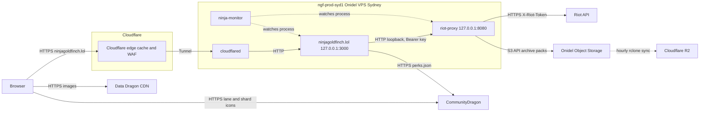

# System overview

Where ninjagoldfinch.lol sits in the platform, what it is responsible for, and what it leaves to riot-proxy and the edge.

## The platform

Three services make up the platform:

| Service            | Responsibility                                                                                                                                    |
| ------------------ | ------------------------------------------------------------------------------------------------------------------------------------------------- |
| ninjagoldfinch.lol | Renders the public pages: player profiles, match pages, champion analytics. Talks only to riot-proxy and, for one file, CommunityDragon.          |
| riot-proxy         | Holds the Riot API key, rate-limits and caches Riot calls, archives matches and timelines, computes champion analytics, and issues consumer keys. |
| ninja-monitor      | Watches each service's CPU, memory and liveness and the host's disk, and alerts on Discord.                                                       |

The split is deliberate. riot-proxy authenticates every caller with a bearer key, so the Browser cannot call it directly without exposing a key; ninjagoldfinch.lol exists to hold that key on a server and turn riot-proxy's JSON into HTML (`docs/IMPLEMENTATION.md:49`). The site adds no API of its own and keeps no player data: its only state is a few lookups held in memory (see [../data/caching.md](../data/caching.md)).

## System context

This diagram shows every system a page view can touch in production.

Read left to right: a visitor reaches Cloudflare over HTTPS, and Cloudflare either answers from its cache or forwards the request through the Tunnel to `cloudflared` on the production host, which passes it to the site on `127.0.0.1:3000`. The site calls riot-proxy over loopback. Images never pass through the host: the Browser loads them from the Data Dragon CDN and CommunityDragon (`src/lib/assets.ts:1-10`). Only riot-proxy talks to Riot and to the object stores. The R2 copy is made by an `rclone` job on the host, not by riot-proxy (`riot-proxy:deploy/README.md:14-18`). The `X-Riot-Token` label is the Riot API's standard header and is riot-proxy's concern; this repo does not show it.

> **TODO (unverified):** how ninja-monitor checks ninjagoldfinch.lol (process state only, or also an HTTP probe of `/healthz`). Source seen: `riot-proxy:docs/design/12-object-storage-and-hosting.md:832-838`; ninja-monitor's repo was not available.

## The production host

| Fact               | Value                                                                                                    | Source                                                                                                    |
| ------------------ | -------------------------------------------------------------------------------------------------------- | --------------------------------------------------------------------------------------------------------- |
| Machine            | Onidel ONI-4, Sydney, `ngf-prod-syd1`, Ubuntu 26.04 LTS                                                  | `riot-proxy:docs/DECISIONS.md:1510`                                                                       |
| Size               | 6 vCPU, 12 GB RAM, 120 GB NVMe, 6 TB a month                                                             | same                                                                                                      |
| Public listeners   | SSH only                                                                                                 | same                                                                                                      |
| Site process       | `ninjagoldfinch-lol.service`: `/usr/bin/node build` in `/opt/ninjagoldfinch-lol` as `ninjagoldfinch-lol` | owner: `systemctl cat`, see [inventory](../_meta/inventory.md#14-owner-supplied-evidence-not-in-any-repo) |
| Site address       | `127.0.0.1:3000`                                                                                         | `README.md:99`, `riot-proxy:docs/design/12-object-storage-and-hosting.md:531-533`                         |
| riot-proxy address | `127.0.0.1:8080`, reached by the site as `PROXY_URL=http://127.0.0.1:8080`                               | `riot-proxy:docs/design/12-object-storage-and-hosting.md:630`                                             |
| Tunnel routes      | `ninjagoldfinch.lol` → `:3000`; `api.ninjagoldfinch.lol` and `admin.ninjagoldfinch.lol` → `:8080`        | `riot-proxy:docs/design/13-admin-dashboard.md:61-65`                                                      |

This repo's own ADR-038 describes the production server as "2 vCPU, 4 GB" (`docs/DECISIONS.md:504`). That was the server before the move to `ngf-prod-syd1`; riot-proxy's ADR-142 records the move. The rest of ADR-038 (systemd, `node build`, the Tunnel) still holds.

The site and riot-proxy start in order: the unit has `After=network-online.target riot-proxy.service` (owner-supplied unit). It does not `Require` riot-proxy, so the site starts and answers `/healthz` even if riot-proxy is down; pages then show "Temporarily unavailable".

## Other machines

| Machine                       | Role                                                                                               | Status              |
| ----------------------------- | -------------------------------------------------------------------------------------------------- | ------------------- |
| `ngf-mon-syd1`                | The former production box, now the monitoring host (ninja-monitor; Prometheus and Grafana planned) | live                |
| LAN dev proxy `192.168.68.46` | A riot-proxy with auth off, used for site development until SPD-01                                 | dormant             |
| preview VM `192.168.68.47`    | A Proxmox VM that built and ran the site in Docker (`deploy/proxmox/`)                             | deleted, may return |

Sources for the table: `riot-proxy:docs/DECISIONS.md:1512`, `docs/DECISIONS.md:536`, `docs/PROGRESS.md:71`, owner answer of 2026-10-19. Development no longer depends on any of them: see [../integration/environments.md](../integration/environments.md).

## What the site does not do

- It never calls the Riot API (`CLAUDE.md:18-20`). A missing riot-proxy feature is raised with riot-proxy, not worked around.
- It has no database, no object storage, no background jobs and no client-side fetching of riot-proxy data (`CLAUDE.md:57-58`; inventory section 6).
- It does not compute MMR or ELO, and it hides custom games (`CLAUDE.md:24-25`, `src/lib/domain/matches.ts`, ADR-017).
- It does not send security headers or a Content Security Policy yet (P5-03 is open in `docs/IMPLEMENTATION.md:544`; `src/hooks.server.ts:6-15` sets only `cache-control`).

---

**Sources:** `src/lib/assets.ts:L1-L10`, `src/hooks.server.ts:L6-L15`, `README.md:L90-L101`, `CLAUDE.md:L18-L25`, `docs/IMPLEMENTATION.md:L49,L544`, `docs/DECISIONS.md:L504,L536`, `docs/PROGRESS.md:L71`, `riot-proxy:docs/DECISIONS.md:L1510-L1512`, `riot-proxy:docs/design/12-object-storage-and-hosting.md:L531-L533,L630,L832-L838`, `riot-proxy:docs/design/13-admin-dashboard.md:L55-L67`, `riot-proxy:deploy/README.md:L14-L18`, owner-supplied `systemctl cat ninjagoldfinch-lol` (2026-10-19)
**Last verified:** 2026-11-03 against commit `03faa33`
