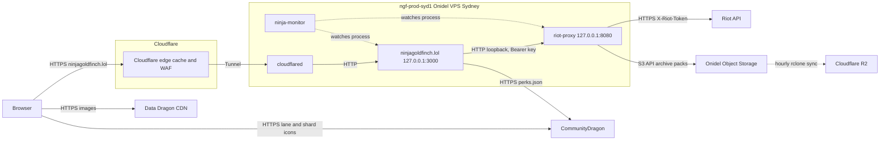

# System overview

Where ninjagoldfinch.lol sits in the platform, what it is responsible for, and what it leaves to riot-proxy and the edge.

## The platform

Three services make up the platform:

| Service            | Responsibility                                                                                                                                    |
| ------------------ | ------------------------------------------------------------------------------------------------------------------------------------------------- |
| ninjagoldfinch.lol | Renders the public pages: player profiles, match pages, champion analytics. Talks only to riot-proxy and, for one file, CommunityDragon.          |
| riot-proxy         | Holds the Riot API key, rate-limits and caches Riot calls, archives matches and timelines, computes champion analytics, and issues consumer keys. |
| ninja-monitor      | Watches each service's CPU, memory and liveness, read from its systemd unit, and the host's disk, and alerts on Discord.                          |

The split is deliberate. riot-proxy authenticates every caller with a bearer key, so the Browser cannot call it directly without exposing a key; ninjagoldfinch.lol exists to hold that key on a server and turn riot-proxy's JSON into HTML (`docs/IMPLEMENTATION.md:51`). The site adds no API for game data; its only JSON routes report on itself: `/healthz`, `/api/version` and `/api/status` (ADR-051, ADR-061, ADR-062). It keeps no player data: it holds a few lookups in memory (see [../data/caching.md](../data/caching.md)) and, for its events, small files in its state directory once the unit has `StateDirectory=` (unverified on both hosts, [gaps.md](../_meta/gaps.md)): the last start's version, and, when `EVENTS_URL` is set, whether a `proxy_unreachable` event is raised (ADR-063, ADR-064).

## System context

This diagram shows every system a page view can touch in production.

Read left to right: a visitor reaches Cloudflare over HTTPS, and Cloudflare either answers from its cache or forwards the request through the Tunnel to `cloudflared` on the production host, which passes it to the site on `127.0.0.1:3000`. The site calls riot-proxy over loopback. Images never pass through the host: the Browser loads them from the Data Dragon CDN and CommunityDragon (`src/lib/assets.ts:1-10`). Only riot-proxy talks to Riot and to the object stores. The R2 copy is made by an `rclone` job on the host, not by riot-proxy (`riot-proxy:deploy/README.md:14-18`). The `X-Riot-Token` label is the Riot API's standard header and is riot-proxy's concern; this repo does not show it.

> **TODO (unverified):** whether anything probes `/healthz` from outside the host. The P5-05 answers say ninja-monitor on `ngf-mon-syd1` fetches `https://ninjagoldfinch.lol/healthz` every minute through Cloudflare, but ninja-monitor's public source (`v0.2.3`) has no HTTP probe: it watches a service through its systemd unit, and the only timed GET is the heartbeat's, to whatever URL its env variable holds, and its result is only logged. What is known is that a heartbeat from `ngf-mon-syd1` pings Healthchecks.io every minute, which emails the owner when the pings stop ([integration/monitoring-hooks.md](../integration/monitoring-hooks.md#from-outside-the-heartbeat-to-healthchecksio)). Source for the instance on the production host: `riot-proxy:docs/design/12-object-storage-and-hosting.md:839-845`.

## The production host

| Fact               | Value                                                                                                                          | Source                                                                                                                                                                   |
| ------------------ | ------------------------------------------------------------------------------------------------------------------------------ | ------------------------------------------------------------------------------------------------------------------------------------------------------------------------ |
| Machine            | Onidel ONI-4, Sydney, `ngf-prod-syd1`, Ubuntu 26.04 LTS                                                                        | `riot-proxy:docs/DECISIONS.md:1510`                                                                                                                                      |
| Size               | 6 vCPU, 12 GB RAM, 120 GB NVMe, 6 TB a month                                                                                   | same                                                                                                                                                                     |
| Public listeners   | SSH only                                                                                                                       | same                                                                                                                                                                     |
| Site process       | `ninjagoldfinch-lol.service`: `/usr/bin/node /srv/ninjagoldfinch-lol/current/build`, the live release, as `ninjagoldfinch-lol` | owner: `systemctl cat`, see [inventory](../_meta/inventory.md#14-owner-supplied-evidence-not-in-any-repo); the drop-in `deploy/systemd/ninja-deploy.conf:7-10` (ADR-054) |
| Site address       | `127.0.0.1:3000`                                                                                                               | `README.md:193`, `riot-proxy:docs/design/12-object-storage-and-hosting.md:539-541`                                                                                       |
| riot-proxy address | `127.0.0.1:8080`, reached by the site as `PROXY_URL=http://127.0.0.1:8080`                                                     | `riot-proxy:docs/design/12-object-storage-and-hosting.md:637`                                                                                                            |
| Tunnel routes      | `ninjagoldfinch.lol` → `:3000`; `api.ninjagoldfinch.lol` and `admin.ninjagoldfinch.lol` → `:8080`                              | `riot-proxy:docs/design/13-admin-dashboard.md:64-66`                                                                                                                     |

This repo's own ADR-038 describes the production server as "2 vCPU, 4 GB" (`docs/DECISIONS.md:504`). That was the server before the move to `ngf-prod-syd1`; riot-proxy's ADR-142 records the move. The rest of ADR-038 (systemd, `node`, the Tunnel) still holds, except that since `v1.0.0` the unit runs a release from `/srv/ninjagoldfinch-lol`, not a build in the checkout (ADR-054).

The site and riot-proxy start in order: the unit has `After=network-online.target riot-proxy.service` (owner-supplied unit). It does not `Require` riot-proxy, so the site starts and answers `/healthz` even if riot-proxy is down; pages then show "Temporarily unavailable".

## Other machines

| Machine                       | Role                                                                                                                                                                                                     | Status  |
| ----------------------------- | -------------------------------------------------------------------------------------------------------------------------------------------------------------------------------------------------------- | ------- |
| `ngf-mon-syd1`                | The former production box, now the monitoring host (ninja-monitor; Prometheus and Grafana planned), and the site's staging host, `https://staging.ninjagoldfinch.lol` behind Cloudflare Access (ADR-057) | live    |
| LAN dev proxy `192.168.68.46` | A riot-proxy with auth off, used for site development until SPD-01                                                                                                                                       | dormant |

Sources for the table: `riot-proxy:docs/DECISIONS.md:1512`, `docs/DECISIONS.md:538` (ADR-039), ADR-057, `docs/PROGRESS.md:50` (SPD-01), owner answer of 2026-10-19. Development no longer depends on any of them: see [../integration/environments.md](../integration/environments.md).

## What the site does not do

- It never calls the Riot API (`CLAUDE.md:21-23`). A missing riot-proxy feature is raised with riot-proxy, not worked around.
- It has no database, no object storage and no client-side fetching of riot-proxy data (`CLAUDE.md:62-63`; inventory section 6). Its only background work is in the server process: the status checks every `STATUS_CHECK_INTERVAL_S` (ADR-062), the patch refresh (ADR-048), and sending events (ADR-063).
- It does not compute MMR or ELO, and it hides custom games (`CLAUDE.md:27-28`, `src/lib/domain/matches.ts`, ADR-017).
- It allows no third-party script, style or frame: every page carries a Content Security Policy and the other security headers (`src/lib/server/security.ts`, ADR-055, [../deployment/security.md](../deployment/security.md#response-headers)).

---

**Sources:** `src/lib/assets.ts:L1-L10`, `deploy/systemd/ninja-deploy.conf:L1-L15`, `README.md:L186-L196`, `CLAUDE.md:L21-L28,L62-L63`, `docs/IMPLEMENTATION.md:L51,L471`, `docs/DECISIONS.md:L504,L538` and ADR-048, ADR-051, ADR-054, ADR-055, ADR-057, ADR-061 to ADR-064, `docs/_meta/gaps.md`, `docs/PROGRESS.md:L50`, owner-supplied `systemctl cat ninjagoldfinch-lol` (2026-10-19), `riot-proxy:docs/DECISIONS.md:L1510-L1512`, `riot-proxy:docs/design/12-object-storage-and-hosting.md:L539-L541,L637,L839-L845`, `riot-proxy:docs/design/13-admin-dashboard.md:L55-L69`, `riot-proxy:deploy/README.md:L13-L18` (riot-proxy at `7531561`), `ninja-monitor` at `v0.2.3` (see [integration/monitoring-hooks.md](../integration/monitoring-hooks.md))
**Last verified:** 2026-11-09 against commit `4986766`
