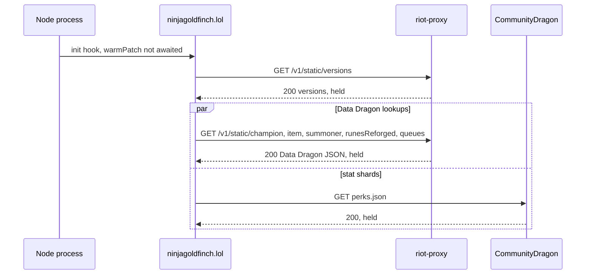
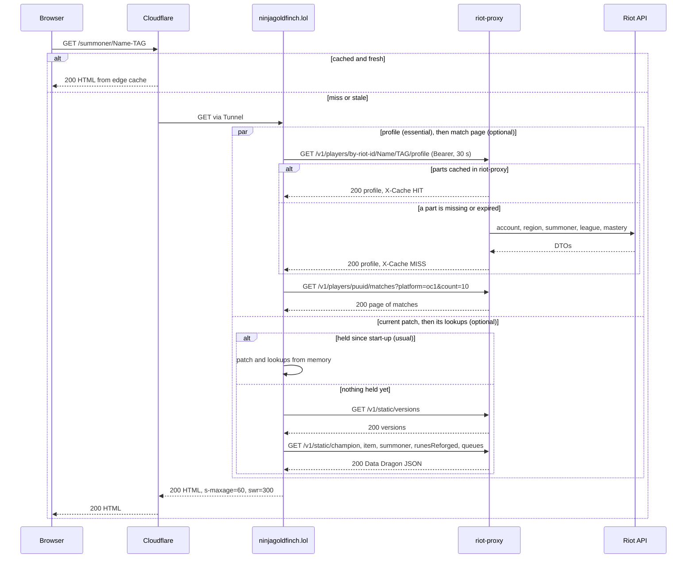
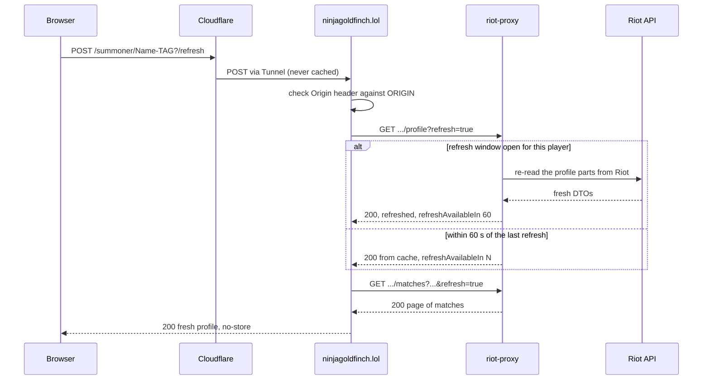
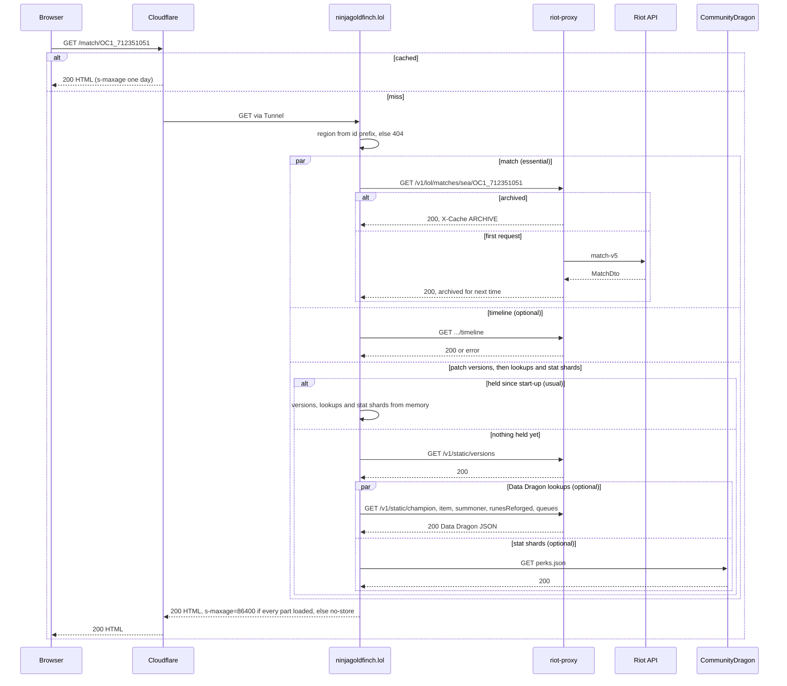
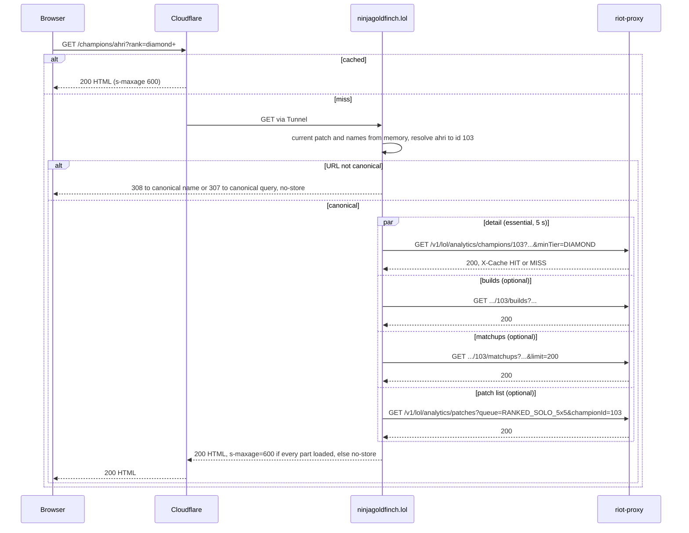

# Request lifecycle

What happens between a visitor's request and the HTML coming back, for the three busiest kinds of page: a player profile (including Refresh), a match page and a champion page.

## Common path

Every request passes the same steps before and after its page-specific work:

1. Cloudflare answers from its cache if it holds a fresh copy for that exact URL, query string included (`docs/DECISIONS.md:579`, ADR-042). Otherwise the request goes through the Tunnel to `127.0.0.1:3000`.
2. SvelteKit matches the route and runs `handle` in `src/hooks.server.ts:18-29`, which resolves the request first, inside `timeLoad`, and adjusts the response afterwards. `timeLoad` records every riot-proxy call the request makes and, if the whole request (render included) took over 100 ms, logs one `slow load …` line (`src/hooks.server.ts:19-21`, `src/lib/server/timing.ts:67-81`, ADR-046).
3. The route's load parses the URL. If the query is not in its canonical form it redirects with 307 before calling riot-proxy; a champion name that is not the canonical slug gets 308 (`src/routes/summoner/[riotId]/+page.server.ts:18-22`, `src/routes/champions/+page.server.ts:10-14`, `src/routes/champions/[key]/+page.server.ts:15-26`).
4. The loader calls riot-proxy through the proxy client. Each call has a deadline: 5 s for `/v1/lol/analytics/*` and `/v1/static/*`, 30 s for everything else (`src/lib/server/proxy.ts:74-78`). A call past its deadline, or one that cannot reach riot-proxy, becomes a 503 (`src/lib/server/proxy.ts:125-129`).
5. The load sets `Cache-Control` from `src/lib/server/cache.ts:5-16`.
6. Back in `handle`, any non-GET/HEAD response is forced to `no-store`, a 404 to `public, s-maxage=60`, and any other status of 400 or above to `no-store` (`src/lib/server/cache.ts:29-34`). A response that still has no `Cache-Control`, such as a redirect from step 3, gets `no-store` (`src/hooks.server.ts:22-27`, ADR-045).
7. Unexpected exceptions are logged and shown as "Temporarily unavailable" (`src/hooks.server.ts:34-39`).

Failed riot-proxy responses are logged as `proxy <status> <method> <path> request-id=<id>`, and analytics calls slower than 250 ms as `proxy slow … x-cache=… <ms>ms` (`src/lib/server/proxy.ts:12-67`). A call that got no response is logged as `proxy timeout … after <ms> ms` or `proxy unreachable …` (`src/lib/server/proxy.ts:127-128`). A request slower than 100 ms is logged as `slow load <route id> <total>ms: <METHOD> <spec path> <ms>, …` (`src/lib/server/timing.ts:83-95`).

## Start-up

When the Node process starts, SvelteKit runs the `init` hook in `src/hooks.server.ts:11-13`. It starts `warmPatch` without waiting for it, so the server answers at once. `warmPatch` fetches the version list, then the current patch's Data Dragon lookups and CommunityDragon stat shards together, and holds them (`src/lib/server/patch.ts:136-146`, ADR-048). A request that arrives before they finish shares the same in-flight fetches rather than starting its own. A failed version list or lookups is logged as `start-up warm of the current patch failed:`, and the first page that needs them fetches them as before; a failed `perks.json` is not, and match pages retry it. The warm-up's riot-proxy calls belong to no request, so no `slow load` line lists them. The hook does nothing while `vite build` prerenders.

After that, a page reads the patch and its lookups from memory. Once the held patch is older than 5 minutes, the next request still uses it and starts one background refresh of the version list; a new patch's Data Dragon lookups load before pages switch to it, and its stat shards start alongside without holding back the switch ([data/caching.md](../data/caching.md#site-in-memory-lookups)).

## Profile page

`GET /summoner/{GameName-TAG}`, loaded by `loadProfile` (`src/lib/server/profile.ts:71-155`).

Notes, each from the code:

- The profile call names no platform; riot-proxy finds the player's platform and returns it. The site maps it to one of its 15 regions; a platform it does not know is a 503 (`src/lib/server/profile.ts:85-95`, ADR-037).
- The match page call needs the profile's `puuid`, so a cold profile is two round trips (`src/lib/server/profile.ts:54-56`). The current patch and its Data Dragon lookups do not depend on the player, so they start before the profile call, alongside it, rather than after it (SPD-08, `src/lib/server/profile.ts:76-83`). Usually they are already held from start-up and cost nothing ([Start-up](#start-up)). They are wrapped in `early()`, so a profile that fails first leaves no unhandled rejection behind (`src/lib/server/errors.ts:60-68`). A failed current patch still fails the page.
- The match page is optional. If it fails or throws, the page still renders the header and rank, shows a notice, and is sent with `no-store` so the gap is not kept at the edge (`src/lib/server/profile.ts:97-127`, `src/routes/summoner/[riotId]/+page.server.ts:25-26`).
- Data Dragon names are optional too; on failure the page uses fallbacks such as `Item 1234` (`src/lib/server/profile.ts:78-83`, `src/lib/server/static-data.ts:78-92`).
- Custom games are removed before rendering (`src/lib/server/profile.ts:122`).
- riot-proxy may wait for its Riot rate limiter: up to 2 s for an interactive request (`riot-proxy:src/config.rs:716`). If the wait budget runs out it serves a cached copy as `STALE` when it has one, else `RATE_LIMITED` (`riot-proxy:src/fetcher.rs:455-466`). Its Riot client allows 25 s per request and retries a 5xx twice after 250 ms and 750 ms (`riot-proxy:src/riot/client.rs:19-24`, `riot-proxy:src/fetcher.rs:26-27`). The site's 30 s budget is sized for that.

### Refresh

The Refresh button is a form `POST` to `?/refresh` on the profile URL (`src/routes/summoner/[riotId]/+page.server.ts:30-38`, ADR-012).

- SvelteKit refuses a cross-origin form post with 403; the origin is fixed at build time from `ORIGIN` (`vite.config.ts:16-19`, ADR-014). Observed: a POST with `Origin: http://evil.example` returned 403.
- riot-proxy allows one refresh per player and part per 60 s, held in memory; a second request inside the window is answered from cache and told how long is left (`riot-proxy:src/routes/players/refresh.rs:1-18,43-71`).
- The action returns the fresh profile in the response, so a cached copy of the page cannot hide it (`docs/DECISIONS.md:153-157`). `handle` sends it with `no-store` because the method is POST.

## Match page

`GET /match/{matchId}`, loaded by `loadMatch` (`src/lib/server/match.ts:34-85`).

- The region comes from the match id's prefix (`OC1_…` → Oceania, route `sea`); an id with no known prefix is a 404 without calling riot-proxy (`src/routes/match/[matchId]/+page.server.ts:9-11`, `src/lib/domain/regions.ts:46-50`).
- The patch versions, and then the Data Dragon lookups and stat shards for the current patch, do not depend on the match, so they load alongside the match and timeline rather than after them (SPD-08, `src/lib/server/match.ts:42-61`). Usually all three are already held from start-up. A failed version list, possible only when nothing is held yet, still fails the page; failed lookups fall back to plain names and failed stat shards to none.
- A custom game is a 404 (`src/lib/server/match.ts:69`).
- A page without its timeline, Data Dragon lookups or stat shards is sent with `no-store`, so the gap is not cached for a day. `loadMatch` returns `complete` for this (`src/lib/server/match.ts:76-84`, `src/routes/match/[matchId]/+page.server.ts:17-19`, ADR-045).
- riot-proxy treats match and timeline as immutable and serves them from its archive once fetched (`riot-proxy:src/riot/endpoints.rs:185-204`, `riot-proxy:src/fetcher.rs:305-317`).

## Champion page

`GET /champions/{key}`, loaded by `findChampionPage` then `loadChampionPage` (`src/lib/server/champion-page.ts:82-175`).

- Analytics never reach Riot: riot-proxy answers from its own tables, with an in-memory copy until the next rebuild (`riot-proxy:src/routes/analytics.rs:3`, `riot-proxy:src/routes/analytics/cache.rs:1-19`).
- Measured on production (ADR-039, `docs/DECISIONS.md:523-529`): 8–15 ms for a champion page when riot-proxy is warm; about 200 ms on a champion's first view after a rebuild; 55–69 ms for a Cloudflare `MISS` and 25–30 ms for a `HIT` from outside.
- An unknown champion is a 404; without the Data Dragon names the URL cannot be resolved and the page is a 503, or a 429 if riot-proxy rate limited the lookups (`src/lib/server/champion-page.ts:92-100`).
- The name redirect is a 308, since a champion's slug does not change; the query redirect is a 307, since a default or a champion the lookups do not know yet can change (`src/routes/champions/[key]/+page.server.ts:21-26`, ADR-045).
- A page without its set builds, matchups or patch list is sent with `no-store` (`src/lib/server/champion-page.ts:173`, `src/routes/champions/[key]/+page.server.ts:29-30`).

## Other routes

- `/healthz` answers `{"ok":true}` without calling riot-proxy (`src/routes/healthz/+server.ts:5-6`).
- `/search` either redirects (303) or re-renders the form; a Riot ID never reaches riot-proxy from here (`src/routes/search/+page.server.ts:14-47`).
- `/` and `/about` are prerendered at build time and served as static files from `build/prerendered`, without running `handle` (`src/routes/+page.ts:3`, `src/routes/about/+page.ts:2`).
- Old URLs with a region redirect with 308, sent `no-store` by `handle` (`src/routes/summoner/[region]/[riotId]/+server.ts:9-13`, `src/routes/match/[region]/[matchId]/+server.ts:8-11`).

With JavaScript, SvelteKit fetches a page's `__data.json` instead of its HTML on client-side navigation. It runs the same load. SvelteKit sends it with `private, no-store`, and a redirect or an error in the load comes back as a 200 with a redirect or error node (`node_modules/@sveltejs/kit/src/runtime/server/data/index.js:89-148`). A header the load set with `setHeaders` replaces that, so a load that reached `setHeaders` gives its data the page's policy (`node_modules/@sveltejs/kit/src/runtime/server/respond.js:212-237,513-516`; observed on the profile). Cloudflare caches the `public` ones like their HTML: on 2026-11-03 each page type's `__data.json`, with and without `x-sveltekit-invalidated=01`, went `MISS` or `EXPIRED` then `HIT` from outside, with its page's `Cache-Control` (SPD-06, `docs/PROGRESS.md`).

---

**Sources:** `src/hooks.server.ts:L1-L39`, `src/lib/server/patch.ts:L51-L146`, `src/lib/server/cache.ts:L5-L34`, `src/lib/server/proxy.ts:L12-L154`, `src/lib/server/timing.ts:L1-L95`, `src/lib/server/profile.ts:L54-L155`, `src/lib/server/match.ts:L34-L85`, `src/lib/server/errors.ts:L60-L68`, `src/lib/server/champion-page.ts:L82-L175`, `src/routes/summoner/[riotId]/+page.server.ts:L14-L38`, `src/routes/match/[matchId]/+page.server.ts:L8-L21`, `src/routes/champions/+page.server.ts:L7-L20`, `src/routes/champions/[key]/+page.server.ts:L9-L32`, `src/routes/search/+page.server.ts:L14-L47`, `src/routes/+page.ts:L3`, `src/routes/about/+page.ts:L2`, `node_modules/@sveltejs/kit/src/runtime/server/data/index.js:L89-L148`, `node_modules/@sveltejs/kit/src/runtime/server/respond.js:L212-L237,L513-L516`, `src/lib/domain/regions.ts:L46-L50`, `vite.config.ts:L16-L19`, `docs/DECISIONS.md:L153-L157,L523-L529,L579,L617-L630,L684-L715`, `docs/PROGRESS.md:L55`, `riot-proxy:src/routes/players/refresh.rs:L1-L71`, `riot-proxy:src/fetcher.rs:L9-L44,L305-L317,L455-L466`, `riot-proxy:src/riot/client.rs:L19-L24`, `riot-proxy:src/config.rs:L716`, `riot-proxy:src/riot/endpoints.rs:L185-L204`, `riot-proxy:src/routes/analytics.rs:L3`, `riot-proxy:src/routes/analytics/cache.rs:L1-L19`
**Last verified:** 2026-11-03 against commit `a6b406b`
