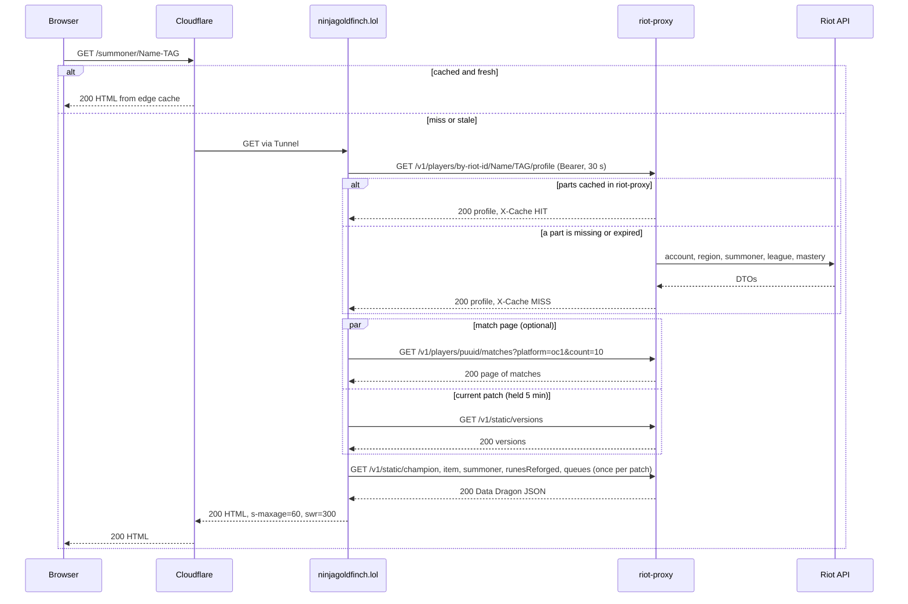
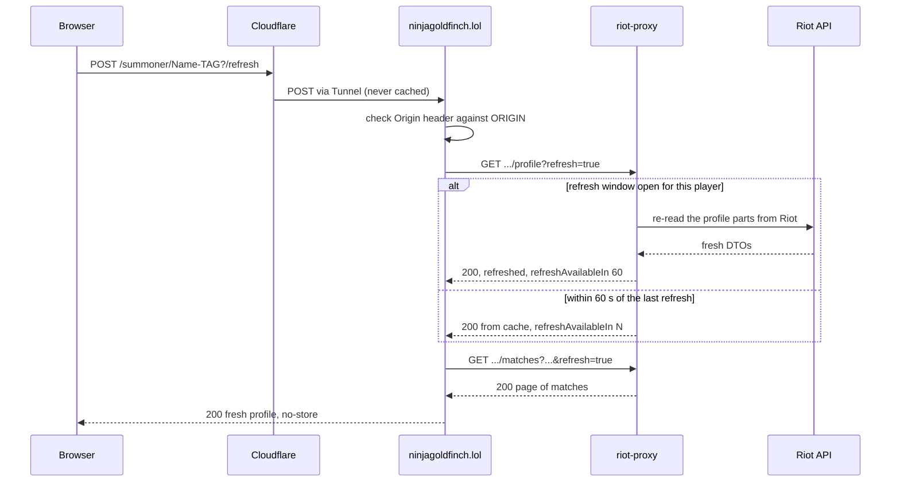
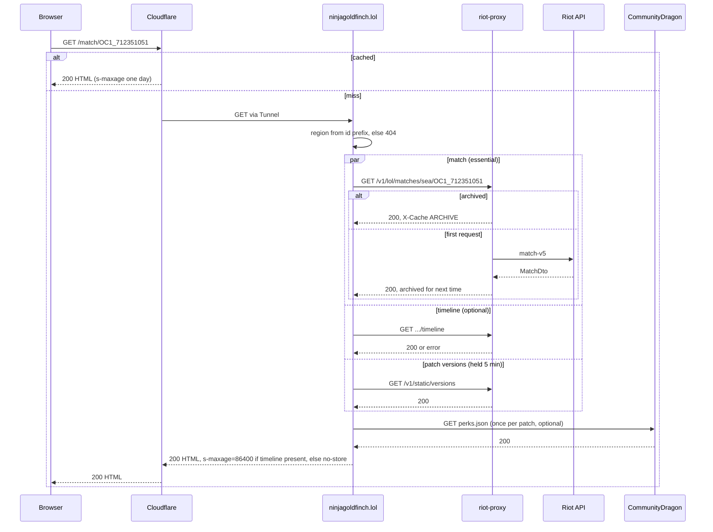
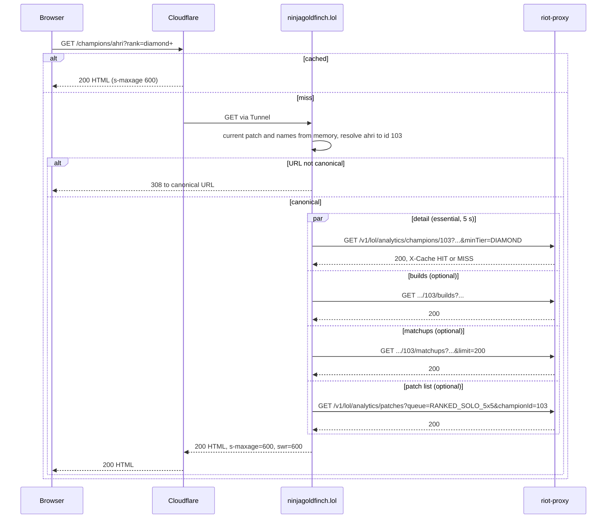

# Request lifecycle

What happens between a visitor's request and the HTML coming back, for the three busiest kinds of page: a player profile (including Refresh), a match page and a champion page.

## Common path

Every request passes the same steps before and after its page-specific work:

1. Cloudflare answers from its cache if it holds a fresh copy for that exact URL, query string included (`docs/DECISIONS.md:577`, ADR-042). Otherwise the request goes through the Tunnel to `127.0.0.1:3000`.
2. SvelteKit matches the route and runs `handle` in `src/hooks.server.ts:5-10`, which resolves the request first and adjusts the response afterwards.
3. The route's load parses the URL. If the query is not in its canonical form it redirects (307 or 308) before calling riot-proxy (`src/routes/summoner/[riotId]/+page.server.ts:18-22`, `src/routes/champions/+page.server.ts:10-14`, `src/routes/champions/[key]/+page.server.ts:15-23`).
4. The loader calls riot-proxy through the proxy client. Each call has a deadline: 5 s for `/v1/lol/analytics/*` and `/v1/static/*`, 30 s for everything else (`src/lib/server/proxy.ts:73-77`). A call past its deadline, or one that cannot reach riot-proxy, becomes a 503 (`src/lib/server/proxy.ts:124-128`).
5. The load sets `Cache-Control` from `src/lib/server/cache.ts:5-16`.
6. Back in `handle`, any non-GET/HEAD response is forced to `no-store`, a 404 to `public, s-maxage=60`, and any other status of 400 or above to `no-store` (`src/lib/server/cache.ts:29-34`).
7. Unexpected exceptions are logged and shown as "Temporarily unavailable" (`src/hooks.server.ts:15-20`).

Failed riot-proxy responses are logged as `proxy <status> <method> <path> request-id=<id>`, and analytics calls slower than 250 ms as `proxy slow … x-cache=… <ms>ms` (`src/lib/server/proxy.ts:11-66`). A call that got no response is logged as `proxy timeout … after <ms> ms` or `proxy unreachable …` (`src/lib/server/proxy.ts:126-127`).

## Profile page

`GET /summoner/{GameName-TAG}`, loaded by `loadProfile` (`src/lib/server/profile.ts:72-152`).

Notes, each from the code:

- The profile call names no platform; riot-proxy finds the player's platform and returns it. The site maps it to one of its 15 regions; a platform it does not know is a 503 (`src/lib/server/profile.ts:78-87`, ADR-037).
- The match page call needs the profile's `puuid`, so a cold profile is two round trips (`src/lib/server/profile.ts:56-57`).
- The match page is optional. If it fails or throws, the page still renders the header and rank, shows a notice, and is sent with `no-store` so the gap is not kept at the edge (`src/lib/server/profile.ts:89-124`, `src/routes/summoner/[riotId]/+page.server.ts:25-26`).
- Data Dragon names are optional too; on failure the page uses fallbacks such as `Item 1234` (`src/lib/server/profile.ts:108-111`).
- Custom games are removed before rendering (`src/lib/server/profile.ts:119`).
- riot-proxy may wait for its Riot rate limiter: up to 2 s for an interactive request (`riot-proxy:src/config.rs:716`). If the wait budget runs out it serves a cached copy as `STALE` when it has one, else `RATE_LIMITED` (`riot-proxy:src/fetcher.rs:455-466`). Its Riot client allows 25 s per request and retries a 5xx twice after 250 ms and 750 ms (`riot-proxy:src/riot/client.rs:19-24`, `riot-proxy:src/fetcher.rs:26-27`). The site's 30 s budget is sized for that.

### Refresh

The Refresh button is a form `POST` to `?/refresh` on the profile URL (`src/routes/summoner/[riotId]/+page.server.ts:30-38`, ADR-012).

- SvelteKit refuses a cross-origin form post with 403; the origin is fixed at build time from `ORIGIN` (`vite.config.ts:16-19`, ADR-014). Observed: a POST with `Origin: http://evil.example` returned 403.
- riot-proxy allows one refresh per player and part per 60 s, held in memory; a second request inside the window is answered from cache and told how long is left (`riot-proxy:src/routes/players/refresh.rs:1-18,43-71`).
- The action returns the fresh profile in the response, so a cached copy of the page cannot hide it (`docs/DECISIONS.md:153-157`). `handle` sends it with `no-store` because the method is POST.

## Match page

`GET /match/{matchId}`, loaded by `loadMatch` (`src/lib/server/match.ts:29-73`).

- The region comes from the match id's prefix (`OC1_…` → Oceania, route `sea`); an id with no known prefix is a 404 without calling riot-proxy (`src/routes/match/[matchId]/+page.server.ts:8-10`, `src/lib/domain/regions.ts:46-50`).
- A custom game is a 404 (`src/lib/server/match.ts:49`).
- A page without its timeline is sent with `no-store`, so the gap is not cached for a day (`src/routes/match/[matchId]/+page.server.ts:13-15`).
- riot-proxy treats match and timeline as immutable and serves them from its archive once fetched (`riot-proxy:src/riot/endpoints.rs:185-204`, `riot-proxy:src/fetcher.rs:305-317`).

## Champion page

`GET /champions/{key}`, loaded by `findChampionPage` then `loadChampionPage` (`src/lib/server/champion-page.ts:82-174`).

- Analytics never reach Riot: riot-proxy answers from its own tables, with an in-memory copy until the next rebuild (`riot-proxy:src/routes/analytics.rs:3`, `riot-proxy:src/routes/analytics/cache.rs:1-19`).
- Measured on production (ADR-039, `docs/DECISIONS.md:521-527`): 8–15 ms for a champion page when riot-proxy is warm; about 200 ms on a champion's first view after a rebuild; 55–69 ms for a Cloudflare `MISS` and 25–30 ms for a `HIT` from outside.
- An unknown champion is a 404; without the Data Dragon names the URL cannot be resolved and the page is a 503, or a 429 if riot-proxy rate limited the lookups (`src/lib/server/champion-page.ts:92-100`).

## Other routes

- `/healthz` answers `{"ok":true}` without calling riot-proxy (`src/routes/healthz/+server.ts:5-6`).
- `/search` either redirects (303) or re-renders the form; a Riot ID never reaches riot-proxy from here (`src/routes/search/+page.server.ts:14-47`).
- `/about` is prerendered at build time (`src/routes/about/+page.ts:1-2`).
- Old URLs with a region redirect with 308 (`src/routes/summoner/[region]/[riotId]/+server.ts:9-13`, `src/routes/match/[region]/[matchId]/+server.ts:8-11`).

With JavaScript, SvelteKit fetches a page's `__data.json` instead of its HTML on client-side navigation. It runs the same load and carries the same `Cache-Control` (observed on the profile). Whether Cloudflare caches `__data.json` is open task SPD-06 (`docs/PROGRESS.md:55`).

> **TODO (unverified):** whether Cloudflare caches `__data.json` responses (SPD-06). Needs a check from outside against production.

---

**Sources:** `src/hooks.server.ts:L5-L20`, `src/lib/server/cache.ts:L5-L34`, `src/lib/server/proxy.ts:L11-L153`, `src/lib/server/profile.ts:L56-L152`, `src/lib/server/match.ts:L29-L73`, `src/lib/server/champion-page.ts:L82-L174`, `src/routes/summoner/[riotId]/+page.server.ts:L14-L38`, `src/routes/match/[matchId]/+page.server.ts:L7-L17`, `src/routes/champions/+page.server.ts:L7-L19`, `src/routes/champions/[key]/+page.server.ts:L9-L28`, `src/routes/search/+page.server.ts:L14-L47`, `src/lib/domain/regions.ts:L46-L50`, `vite.config.ts:L16-L19`, `docs/DECISIONS.md:L153-L157,L521-L527,L577`, `docs/PROGRESS.md:L55`, `riot-proxy:src/routes/players/refresh.rs:L1-L71`, `riot-proxy:src/fetcher.rs:L9-L44,L305-L317,L455-L466`, `riot-proxy:src/riot/client.rs:L19-L24`, `riot-proxy:src/config.rs:L716`, `riot-proxy:src/riot/endpoints.rs:L185-L204`, `riot-proxy:src/routes/analytics.rs:L3`, `riot-proxy:src/routes/analytics/cache.rs:L1-L19`
**Last verified:** 2026-11-03 against commit `2948c82`
