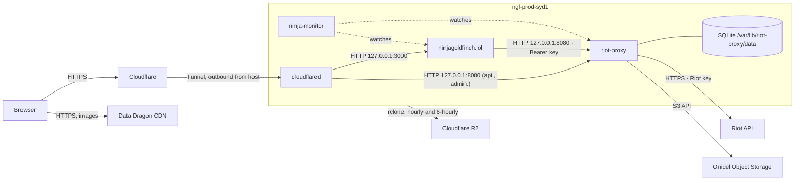

# Deployment overview

Where and how ninjagoldfinch.lol runs in production: one Onidel VPS in Sydney shared with riot-proxy, reached only through a Cloudflare Tunnel, with no reverse proxy, no Docker and no object storage of its own. Read this before [install.md](./install.md) or the [runbook](../operations/runbook.md).

## The host

| Fact             | Value                                                                                                | Source                                                                                                 |
| ---------------- | ---------------------------------------------------------------------------------------------------- | ------------------------------------------------------------------------------------------------------ |
| Name             | `ngf-prod-syd1`                                                                                      | `riot-proxy:docs/DECISIONS.md:1510`                                                                    |
| Plan             | Onidel ONI-4, Sydney: 6 vCPU, 12 GB RAM, 120 GB NVMe on replicated storage, 6 TB/month               | `riot-proxy:docs/DECISIONS.md:1510`                                                                    |
| OS               | Ubuntu 26.04 LTS                                                                                     | `riot-proxy:docs/DECISIONS.md:1510`                                                                    |
| Public listeners | SSH only; everything else on `127.0.0.1`                                                             | `riot-proxy:docs/DECISIONS.md:1510`, `riot-proxy:docs/design/12-object-storage-and-hosting.md:806-807` |
| Runs             | riot-proxy, ninjagoldfinch.lol, `cloudflared`, ninja-monitor, riot-proxy's backup and replica timers | `riot-proxy:docs/design/12-object-storage-and-hosting.md:808-838`                                      |
| In service since | 2026-10-13 (moved from an OVH VPS; ADR-038's "2 vCPU, 4 GB" describes that old box)                  | `riot-proxy:docs/DECISIONS.md:1507-1512`, `docs/DECISIONS.md:504`                                      |

The previous box is now `ngf-mon-syd1`, the monitoring host; it holds no Riot key and no data (`riot-proxy:docs/DECISIONS.md:1512`).

## Topology

How a visitor's request reaches the site and riot-proxy, and what each process talks to.

TLS ends at Cloudflare; the Tunnel carries requests to `cloudflared` on the host, which forwards plain HTTP over loopback. No DNS record points at the host's IP, so no DNS change is needed when the connector moves (`riot-proxy:docs/design/12-object-storage-and-hosting.md:532-537`). The site talks only to riot-proxy, over loopback, with its consumer key ([integration/service-communication.md](../integration/service-communication.md)). ninja-monitor's checks are described in [integration/monitoring-hooks.md](../integration/monitoring-hooks.md).

## Hostnames and routes

| Public hostname            | Tunnel target                 | Notes                                                       | Source                                                                                                                  |
| -------------------------- | ----------------------------- | ----------------------------------------------------------- | ----------------------------------------------------------------------------------------------------------------------- |
| `ninjagoldfinch.lol`       | `127.0.0.1:3000` (site)       | Cached at the edge per the site's `Cache-Control`           | `riot-proxy:docs/design/13-admin-dashboard.md:66`, `docs/DECISIONS.md:510`                                              |
| `api.ninjagoldfinch.lol`   | `127.0.0.1:8080` (riot-proxy) | WAF blocks `/metrics`, `/dashboard*`, `/dev*`, `/v1/admin*` | `riot-proxy:docs/design/13-admin-dashboard.md:51,65`, `riot-proxy:docs/design/12-object-storage-and-hosting.md:904-917` |
| `admin.ninjagoldfinch.lol` | `127.0.0.1:8080` (riot-proxy) | Behind Cloudflare Access (one-time PIN, owner's email)      | `riot-proxy:docs/design/13-admin-dashboard.md:39,50,64`                                                                 |

The site does not use `api.ninjagoldfinch.lol`; it calls riot-proxy on loopback.

## Who owns what on the host

| Owner              | Process / unit                                                                     | User                                                   | Listens                   | Paths                                                                                                                                                                            |
| ------------------ | ---------------------------------------------------------------------------------- | ------------------------------------------------------ | ------------------------- | -------------------------------------------------------------------------------------------------------------------------------------------------------------------------------- |
| ninjagoldfinch.lol | `ninjagoldfinch-lol.service` (`/usr/bin/node build`)                               | `ninjagoldfinch-lol`                                   | `127.0.0.1:3000`          | checkout and build `/opt/ninjagoldfinch-lol`; home `/opt/ninjagoldfinch-lol-home`; settings `/etc/ninjagoldfinch-lol/env`; unit `/etc/systemd/system/ninjagoldfinch-lol.service` |
| riot-proxy         | `riot-proxy.service`                                                               | `riot-proxy`                                           | `127.0.0.1:8080`          | binary `/usr/local/bin/riot-proxy`; data `/var/lib/riot-proxy/data`; settings `/etc/riot-proxy/env`; rclone `/etc/riot-proxy/rclone.conf`                                        |
| riot-proxy         | `riot-proxy-replica.timer` (hourly at :17), `riot-proxy-offsite.timer` (every 6 h) | replica: systemd `DynamicUser`; offsite: not in a repo | none                      | `riot-proxy:deploy/README.md`; the offsite unit is not in either repo                                                                                                            |
| Cloudflare         | `cloudflared` system service                                                       | not documented                                         | none (outbound)           | token `/etc/cloudflared/token`                                                                                                                                                   |
| ninja-monitor      | ninja-monitor                                                                      | not documented here                                    | API over SSH forward only | not in either repo                                                                                                                                                               |

Sources for the table: site unit and paths from the owner-supplied `systemctl cat ninjagoldfinch-lol` ([inventory section 14](../_meta/inventory.md#14-owner-supplied-evidence-not-in-any-repo)) and `README.md:95-102`; the site user's home from `riot-proxy:docs/design/12-object-storage-and-hosting.md:614-615`; riot-proxy's user and paths from `riot-proxy:docs/design/12-object-storage-and-hosting.md:586-594`; the replica unit from `riot-proxy:deploy/riot-proxy-replica.service:1-33` and `.timer:1-10`; the offsite job from `riot-proxy:docs/DECISIONS.md:1511` and `riot-proxy:docs/design/12-object-storage-and-hosting.md:810-812`; cloudflared from `riot-proxy:docs/design/12-object-storage-and-hosting.md:803-806`; ninja-monitor from `riot-proxy:docs/design/12-object-storage-and-hosting.md:832-838`.

Coordination rules that follow from sharing the box:

- Port 3000 is the site's and 8080 is riot-proxy's; the Tunnel's routes name them, so changing either means changing the Tunnel too.
- The site's unit starts `After=network-online.target riot-proxy.service`, so on boot it starts after riot-proxy, but it does not `Require` it: a stopped riot-proxy leaves the site up, serving 503s for data pages ([operations/troubleshooting.md](../operations/troubleshooting.md)).
- The 120 GB disk is shared, and riot-proxy's SQLite database dominates it; the site's footprint is its checkout, `node_modules` and the journal ([capacity.md](./capacity.md)).

> **TODO (unverified):** The production `riot-proxy.service` unit, the `cloudflared` unit and ninja-monitor's configuration are not in either repository. Their contents (user, hardening, restart policy, ninja-monitor's check method) are taken from riot-proxy's migration notes only. Read them on the host with `systemctl cat riot-proxy cloudflared`.

## Object storage

ninjagoldfinch.lol reads and writes no bucket. riot-proxy writes match and timeline packs to the Onidel bucket `riot-proxy-archive` (system of record), an hourly `rclone sync` copies it to the R2 bucket of the same name (replica), and a 6-hourly job copies riot-proxy's SQLite backups to R2 `ngf-backups`. The replica went live on 2026-10-14 (`riot-proxy:PROGRESS.md:335`). Details: [integration/object-storage.md](../integration/object-storage.md).

## How the site is deployed

The site is built on the host from a git checkout pulled with a read-only deploy key, and runs as `node build` under systemd (ADR-038, `docs/DECISIONS.md:500-516`). Step-by-step: [install.md](./install.md) for a new host, [upgrade-and-rollback.md](./upgrade-and-rollback.md) for a release.

## Logs and data

| What            | Where                                                                                                                      |
| --------------- | -------------------------------------------------------------------------------------------------------------------------- |
| Site logs       | journald: `sudo journalctl -u ninjagoldfinch-lol` (`README.md:101`)                                                        |
| Site state      | none on disk; in-memory holds only ([data/caching.md](../data/caching.md))                                                 |
| Site settings   | `/etc/ninjagoldfinch-lol/env`, root-only (`riot-proxy:docs/design/12-object-storage-and-hosting.md:623-626` (`umask 077`)) |
| riot-proxy logs | JSON on stdout (`riot-proxy:README.md:132`), so journald under its unit                                                    |
| riot-proxy data | `/var/lib/riot-proxy/data` (SQLite, Data Dragon mirror, backups)                                                           |

---

**Sources:** `riot-proxy:docs/DECISIONS.md:L1507-L1512`, `riot-proxy:docs/design/12-object-storage-and-hosting.md:L532-L537,L586-L594,L612-L626,L803-L838,L904-L917`, `riot-proxy:docs/design/13-admin-dashboard.md:L39,L44-L67`, `riot-proxy:deploy/README.md:L1-L36`, `riot-proxy:deploy/riot-proxy-replica.service:L1-L33`, `riot-proxy:deploy/riot-proxy-replica.timer:L1-L10`, `riot-proxy:PROGRESS.md:L335`, `riot-proxy:README.md:L132`, `README.md:L89-L114`, `docs/DECISIONS.md:L500-L516`, owner-supplied unit (inventory section 14)
**Last verified:** 2026-10-20 against commit `85d9cf8`
