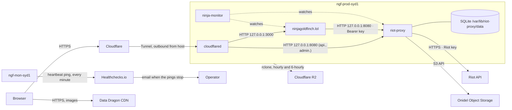

# Deployment overview

Where and how ninjagoldfinch.lol runs in production: one Onidel VPS in Sydney shared with riot-proxy, reached only through a Cloudflare Tunnel, with no reverse proxy, no Docker and no object storage of its own. Read this before [install.md](./install.md) or the [runbook](../operations/runbook.md).

## The host

| Fact             | Value                                                                                                | Source                                                                                                 |
| ---------------- | ---------------------------------------------------------------------------------------------------- | ------------------------------------------------------------------------------------------------------ |
| Name             | `ngf-prod-syd1`                                                                                      | `riot-proxy:docs/DECISIONS.md:1510`                                                                    |
| Plan             | Onidel ONI-4, Sydney: 6 vCPU, 12 GB RAM, 120 GB NVMe on replicated storage, 6 TB/month               | `riot-proxy:docs/DECISIONS.md:1510`                                                                    |
| OS               | Ubuntu 26.04 LTS                                                                                     | `riot-proxy:docs/DECISIONS.md:1510`                                                                    |
| Public listeners | SSH only; everything else on `127.0.0.1`                                                             | `riot-proxy:docs/DECISIONS.md:1510`, `riot-proxy:docs/design/12-object-storage-and-hosting.md:813-814` |
| Runs             | riot-proxy, ninjagoldfinch.lol, `cloudflared`, ninja-monitor, riot-proxy's backup and replica timers | `riot-proxy:docs/design/12-object-storage-and-hosting.md:808-845`                                      |
| In service since | 2026-10-13 (moved from an OVH VPS; ADR-038's "2 vCPU, 4 GB" describes that old box)                  | `riot-proxy:docs/DECISIONS.md:1507-1512`, `docs/DECISIONS.md:504`                                      |

The previous box is now `ngf-mon-syd1`, the monitoring host; it holds no Riot key and no data (`riot-proxy:docs/DECISIONS.md:1512`). It also runs a second ninja-monitor (`riot-proxy:docs/design/12-object-storage-and-hosting.md:839-840`) and the site's staging copy, `https://staging.ninjagoldfinch.lol`, behind Cloudflare Access on a tunnel of its own, which reads production riot-proxy at `https://api.ninjagoldfinch.lol` with a key of its own (ADR-057, ADR-058; [releases.md](./releases.md#setting-up-staging-once)).

## Topology

How a visitor's request reaches the site and riot-proxy, and what each process talks to.

TLS ends at Cloudflare; the Tunnel carries requests to `cloudflared` on the host, which forwards plain HTTP over loopback. No DNS record points at the host's IP, so no DNS change is needed when the connector moves (`riot-proxy:docs/design/12-object-storage-and-hosting.md:542-545`). The site talks only to riot-proxy, over loopback, with its consumer key ([integration/service-communication.md](../integration/service-communication.md)). ninja-monitor's checks are described in [integration/monitoring-hooks.md](../integration/monitoring-hooks.md). From `ngf-mon-syd1`, a heartbeat pings a Healthchecks.io check every minute, which emails the owner when the pings stop (P5-05); whether anything there also probes `https://ninjagoldfinch.lol/healthz` is unverified ([integration/monitoring-hooks.md](../integration/monitoring-hooks.md#from-outside-the-heartbeat-to-healthchecksio)).

## Hostnames and routes

| Public hostname            | Tunnel target                 | Notes                                                       | Source                                                                                                                  |
| -------------------------- | ----------------------------- | ----------------------------------------------------------- | ----------------------------------------------------------------------------------------------------------------------- |
| `ninjagoldfinch.lol`       | `127.0.0.1:3000` (site)       | Cached at the edge per the site's `Cache-Control`           | `riot-proxy:docs/design/13-admin-dashboard.md:66`, `docs/DECISIONS.md:510`                                              |
| `api.ninjagoldfinch.lol`   | `127.0.0.1:8080` (riot-proxy) | WAF blocks `/metrics`, `/dashboard*`, `/dev*`, `/v1/admin*` | `riot-proxy:docs/design/13-admin-dashboard.md:51,65`, `riot-proxy:docs/design/12-object-storage-and-hosting.md:911-919` |
| `admin.ninjagoldfinch.lol` | `127.0.0.1:8080` (riot-proxy) | Behind Cloudflare Access (one-time PIN, owner's email)      | `riot-proxy:docs/design/13-admin-dashboard.md:39,50,64`                                                                 |

The site does not use `api.ninjagoldfinch.lol`; it calls riot-proxy on loopback.

## Who owns what on the host

| Owner              | Process / unit                                                                                         | User                                                   | Listens                   | Paths                                                                                                                                                                                                                                                                                                                                                                                                                                                                                                                           |
| ------------------ | ------------------------------------------------------------------------------------------------------ | ------------------------------------------------------ | ------------------------- | ------------------------------------------------------------------------------------------------------------------------------------------------------------------------------------------------------------------------------------------------------------------------------------------------------------------------------------------------------------------------------------------------------------------------------------------------------------------------------------------------------------------------------- |
| ninjagoldfinch.lol | `ninjagoldfinch-lol.service` (`/usr/bin/node /srv/ninjagoldfinch-lol/current/build`, from its drop-in) | `ninjagoldfinch-lol`                                   | `127.0.0.1:3000`          | releases `/srv/ninjagoldfinch-lol/releases/<tag>/`, the live one linked as `/srv/ninjagoldfinch-lol/current`; state `/var/lib/ninjagoldfinch-lol` once the drop-in with `StateDirectory=` is installed (unverified on both hosts, [gaps.md](../_meta/gaps.md)); home `/opt/ninjagoldfinch-lol-home`; settings `/etc/ninjagoldfinch-lol/env`; unit `/etc/systemd/system/ninjagoldfinch-lol.service` and drop-in `ninjagoldfinch-lol.service.d/ninja-deploy.conf`; the old checkout `/opt/ninjagoldfinch-lol`, kept as a fallback |
| riot-proxy         | `riot-proxy.service`                                                                                   | `riot-proxy`                                           | `127.0.0.1:8080`          | binary `/usr/local/bin/riot-proxy`; data `/var/lib/riot-proxy/data`; settings `/etc/riot-proxy/env`; rclone `/etc/riot-proxy/rclone.conf`                                                                                                                                                                                                                                                                                                                                                                                       |
| riot-proxy         | `riot-proxy-replica.timer` (hourly at :17), `riot-proxy-offsite.timer` (every 6 h)                     | replica: systemd `DynamicUser`; offsite: not in a repo | none                      | `riot-proxy:deploy/README.md`; the offsite unit is not in either repo                                                                                                                                                                                                                                                                                                                                                                                                                                                           |
| Cloudflare         | `cloudflared` system service                                                                           | not documented                                         | none (outbound)           | token `/etc/cloudflared/token`                                                                                                                                                                                                                                                                                                                                                                                                                                                                                                  |
| ninja-monitor      | `ninja-monitor.service`                                                                                | not documented here                                    | API over SSH forward only | by default `/etc/ninja-monitor/config.toml` and `/etc/ninja-monitor/env` (secrets)                                                                                                                                                                                                                                                                                                                                                                                                                                              |

Sources for the table: the site's unit from the owner-supplied `systemctl cat ninjagoldfinch-lol` ([inventory section 14](../_meta/inventory.md#14-owner-supplied-evidence-not-in-any-repo)), its release paths and drop-in from `deploy/systemd/ninja-deploy.conf:1-15` and [releases.md](./releases.md) (ADR-054, ADR-063), the checkout kept as a fallback from `README.md:186` and ADR-054; the site user's home from `riot-proxy:docs/design/12-object-storage-and-hosting.md:622`; riot-proxy's user and paths from `riot-proxy:docs/design/12-object-storage-and-hosting.md:593-601`; the replica unit from `riot-proxy:deploy/riot-proxy-replica.service:1-33` and `.timer:1-11`; the offsite job from `riot-proxy:docs/DECISIONS.md:1511` and `riot-proxy:docs/design/12-object-storage-and-hosting.md:816-820`; cloudflared from `riot-proxy:docs/design/12-object-storage-and-hosting.md:808-813`; ninja-monitor from `riot-proxy:docs/design/12-object-storage-and-hosting.md:839-845` and its default files from `ninja-monitor:README.md:147-150,254` (`v0.2.3`).

Coordination rules that follow from sharing the box:

- Port 3000 is the site's and 8080 is riot-proxy's; the Tunnel's routes name them, so changing either means changing the Tunnel too.
- The site's unit starts `After=network-online.target riot-proxy.service`, so on boot it starts after riot-proxy, but it does not `Require` it: a stopped riot-proxy leaves the site up, serving 503s for data pages ([operations/troubleshooting.md](../operations/troubleshooting.md)).
- The 120 GB disk is shared, and riot-proxy's SQLite database dominates it; the site's footprint is its releases (the newest 5 kept), the small files in its state directory once the drop-in with `StateDirectory=` is installed (unverified on both hosts, [gaps.md](../_meta/gaps.md)), the old checkout while it is kept, and the journal ([capacity.md](./capacity.md)).

ninja-monitor's check method is settled by its public source: a service is `running` while its unit's cgroup exists and has processes, and `down` otherwise (`ninja-monitor:README.md:52-56`, `src/config.rs:106-116`, `v0.2.3`); it does not request the site over HTTP.

> **TODO (unverified):** The production `riot-proxy.service` unit, the `cloudflared` unit and ninja-monitor's configuration file on this host are not in any repository. Their contents (user, hardening, restart policy, which services ninja-monitor watches and with which limits) are taken from riot-proxy's migration notes only. Read them on the host with `systemctl cat riot-proxy cloudflared ninja-monitor` and `sudo cat /etc/ninja-monitor/config.toml`. Also unrecorded: whether the old checkout `/opt/ninjagoldfinch-lol` has been removed ([releases.md](./releases.md#6-retire-the-checkout-deploy)).

## Object storage

ninjagoldfinch.lol reads and writes no bucket. riot-proxy writes match and timeline packs to the Onidel bucket `riot-proxy-archive` (system of record), an hourly `rclone sync` copies it to the R2 bucket of the same name (replica), and a 6-hourly job copies riot-proxy's SQLite backups to R2 `ngf-backups`. The replica went live on 2026-10-14 (`riot-proxy:PROGRESS.md:343`). Details: [integration/object-storage.md](../integration/object-storage.md).

## How the site is deployed

From `v1.0.0` production runs a release, not a checkout. A `v*` tag builds a tarball for production and one for staging (ADR-052, ADR-057); `release.yml` deploys each release to staging, and `deploy.yml`, run by hand, deploys a tag to production after the owner's approval through `ninja-actions/deploy@v1`. On the host, `ninja-deploy` unpacks it under `/srv/ninjagoldfinch-lol/releases/`, links `current`, restarts the unit, waits for `/healthz` to report the new version, and rolls back if it does not (ADR-051, ADR-053, ADR-054). Production takes only a version that passed staging's smoke test or was live in production before, unless the deploy is run with a break-glass reason (ADR-060). The unit still runs `node` under systemd, without Docker (ADR-038). Step-by-step: [releases.md](./releases.md) for deploying, rolling back and staging, [install.md](./install.md) for a new host, [upgrade-and-rollback.md](./upgrade-and-rollback.md) for a release.

## Logs and data

| What            | Where                                                                                                                                                                                                                                                                                                                                                                                                   |
| --------------- | ------------------------------------------------------------------------------------------------------------------------------------------------------------------------------------------------------------------------------------------------------------------------------------------------------------------------------------------------------------------------------------------------------- |
| Site logs       | journald: `sudo journalctl -u ninjagoldfinch-lol` (`README.md:194`)                                                                                                                                                                                                                                                                                                                                     |
| Site state      | `/var/lib/ninjagoldfinch-lol/`, once the drop-in with `StateDirectory=` is installed (unverified on both hosts, [gaps.md](../_meta/gaps.md)): `last-version.json`, and `proxy-alarm.json` only when `EVENTS_URL` is set, for its events (ADR-063, ADR-064, [releases.md](./releases.md#the-state-directory-for-events-once)); everything else is held in memory ([data/caching.md](../data/caching.md)) |
| Site settings   | `/etc/ninjagoldfinch-lol/env`, root-only (`riot-proxy:docs/design/12-object-storage-and-hosting.md:633` (`umask 077`))                                                                                                                                                                                                                                                                                  |
| riot-proxy logs | JSON on stdout (`riot-proxy:README.md:184`), so journald under its unit                                                                                                                                                                                                                                                                                                                                 |
| riot-proxy data | `/var/lib/riot-proxy/data` (SQLite, Data Dragon mirror, backups)                                                                                                                                                                                                                                                                                                                                        |

---

**Sources:** `riot-proxy:docs/DECISIONS.md:L1507-L1512`, `riot-proxy:docs/design/12-object-storage-and-hosting.md:L539-L545,L593-L601,L616-L634,L808-L851,L911-L919`, `riot-proxy:docs/design/13-admin-dashboard.md:L39,L44-L69`, `riot-proxy:deploy/README.md:L1-L36`, `riot-proxy:deploy/riot-proxy-replica.service:L1-L33`, `riot-proxy:deploy/riot-proxy-replica.timer:L1-L11`, `riot-proxy:PROGRESS.md:L343`, `riot-proxy:README.md:L184` (riot-proxy at `7531561`), `ninja-monitor:README.md:L52-L56,L147-L150,L254`, `ninja-monitor:src/config.rs:L106-L116` (`v0.2.3`), `README.md:L186-L196`, `deploy/systemd/ninja-deploy.conf:L1-L15`, `docs/deployment/releases.md:L1-L13,L169-L216,L218-L300`, `docs/_meta/gaps.md`, `docs/DECISIONS.md` (ADR-038, ADR-051 to ADR-054, ADR-057, ADR-058, ADR-060, ADR-063, ADR-064), owner-supplied unit (inventory section 14), `docs/PROGRESS.md` ("P5-05 check")
**Last verified:** 2026-11-09 against commit `4986766`
