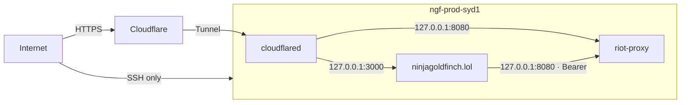

# Security

A brief threat model for ninjagoldfinch.lol: what it holds that is worth protecting, how each secret is kept, what an attacker can reach, and what one compromised service on the shared host could do. It covers the site; riot-proxy's own threat model is riot-proxy's.

## Assets

| Asset                                                 | Held by                                     | Impact if exposed                                                                                                                               |
| ----------------------------------------------------- | ------------------------------------------- | ----------------------------------------------------------------------------------------------------------------------------------------------- |
| `PROXY_KEY` (`ninjagoldfinch-lol-prod`, `read` scope) | the site                                    | Anyone can query riot-proxy as the site, within its quota (600/min by default), and exhaust that quota so the site shows 429                    |
| Deploy key                                            | the site's service user                     | Read access to the private repository                                                                                                           |
| Riot API key                                          | riot-proxy only                             | Not reachable from the site                                                                                                                     |
| Object-storage keys                                   | riot-proxy and `rclone` only                | Not reachable from the site; the site has none ([integration/object-storage.md](../integration/object-storage.md))                              |
| Tunnel token                                          | `cloudflared` (`/etc/cloudflared/token`)    | Someone could run a connector for the Tunnel and receive the site's traffic                                                                     |
| PUUIDs                                                | in riot-proxy's responses, server-side only | Riot's player ids; the site never sends them to the browser (checked on 2026-10-20: no PUUID in any profile or match page or its `__data.json`) |

## Key custody

**`PROXY_KEY`.**

- Lives only in `/etc/ninjagoldfinch-lol/env` on the host (root-only, created with `umask 077`) and in a developer's git-ignored `.env` (`.gitignore:16-18`; `riot-proxy:docs/design/12-object-storage-and-hosting.md:623-626`).
- Declared private in `src/env.ts:27-30` and read through `$app/env/private`, a server-only module; only `src/lib/server/proxy.ts` uses it (`src/lib/server/proxy.ts:3,137-154`). It is never put in a `PUBLIC_` variable, the only public one being `PUBLIC_SITE_NAME` (`src/env.ts:17-22`, `CLAUDE.md:15-17`).
- Sent only to riot-proxy, as `Authorization: Bearer`, over loopback. The fixture recorder sends it to riot-proxy but never to a CommunityDragon URL (`tests/record-fixture.ts:45-48`).
- Never logged: no `console.*` call prints it (all calls read 2026-10-20).
- The pre-commit hook refuses staged lines matching `(rpx_|RGAPI-)[A-Za-z0-9_-]` (`.githooks/pre-commit:10-23`, ADR-002), and fixtures are redacted (`CLAUDE.md:13-14`); `tests/unit/fixtures-redacted.test.ts` scans every fixture file for keys and raw player ids in `just check` (RV-13).
- Rotation and revocation are riot-proxy commands; there is no rotate command, so rotation is create-new, deploy, revoke-old ([integration/authentication.md](../integration/authentication.md)).

**Deploy key.** Generated per host, read-only, and never copied between hosts; the old host's key is revoked when a host is replaced (`riot-proxy:docs/design/12-object-storage-and-hosting.md:617-619`).

**Riot key and object-storage keys.** The site never sees them. riot-proxy keeps them in `/etc/riot-proxy/env` and `/etc/riot-proxy/rclone.conf`, both 0600 (`riot-proxy:docs/design/12-object-storage-and-hosting.md:443,710`). The R2 tokens are scoped to one bucket each (`riot-proxy:deploy/README.md:26-28`).

## Network exposure



Only SSH listens on the public interface; the site and riot-proxy bind `127.0.0.1` (`riot-proxy:docs/DECISIONS.md:1510`, `docs/DECISIONS.md:509`). The site's only way in is the Tunnel. TLS ends at Cloudflare; the hop from `cloudflared` to the site is plain HTTP on loopback.

## What visitors can send, and how it is checked

| Input                           | Handling                                                                                                                                                                                                                                                                                                                              | Source                                                                                                                                   |
| ------------------------------- | ------------------------------------------------------------------------------------------------------------------------------------------------------------------------------------------------------------------------------------------------------------------------------------------------------------------------------------- | ---------------------------------------------------------------------------------------------------------------------------------------- |
| Riot ID in `/summoner/{riotId}` | Split on the last hyphen; both parts trimmed, 1–16 and 1–5 characters, and neither `.` nor `..` (which would resolve the riot-proxy URL to another route), else 404. Passed to riot-proxy as typed path parameters; the client also refuses a `.` or `..` path parameter (`refuseDotSegments`); riot-proxy's `VALIDATION` becomes 404 | `src/lib/domain/riot-id.ts:38-60`, `src/lib/server/proxy.ts:22-35`, `src/lib/server/errors.ts:19-22`                                     |
| Match ID in `/match/{matchId}`  | Must match `^[A-Za-z0-9]+_[0-9]+$` with a known platform prefix, else 404 before any proxy call                                                                                                                                                                                                                                       | `src/lib/domain/regions.ts:47-50`, `src/lib/domain/match-detail.ts:198-201`                                                              |
| Query parameters                | Parsed into known values; unknown values or keys are dropped by a 307 to the canonical URL                                                                                                                                                                                                                                            | `src/routes/champions/+page.server.ts:7-14`, [api/pagination-filtering-and-versioning.md](../api/pagination-filtering-and-versioning.md) |
| Form POST (Refresh)             | SvelteKit refuses a form POST whose `Origin` differs from the build-time `ORIGIN`: a cross-origin POST got 403 (observed 2026-10-20)                                                                                                                                                                                                  | `vite.config.ts:16-19`, ADR-014                                                                                                          |
| Request body                    | adapter-node's default limit, 512 KB (`BODY_SIZE_LIMIT`)                                                                                                                                                                                                                                                                              | `build/server/adapter-node-handler.js:489` (generated)                                                                                   |

Output is rendered by Svelte, which escapes text; there is no `{@html}` anywhere in `src/` (searched 2026-10-20). Error pages never show riot-proxy's raw messages: only "Not found", "Too many requests" and "Temporarily unavailable" (`src/lib/server/errors.ts:6-33`), and unexpected errors are logged and replaced with a generic message (`src/hooks.server.ts:31-39`).

Path parameters reach riot-proxy through openapi-fetch's typed path templates, which URL-encode them (`tests/unit/mock-proxy.test.ts:29-30` tests that the client's encoding matches the recorded paths).

## Rate limiting

| Layer            | Limit                                                                                                 | Source                                                                                                  |
| ---------------- | ----------------------------------------------------------------------------------------------------- | ------------------------------------------------------------------------------------------------------- |
| Cloudflare       | Edge cache absorbs repeat views; any rate-limiting rule on `/summoner/*` or `/match/*` is unconfirmed | [architecture/concurrency-and-rate-limiting.md](../architecture/concurrency-and-rate-limiting.md) (gap) |
| The site         | None of its own                                                                                       | searched `src/`                                                                                         |
| riot-proxy quota | Per consumer key, default 600 requests per minute, shared by every visitor of the site                | `riot-proxy:src/consumers.rs:14`, `riot-proxy:src/http/quota.rs:1-135`                                  |
| Refresh          | riot-proxy re-reads a player from Riot at most once a minute per part                                 | [integration/contract.md](../integration/contract.md)                                                   |
| Riot key         | Owned by riot-proxy                                                                                   | riot-proxy                                                                                              |

Because the quota is per key and every visitor shares the site's key, one client making many uncached requests (for example random Riot IDs that miss the edge cache) can use up the site's quota and make every visitor see 429 until the window passes. The edge cache's not-found policy (`public, s-maxage=60`) blunts repeats of the same miss but not varied ones (`src/lib/server/cache.ts:12-13`).

## Response headers

Every response that passes through `handle` carries these headers (`src/lib/server/security.ts`, `src/hooks.server.ts:20-32`, ADR-055):

| Header                       | Value                                                                                                           |
| ---------------------------- | --------------------------------------------------------------------------------------------------------------- |
| `Strict-Transport-Security`  | `max-age=31536000`: this host only, no `includeSubDomains` or `preload` (owner, 2026-11-05)                     |
| `X-Content-Type-Options`     | `nosniff`                                                                                                       |
| `Referrer-Policy`            | `strict-origin-when-cross-origin`                                                                               |
| `X-Frame-Options`            | `DENY`                                                                                                          |
| `Cross-Origin-Opener-Policy` | `same-origin`                                                                                                   |
| `Permissions-Policy`         | `accelerometer=(), camera=(), geolocation=(), gyroscope=(), magnetometer=(), microphone=(), payment=(), usb=()` |

Every page, error pages included, also carries a `Content-Security-Policy`, which SvelteKit builds from `CSP_DIRECTIVES` (`vite.config.ts`, hash mode):

```
default-src 'self'; connect-src 'self' https://cloudflareinsights.com; font-src 'self';
img-src 'self' data: https://ddragon.leagueoflegends.com https://raw.communitydragon.org;
object-src 'none'; script-src 'self' https://static.cloudflareinsights.com 'sha256-…'; style-src 'self'; style-src-attr 'unsafe-inline';
base-uri 'self'; form-action 'self'; frame-ancestors 'none'
```

- `script-src` allows the page's one inline script, SvelteKit's bootstrap, by its hash. A hash rather than a nonce, because pages are shared from Cloudflare's cache: a nonce would be served to every visitor of a cached page.
- `style-src-attr 'unsafe-inline'` allows `style="…"` attributes. The server renders Svelte's `style:` directives as attributes, and the gold chart, the objective markers and the damage bars are positioned from data. It allows no `<style>` element and no stylesheet from elsewhere.
- `img-src` names the two image hosts from `src/lib/assets.ts` (`DDRAGON_ORIGIN`, `CDRAGON_ORIGIN`), the only third-party origins the site's own pages make the browser contact, and `data:` for the site icon, which Vite inlines. The `<link rel="preconnect">` to them (SPD-10) adds no new origin and sends no credentials.
- `/` and `/about` are rendered per request, not prerendered, so they get the headers too; adapter-node serves prerendered pages without running `handle` (ADR-055).
- `/_app/*` files (scripts, styles, fonts) are served by adapter-node before `handle` and carry none of these headers. CSP and framing apply to documents, not to the files they load, and these are the site's own hashed files with a correct `Content-Type`, so the missing `nosniff` there is accepted.
- `script-src` and `connect-src` also allow Cloudflare Web Analytics (`CLOUDFLARE_INSIGHTS`, ADR-056). Cloudflare adds its beacon, `https://static.cloudflareinsights.com/beacon.min.js`, to every page at the edge; it is not in the site's code, so the mock-proxy tests never load it. The beacon reports page views and real visitors' Core Web Vitals to `https://cloudflareinsights.com`, and sets no cookies or storage. Without these entries the CSP blocked it (seen in production on `v1.0.1`).

Cloudflare adds none of these itself: on 2026-11-05, before this change, `curl -sI https://ninjagoldfinch.lol/` showed only Cloudflare's `nel`, `report-to` and `cf-*` headers besides the site's own. `tests/e2e/security.test.ts` checks the headers on each page type and fails on any CSP violation while the pages are used, with JavaScript and without.

## The no-auth modes

- **Local riot-proxy with `AUTH_DISABLED=true`** treats every request as the `dev-local` consumer with read and admin scopes (`riot-proxy:src/http/auth.rs:43-52`). riot-proxy refuses it when `ENV=production` (`riot-proxy:src/config.rs:658-662`). Bind it to `127.0.0.1` as in [development-setup.md](../workflows/development-setup.md#option-b-against-a-riot-proxy-you-run-yourself); bound to `0.0.0.0` on a shared network, anyone on that network has admin access to it and can spend its Riot key.
- **The LAN dev proxy (dormant)** at `192.168.68.46:8080` ran with no auth. If it is ever revived, it gives anyone on the LAN admin access to that riot-proxy ([integration/environments.md](../integration/environments.md)).
- The site has no auth-off switch of its own: with `NODE_ENV=production` it refuses to start without `PROXY_KEY` (`src/lib/server/env.ts:47-55`).

## Blast radius on the shared host

| If this is compromised                  | The attacker gets                                                                                                                                        | Limits                                                                                                                                                                      |
| --------------------------------------- | -------------------------------------------------------------------------------------------------------------------------------------------------------- | --------------------------------------------------------------------------------------------------------------------------------------------------------------------------- |
| The site process (`ninjagoldfinch-lol`) | `PROXY_KEY` (read scope), the repository via the deploy key, loopback access to riot-proxy, including its unauthenticated `/metrics` on `127.0.0.1:8080` | Separate system user; `NoNewPrivileges`, `ProtectSystem=strict` (read-only file system) and `PrivateTmp` (owner-supplied unit); cannot read root-only `/etc/riot-proxy/env` |
| riot-proxy                              | The Riot key, the archive and backup credentials, all consumer key hashes, the database                                                                  | riot-proxy's problem; the site's key would need re-issuing                                                                                                                  |
| `cloudflared` or the Tunnel token       | Can intercept or redirect both public hostnames                                                                                                          | Rotate the token in Cloudflare                                                                                                                                              |
| A developer machine                     | Its `.env` key (a dev or production key if one was ever placed there)                                                                                    | Use a separate local key or `AUTH_DISABLED` locally, never production's                                                                                                     |

> **TODO (unverified):** File permissions on `/var/lib/riot-proxy/data` and whether the `ninjagoldfinch-lol` user can read riot-proxy's database. Check with `sudo -u ninjagoldfinch-lol ls /var/lib/riot-proxy/data` on the host.

## Dependencies

- One runtime dependency, `openapi-fetch` (`package.json:34`, bundled into the build since ADR-052); everything else is build or test tooling ([reference/dependencies.md](../reference/dependencies.md)).
- Versions are locked in `pnpm-lock.yaml`, installed with `--frozen-lockfile` everywhere, and `pnpm-workspace.yaml` keeps pnpm's own entry out of the lockfile so GitHub's dependency graph and Dependabot alerts see the app's packages (ADR-005, `pnpm-workspace.yaml:3-7`).
- There is no `dependabot.yml` (no `.github/` directory), so there are no automatic update PRs; updates are manual tasks. Whether Dependabot alerts are switched on for the repository is a GitHub setting not visible from the repo.

---

**Sources:** `src/env.ts:L17-L30`, `src/lib/server/env.ts:L47-L55`, `src/lib/server/proxy.ts:L3,L137-L154`, `src/lib/server/errors.ts:L6-L33`, `src/lib/server/cache.ts:L12-L13`, `src/hooks.server.ts:L20-L32`, `src/lib/server/security.ts`, `src/lib/domain/riot-id.ts:L14-L44`, `src/lib/domain/regions.ts:L47-L50`, `src/lib/domain/match-detail.ts:L198-L201`, `src/routes/champions/+page.server.ts:L7-L14`, `vite.config.ts:L16-L19`, `tests/record-fixture.ts:L45-L48`, `src/lib/assets.ts:L9-L19`, `tests/unit/mock-proxy.test.ts:L29-L30`, `.githooks/pre-commit:L10-L23`, `.gitignore:L16-L18`, `pnpm-workspace.yaml:L3-L7`, `package.json:L34`, `CLAUDE.md:L13-L17`, `docs/DECISIONS.md:L57-L65,L509`, `build/server/adapter-node-handler.js:L489` (generated), `riot-proxy:src/consumers.rs:L14`, `riot-proxy:src/http/quota.rs:L1-L135`, `riot-proxy:src/http/auth.rs:L43-L52`, `riot-proxy:src/config.rs:L658-L662`, `riot-proxy:deploy/README.md:L26-L28`, `riot-proxy:docs/DECISIONS.md:L1510`, `riot-proxy:docs/design/12-object-storage-and-hosting.md:L443,L617-L626,L710`, owner-supplied unit (inventory section 14)
**Last verified:** 2026-11-05 against branch `feat/P5-03-security-headers`
