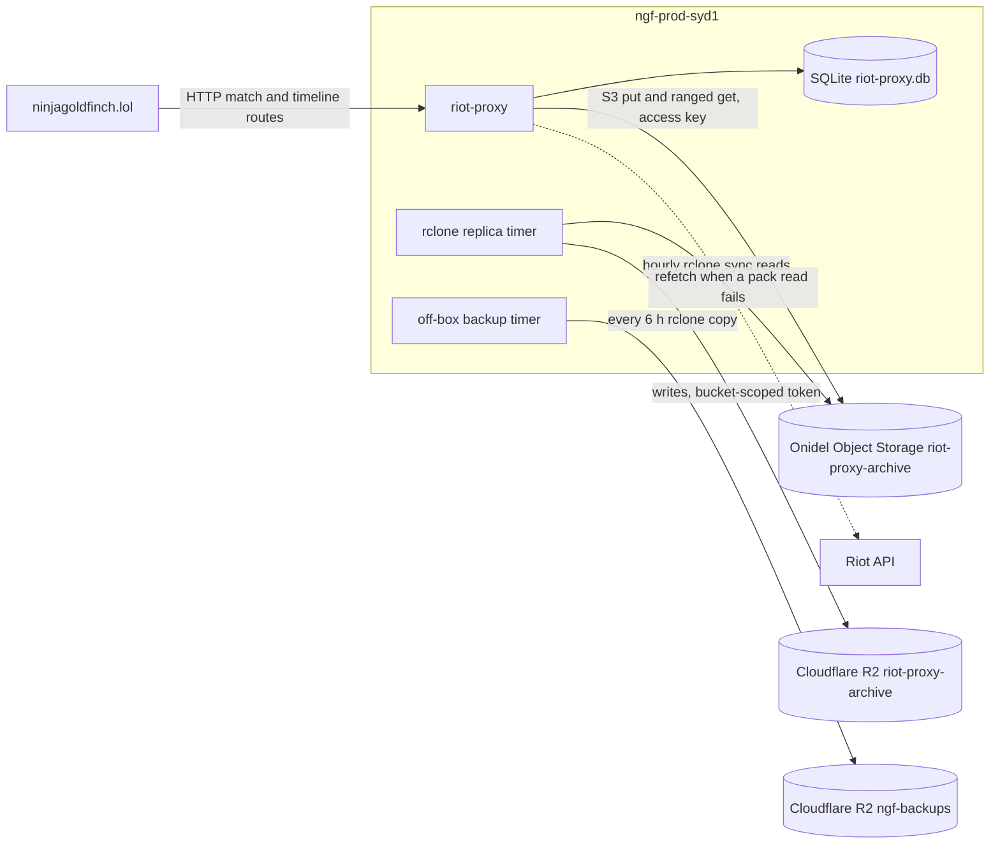

# Object storage

ninjagoldfinch.lol reads and writes no object store. This page says so with evidence, then summarises riot-proxy's buckets on Onidel Object Storage and Cloudflare R2, because they decide how fast and how reliably match pages load.

## The site

A search of `src/`, `tests/` and `deploy/` for S3, R2, bucket, Onidel and object-store clients finds nothing, and the only runtime dependency is `openapi-fetch` (`package.json:48-50`; inventory sections 5 and 6). The site:

- holds no object-storage credentials (its production settings are `NODE_ENV`, `HOST`, `PORT`, `PROXY_URL` and `PROXY_KEY`, owner-supplied 2026-10-19);
- receives archived match and timeline bodies only through riot-proxy's HTTP routes;
- serves no files from a bucket to the Browser; images come from the Data Dragon CDN and CommunityDragon (`src/lib/assets.ts:1-10`).

Build artefacts are built on the host and not uploaded anywhere (`README.md:104-112`).

## riot-proxy's storage topology

This diagram shows the stores riot-proxy uses and where the site's requests touch them.

| Store                 | Bucket               | Contents and key scheme                                                                                                                                                 | Role                              | Source                                                                                            |
| --------------------- | -------------------- | ----------------------------------------------------------------------------------------------------------------------------------------------------------------------- | --------------------------------- | ------------------------------------------------------------------------------------------------- |
| Onidel Object Storage | `riot-proxy-archive` | `packs/<matches\|timelines>/<yyyy>/<mm>/<ulid>.pack` (zstd bodies, index, trailer `RPXPACK1`); daily `index/packs-<date>.jsonl.zst`, `index/locations-<date>.jsonl.zst` | System of record                  | `riot-proxy:src/archive/pack.rs:1-11,124-133`, `riot-proxy:src/archive/recovery.rs:5-8`           |
| Cloudflare R2         | `riot-proxy-archive` | The same objects, copied by `rclone sync` at 17 minutes past every hour                                                                                                 | Replica, never read by riot-proxy | `riot-proxy:deploy/riot-proxy-replica.service:1-20`, `riot-proxy:deploy/riot-proxy-replica.timer` |
| Cloudflare R2         | `ngf-backups`        | `riot-proxy/` SQLite backups, every 6 hours                                                                                                                             | Off-box backups                   | `riot-proxy:docs/design/12-object-storage-and-hosting.md:810-820`                                 |

- **Endpoint and auth:** S3 API at `https://s3.ap-southeast-2.onidel.cloud`, signed with `ARCHIVE_OBJECT_ACCESS_KEY` and `ARCHIVE_OBJECT_SECRET_KEY`; R2 tokens are scoped to one bucket each (`riot-proxy:deploy/README.md:22-28`).
- **Objects:** `application/octet-stream`, with `sha256` and `bodies` metadata; multipart above 8 MiB (`riot-proxy:src/archive/objects.rs:33-42`, `riot-proxy:src/archive/pack.rs:116-121`).
- **Lifecycle:** `index/` expires after 14 days on Onidel and 21 days on R2; R2 aborts incomplete multipart uploads after 1 day; `packs/` are kept forever (`riot-proxy:deploy/README.md:31-36`).
- **Local copies:** riot-proxy keeps bodies in SQLite for `ARCHIVE_BODY_LOCAL_DAYS` (default 14) before offloading (`riot-proxy:src/config.rs:736`).

### Why two stores

Onidel is in Sydney beside the VPS and holds the primary copy. R2 is a copy "for the day the Onidel bucket or account is gone"; restoring means pointing `ARCHIVE_OBJECT_URL` at R2 (`riot-proxy:deploy/README.md:14-18`). The backups bucket is separate so the archive token cannot touch it (`riot-proxy:deploy/README.md:26-28`).

## What an outage means for the site

If a pack read fails (bucket unavailable, missing location or a sha256 mismatch), riot-proxy logs a warning and fetches the match or timeline from Riot again (`riot-proxy:src/archive/matches.rs:242-293`). For the site this means:

- match pages for games older than the local window still load, but slower and at the cost of Riot rate limit;
- under heavy Riot limits riot-proxy may answer `RATE_LIMITED`, which the site shows as "Too many requests" (match) or a section notice (timeline is optional, `src/lib/server/match.ts:43`);
- profiles are unaffected unless a page of matches includes games riot-proxy must read from the archive.

Matches already rendered stay at the edge for a day (`src/lib/server/cache.ts:8-9`), which hides a short outage for popular pages.

---

**Sources:** `package.json:L48-L50`, `src/lib/assets.ts:L1-L10`, `src/lib/server/match.ts:L43`, `src/lib/server/cache.ts:L8-L9`, `README.md:L104-L112`, `riot-proxy:src/archive/pack.rs:L1-L133`, `riot-proxy:src/archive/recovery.rs:L5-L8`, `riot-proxy:src/archive/objects.rs:L1-L42`, `riot-proxy:src/archive/matches.rs:L242-L293`, `riot-proxy:src/config.rs:L736`, `riot-proxy:deploy/README.md:L14-L46`, `riot-proxy:deploy/riot-proxy-replica.service:L1-L20`, `riot-proxy:deploy/riot-proxy-replica.timer`, `riot-proxy:docs/design/12-object-storage-and-hosting.md:L810-L820`, owner-supplied env names (2026-10-19)
**Last verified:** 2026-11-03 against commit `03faa33`
