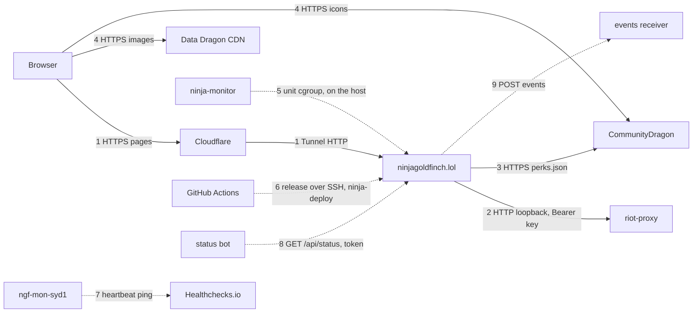
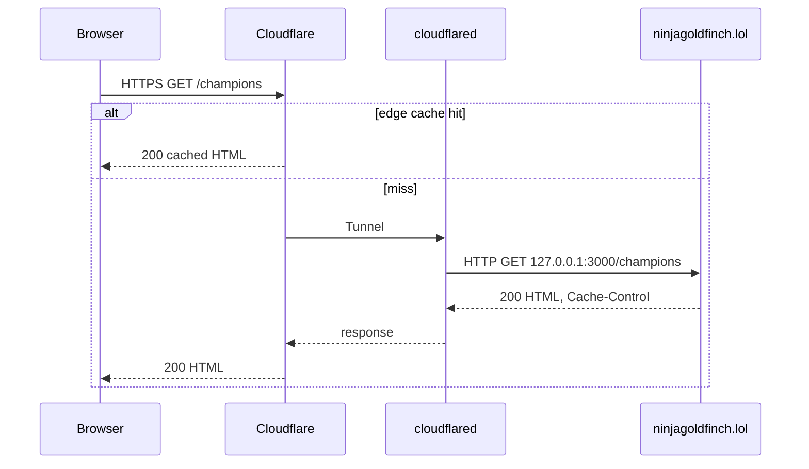
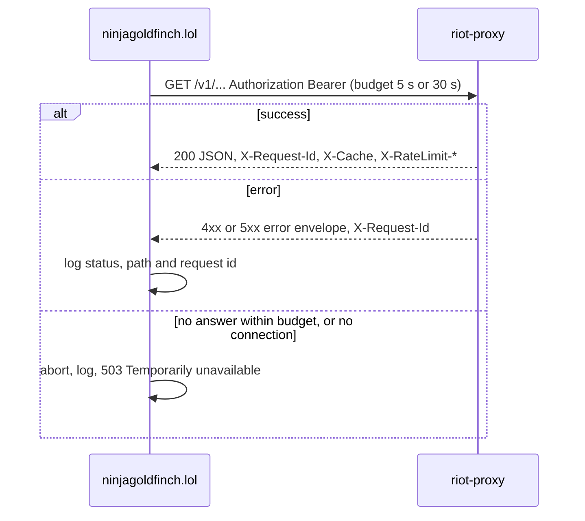
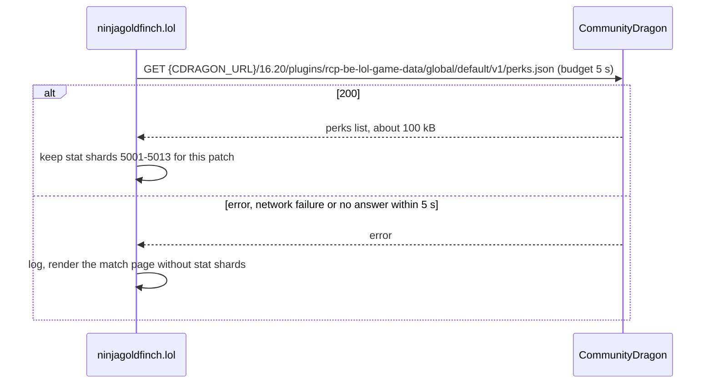

# Service communication

Every interaction between ninjagoldfinch.lol and other systems: who calls whom, over what, with which credentials, how often, and what happens on failure.

## Interaction map

Solid arrows are runtime traffic; dotted arrows are deploy-time or monitoring.

| #   | From → to                            | Protocol and auth                                                                                                    | Frequency                                                   | Failure behaviour                                                     |
| --- | ------------------------------------ | -------------------------------------------------------------------------------------------------------------------- | ----------------------------------------------------------- | --------------------------------------------------------------------- |
| 1   | Browser → ninjagoldfinch.lol         | HTTPS to Cloudflare, Tunnel to `127.0.0.1:3000`; none                                                                | Every uncached page view                                    | Cloudflare error page if the site is down                             |
| 2   | ninjagoldfinch.lol → riot-proxy      | HTTP, `Authorization: Bearer <PROXY_KEY>`                                                                            | 1–9 calls per uncached page                                 | Page error or section notice; no retry                                |
| 3   | ninjagoldfinch.lol → CommunityDragon | HTTPS GET, none                                                                                                      | Once per patch per process                                  | Stat shards left out; retried on the next match page                  |
| 4   | Browser → image CDNs                 | HTTPS GET, none                                                                                                      | Every page with images                                      | Broken image in the Browser                                           |
| 5   | ninja-monitor → ninjagoldfinch.lol   | Reads the unit's cgroup, no request (public source)                                                                  | Each sample (15 s default)                                  | Discord alert                                                         |
| 6   | GitHub Actions → host                | SSH with a deploy key forced to `ninja-deploy ninjagoldfinch-lol`; the release tarball, checked against `SHA256SUMS` | Each release to staging; each approved deploy to production | Health check fails: `ninja-deploy` rolls back to the previous release |
| 7   | `ngf-mon-syd1` → Healthchecks.io     | A ping to a secret URL; not in this repo                                                                             | Every minute                                                | Healthchecks.io emails the owner when pings stop                      |
| 8   | Status bot → ninjagoldfinch.lol      | `GET /api/status` with `Authorization: Bearer <STATUS_TOKEN>`, or from the host or `STATUS_ALLOW_CIDR` without it    | The bot's own schedule, not in this repo                    | `401` without the token; the site's checks are unaffected             |
| 9   | ninjagoldfinch.lol → `EVENTS_URL`    | HTTP or HTTPS `POST` of a JSON event; any secret is in the URL                                                       | Changes of state only, when `EVENTS_URL` is set             | Up to 5 attempts, then dropped and logged                             |

The site never calls the Riot API, Onidel Object Storage or Cloudflare R2. Staging, on `ngf-mon-syd1`, is a second copy of the site with the same interactions, except that it calls production riot-proxy at `https://api.ninjagoldfinch.lol` with a key of its own, and is reached through Cloudflare Access on a tunnel of its own (ADR-057, ADR-058).

## 1. Browser to the site

- The site listens on `127.0.0.1` only (`HOST` in `/etc/ninjagoldfinch-lol/env`; `docs/DECISIONS.md:509`), so the Tunnel is the only way in.
- Payloads are HTML pages, `__data.json` for client navigation, and `POST ?/refresh` form actions (see [../api/endpoints.md](../api/endpoints.md)).
- Cloudflare's caching follows the site's `Cache-Control` (`src/lib/server/cache.ts:5-20`).

- adapter-node is not told the real client address: `ADDRESS_HEADER` stays unset (ADR-065), so the site sees `cloudflared` on loopback for every visitor. With it set, a request made on the host itself has no `CF-Connecting-IP` and adapter-node's `getClientAddress` throws, so `/api/status` would treat local checks as public and ask for the token (ADR-062). Nothing else reads the client address; Cloudflare's rate-limiting rule counts real addresses on its own side.

## 2. The site to riot-proxy

- Base URL `PROXY_URL`; production `http://127.0.0.1:8080` (`riot-proxy:docs/design/12-object-storage-and-hosting.md:637`).
- The header is sent only when `PROXY_KEY` is set (`src/lib/server/proxy.ts:138-151`).
- Routes, payloads and error codes: [contract.md](./contract.md). Key handling: [authentication.md](./authentication.md).
- Retries: none in the site. riot-proxy retries its own Riot calls (`riot-proxy:src/fetcher.rs:12-14`).
- Every failed response is logged with riot-proxy's `X-Request-Id`, which riot-proxy also records on its request log span, so one page error can be traced across both services (`src/lib/server/proxy.ts:7-20`, `riot-proxy:src/http/request_id.rs:49-66`, `riot-proxy:src/app.rs:109-114`).

## 3. The site to CommunityDragon

- Only the match page needs it, once per patch per process. It is fetched at start-up with the current patch's lookups, and when a background refresh finds a new patch, alongside that patch's lookups; it does not hold back the switch, so if it fails, match pages on the new patch go without stat shards and retry it (ADR-048, `src/lib/server/patch.ts:51-60,113-146`). If it is not held, a match page asks for it as soon as the patch versions are known, alongside the match and timeline calls (SPD-08; `src/lib/server/cdragon.ts:15-37`, `src/lib/server/match.ts:44-56`). Two patches are held.
- `CDRAGON_URL` defaults to `https://raw.communitydragon.org` (`src/lib/server/env.ts:19-27`); production does not set it (owner-supplied env names).
- The fetch has a 5 s deadline, `CDRAGON_BUDGET_MS`, which covers the body; the timer is cleared once the body is parsed (`src/lib/server/cdragon.ts:12-34`).
- This is the one outbound call that does not go to riot-proxy; it is for data riot-proxy does not mirror (ADR-026, `docs/DECISIONS.md:319`).

## 4. The Browser to the image CDNs

Image URLs are built in `src/lib/assets.ts` and fetched by the Browser: Data Dragon CDN for champion, item, profile-icon, spell and rune images (`src/lib/assets.ts:9-44`), and CommunityDragon for lane icons and stat shard icons (`src/lib/assets.ts:46-73`). No credentials, no traffic through the host. Pages ask the Browser to open these connections early with `<link rel="preconnect">`: every page to Data Dragon CDN, the profile and match pages to CommunityDragon as well (`src/lib/assets.ts:12-19`, `src/routes/+layout.svelte:29`, `src/routes/summoner/[riotId]/+page.svelte:46`, `src/routes/match/[matchId]/+page.svelte:128`, SPD-10).

## 5. ninja-monitor

ninja-monitor runs on both hosts, each instance posting to its own Discord webhook (`riot-proxy:docs/design/12-object-storage-and-hosting.md:839-845`):

- **On `ngf-prod-syd1`** it watches `ninjagoldfinch-lol` alongside `riot-proxy` and `cloudflared`, alerting on Discord when a service is down for 30 s or uses more than 1 GiB. Its public source (`v0.2.3`) watches a service through its systemd unit's cgroup and sends the site no request (`ninja-monitor:src/config.rs:106-116`, `ninja-monitor:src/alerts/mod.rs:175-178`); samples are taken every 15 s by default (`ninja-monitor:README.md:266`).
- **On `ngf-mon-syd1`**, a heartbeat pings a Healthchecks.io check every minute, and Healthchecks.io emails the owner when the pings stop (P5-05).

Nothing in this repo calls ninja-monitor, and ninja-monitor sends the site no request. Whether anything requests the site from outside, such as `/healthz` from `ngf-mon-syd1` as the P5-05 answers say, is unverified: ninja-monitor's public source has no HTTP probe: the only timed GET is the heartbeat's, to whatever URL its env variable holds, and its result is only logged. Which process sends the heartbeat to Healthchecks.io is not known. See [monitoring-hooks.md](./monitoring-hooks.md#from-outside-the-heartbeat-to-healthchecksio).

## 6. Deploys from GitHub

The host never pulls from GitHub. A `v*` tag builds a production and a staging tarball and publishes them as a GitHub release with `SHA256SUMS` (ADR-052, ADR-057). `deploy.yml` runs on the self-hosted runner: for staging after every release, for production by hand after the owner's approval. It calls `NinjaGoldfinch/ninja-actions/deploy@v1`, which downloads the asset, checks it against `SHA256SUMS`, and uploads it over SSH with a key the host forces to `ninja-deploy ninjagoldfinch-lol`. On the host, `ninja-deploy` unpacks it under `/srv/ninjagoldfinch-lol/releases/`, links `current`, restarts the unit, polls `http://127.0.0.1:3000/healthz` until it reports the new version, and rolls back if it does not (ADR-051, ADR-053, ADR-054). A production deploy also needs the version to have passed staging's smoke test, or to have been live in production before (ADR-060). See [deployment/releases.md](../deployment/releases.md).

Separately, a developer refreshing the committed spec downloads riot-proxy's release binary and `sha256sums` from GitHub releases (`README.md:56-65`). Neither happens at runtime.

## 7. The status bot and events

The owner's status bot polls `GET /api/status` with `STATUS_TOKEN` (ADR-062); a request from the host or from `STATUS_ALLOW_CIDR` needs no token. The site answers from held results and never calls riot-proxy for it. When `EVENTS_URL` is set, the site POSTs an event to it on each change of state: `proxy_unreachable`, `proxy_recovered` and `deployed`. Each event gets up to 5 attempts, then is dropped and logged; a redirect counts as a failed attempt (ADR-063, `src/lib/server/events.ts`). Shapes and settings: [monitoring-hooks.md](./monitoring-hooks.md#endpoints), `README.md:84-179`.

---

**Sources:** `src/lib/server/proxy.ts:L7-L156`, `src/lib/server/cdragon.ts:L12-L37`, `src/lib/server/patch.ts:L51-L60,L108-L146`, `src/lib/server/match.ts:L44-L56`, `src/lib/server/env.ts:L19-L27`, `src/lib/server/cache.ts:L5-L20`, `src/lib/server/events.ts`, `src/lib/assets.ts:L9-L73`, `src/routes/+layout.svelte:L29`, `README.md:L56-L65,L84-L179`, `docs/DECISIONS.md:L319,L509` and ADR-051 to ADR-054, ADR-057, ADR-058, ADR-060, ADR-062, ADR-063, ADR-065, `docs/deployment/releases.md`, the owner's Cloudflare dashboard and checks from outside (2026-11-07), owner-supplied env names (2026-10-19), `docs/PROGRESS.md` ("P5-05 check"), `riot-proxy:docs/design/12-object-storage-and-hosting.md:L637,L839-L845`, `riot-proxy:src/fetcher.rs:L12-L14`, `riot-proxy:src/http/request_id.rs:L49-L66`, `riot-proxy:src/app.rs:L109-L114` (riot-proxy at `7531561`), `ninja-monitor` at `v0.2.3`: `src/config.rs:L106-L116,L147,L156`, `src/heartbeat.rs:L16`, `src/alerts/mod.rs:L175-L178`, `README.md:L266,L279-L281`
**Last verified:** 2026-11-09 against commit `4986766`; the profile page's preconnect citation on 2026-11-10 against `d6696ce` (#147)
