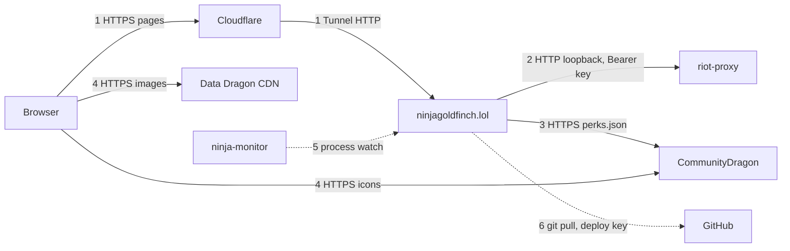
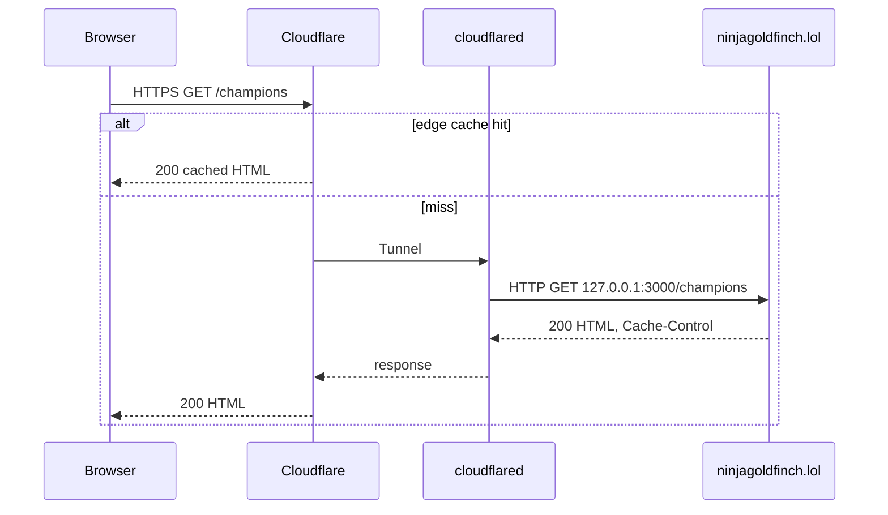
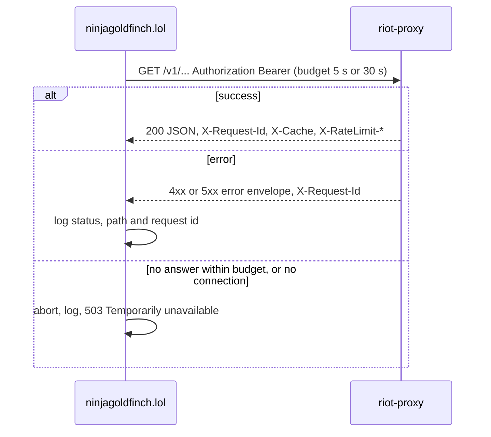
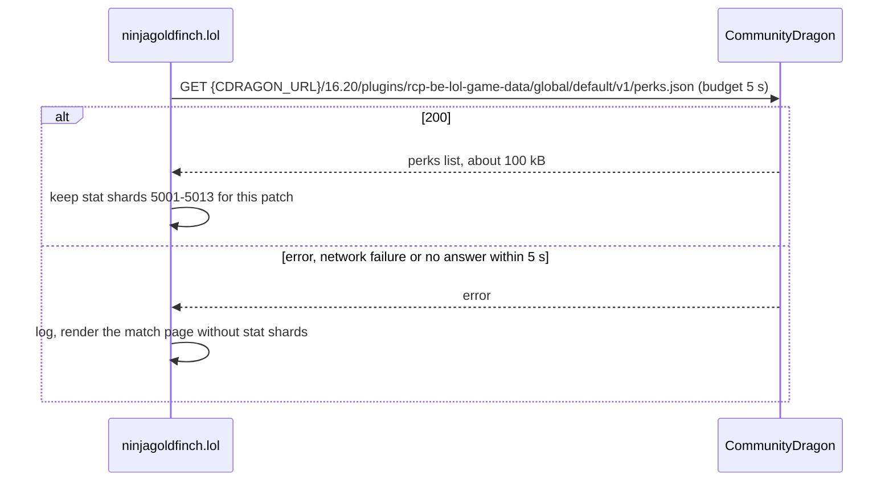

# Service communication

Every interaction between ninjagoldfinch.lol and other systems: who calls whom, over what, with which credentials, how often, and what happens on failure.

## Interaction map

Solid arrows are runtime traffic; dotted arrows are deploy-time or monitoring.

| #   | From → to                            | Protocol and auth                                     | Frequency                   | Failure behaviour                                    |
| --- | ------------------------------------ | ----------------------------------------------------- | --------------------------- | ---------------------------------------------------- |
| 1   | Browser → ninjagoldfinch.lol         | HTTPS to Cloudflare, Tunnel to `127.0.0.1:3000`; none | Every uncached page view    | Cloudflare error page if the site is down            |
| 2   | ninjagoldfinch.lol → riot-proxy      | HTTP, `Authorization: Bearer <PROXY_KEY>`             | 1–8 calls per uncached page | Page error or section notice; no retry               |
| 3   | ninjagoldfinch.lol → CommunityDragon | HTTPS GET, none                                       | Once per patch per process  | Stat shards left out; retried on the next match page |
| 4   | Browser → image CDNs                 | HTTPS GET, none                                       | Every page with images      | Broken image in the Browser                          |
| 5   | ninja-monitor → ninjagoldfinch.lol   | Not in this repo                                      | Continuous                  | Discord alert                                        |
| 6   | Host → GitHub                        | SSH, read-only deploy key                             | Each manual deploy          | Deploy stops; running version unaffected             |

The site never calls the Riot API, Onidel Object Storage or Cloudflare R2.

## 1. Browser to the site

- The site listens on `127.0.0.1` only (`HOST` in `/etc/ninjagoldfinch-lol/env`; `docs/DECISIONS.md:509`), so the Tunnel is the only way in.
- Payloads are HTML pages, `__data.json` for client navigation, and `POST ?/refresh` form actions (see [../api/endpoints.md](../api/endpoints.md)).
- Cloudflare's caching follows the site's `Cache-Control` (`src/lib/server/cache.ts:5-18`).

> **TODO (unverified):** whether adapter-node is told the real client address (`ADDRESS_HEADER=CF-Connecting-IP`, as the plan suggests in `docs/IMPLEMENTATION.md:392`). It is not among the variable names in `/etc/ninjagoldfinch-lol/env`, so the site probably sees `127.0.0.1` for every client; nothing in the code reads the client address today.

## 2. The site to riot-proxy

- Base URL `PROXY_URL`; production `http://127.0.0.1:8080` (`riot-proxy:docs/design/12-object-storage-and-hosting.md:630`).
- The header is sent only when `PROXY_KEY` is set (`src/lib/server/proxy.ts:137-148`).
- Routes, payloads and error codes: [contract.md](./contract.md). Key handling: [authentication.md](./authentication.md).
- Retries: none in the site. riot-proxy retries its own Riot calls (`riot-proxy:src/fetcher.rs:9-14`).
- Every failed response is logged with riot-proxy's `X-Request-Id`, which riot-proxy also records on its request log span, so one page error can be traced across both services (`src/lib/server/proxy.ts:7-20`, `riot-proxy:src/http/request_id.rs:49-66`, `riot-proxy:src/app.rs:107-115`).

## 3. The site to CommunityDragon

- Only the match page needs it, once per patch per process. It is fetched at start-up with the current patch's lookups, and when a background refresh finds a new patch, alongside that patch's lookups; it does not hold back the switch, so if it fails, match pages on the new patch go without stat shards and retry it (ADR-048, `src/lib/server/patch.ts:51-60,113-146`). If it is not held, a match page asks for it as soon as the patch versions are known, alongside the match and timeline calls (SPD-08; `src/lib/server/cdragon.ts:15-37`, `src/lib/server/match.ts:44-56`). Two patches are held.
- `CDRAGON_URL` defaults to `https://raw.communitydragon.org` (`src/lib/server/env.ts:17-25`); production does not set it (owner-supplied env names).
- The fetch has a 5 s deadline, `CDRAGON_BUDGET_MS`, which covers the body; the timer is cleared once the body is parsed (`src/lib/server/cdragon.ts:12-34`).
- This is the one outbound call that does not go to riot-proxy; it is for data riot-proxy does not mirror (ADR-026, `docs/DECISIONS.md:319`).

## 4. The Browser to the image CDNs

Image URLs are built in `src/lib/assets.ts` and fetched by the Browser: Data Dragon CDN for champion, item, profile-icon, spell and rune images (`src/lib/assets.ts:9-44`), and CommunityDragon for lane icons and stat shard icons (`src/lib/assets.ts:46-73`). No credentials, no traffic through the host. Pages ask the Browser to open these connections early with `<link rel="preconnect">`: every page to Data Dragon CDN, the profile and match pages to CommunityDragon as well (`src/lib/assets.ts:12-19`, `src/routes/+layout.svelte:21-24`, SPD-10).

## 5. ninja-monitor

ninja-monitor runs on `ngf-prod-syd1` and watches `ninjagoldfinch-lol` alongside `riot-proxy` and `cloudflared`, alerting on Discord when a service is down for 30 s or uses more than 1 GiB (`riot-proxy:docs/design/12-object-storage-and-hosting.md:832-838`). Nothing in this repo calls it or is called by it. See [monitoring-hooks.md](./monitoring-hooks.md).

## 6. Deploys from GitHub

A deploy pulls `main` over SSH with a read-only deploy key belonging to the `ninjagoldfinch-lol` user (`README.md:97,104-112`; `riot-proxy:docs/design/12-object-storage-and-hosting.md:617-619`). Separately, a developer refreshing the committed spec downloads riot-proxy's release binary and `sha256sums` from GitHub releases (`README.md:56-65`). Neither happens at runtime.

---

**Sources:** `src/lib/server/proxy.ts:L7-L154`, `src/lib/server/cdragon.ts:L12-L37`, `src/lib/server/patch.ts:L51-L60,L113-L146`, `src/lib/server/match.ts:L44-L56`, `src/lib/server/env.ts:L17-L25`, `src/lib/server/cache.ts:L5-L16`, `src/lib/assets.ts:L9-L73`, `README.md:L56-L65,L97-L112`, `docs/DECISIONS.md:L319,L509`, `docs/IMPLEMENTATION.md:L392`, `riot-proxy:docs/design/12-object-storage-and-hosting.md:L617-L619,L630,L832-L838`, `riot-proxy:src/fetcher.rs:L9-L14`, `riot-proxy:src/http/request_id.rs:L49-L66`, `riot-proxy:src/app.rs:L107-L115`, owner-supplied env names (2026-10-19)
**Last verified:** 2026-11-03 against commit `ea998cb`
