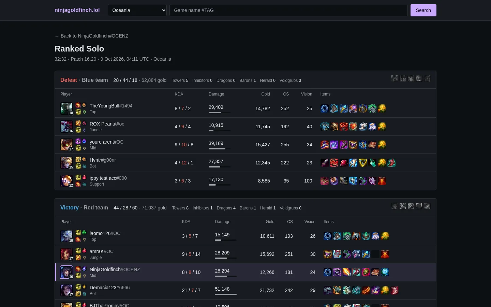
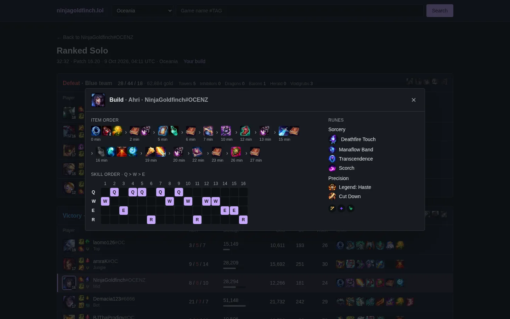
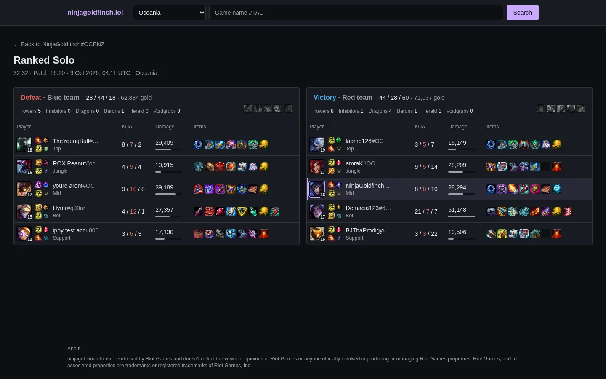
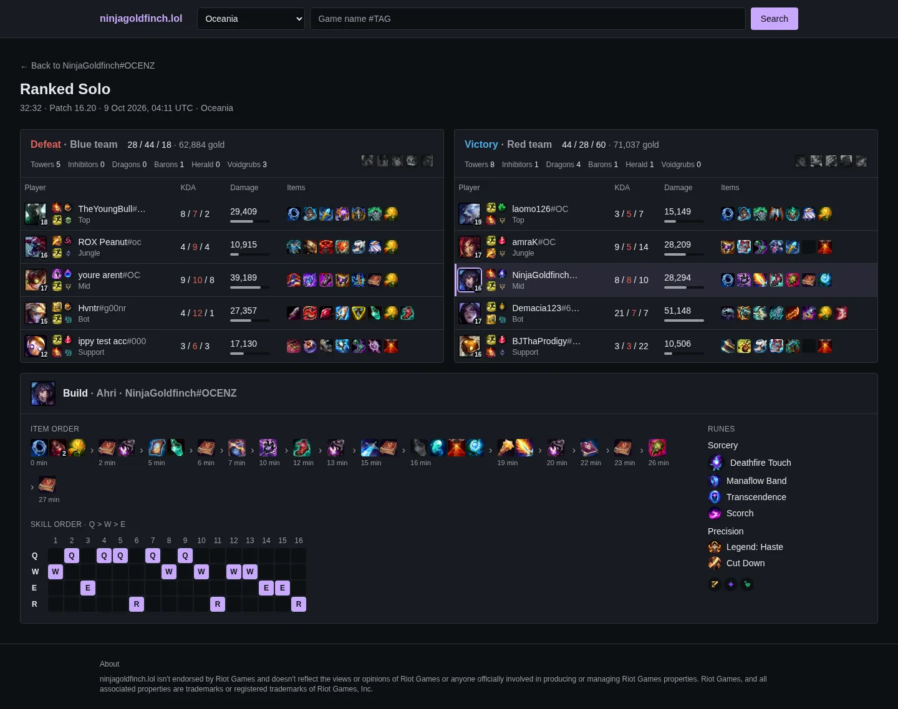

# Match page layouts

The match page has to fit two team scoreboards and a build (and, from P3-03, the timeline charts) into as little height as possible. Three layouts were mocked up on 2026-10-10, at 1440 × 900 against the recorded match `OC1_712351051`. The owner chose **A** (ADR-028). **B** and **B with the build** are kept here so they can be built later, possibly as a layout a visitor picks.

The mock-ups were made by restyling the live page in the browser. The CSS below is what produced them, not finished code.

## A: stacked scoreboards, build in a popup (built)

The two team tables stay full width, one above the other. No build is on the page until a visitor clicks a champion (or the header's build link). The build then opens as a modal dialog over the page. Without JavaScript the same link loads `?build=N#build`, and the build renders below the scoreboards.

At 1440 × 900 everything down to Red's fourth player is on screen. Red's last row and the footer are just below it (the page is 1,068 px tall).





## B: teams side by side

Blue on the left, Red on the right, each in half the width. To fit, the Gold, CS and Vision columns are dropped and items shrink to 22 px. The page is also widened to 88rem. Both teams fit in about 580 px with room to spare. The build would open as a popup, as in A.

The owner found the side-by-side tables less attractive than the stacked ones.



```css
main {
	max-width: 88rem;
}
main > div.mt-6 {
	display: grid;
	grid-template-columns: 1fr 1fr;
	gap: 1rem;
}
/* Gold, CS and Vision: the 4th to 6th columns of each team table. */
main section th:nth-child(n + 4):nth-child(-n + 6),
main section td:nth-child(n + 4):nth-child(-n + 6) {
	display: none;
}
main section td,
main section th {
	padding-inline: 0.4rem;
}
main section ul[aria-label='Items'] img,
main section ul[aria-label='Items'] li > span {
	width: 22px;
	height: 22px;
}
main section a.max-w-40 {
	max-width: 7rem;
} /* Riot IDs truncate sooner */
```

## B with the build underneath

As B, with the build panel full width below both teams instead of in a popup. The build ends at 1,000 px, about 100 px below a 900 px window. It would fit on one screen if the build were tightened: items on one line, a smaller skill grid.



```css
/* B's CSS, with its `main section` rules limited to the team tables
   (the mock-up used `main section:not(#build)`), plus: */
main > div.mt-6 > #build {
	grid-column: 1 / -1;
}
```

## Letting visitors choose

If these become a visitor's choice, things to settle first:

- **Where the choice lives.** The page is server-rendered and cached at the edge for a day, so a cookie read on the server would split the cache by cookie. A class set on `<html>` from `localStorage` before first paint keeps one cached page, but needs a small inline script and the CSP to allow it (P5-03). A query parameter (`?layout=side`) is cacheable and works without JavaScript, but has to be carried on every link.
- **Narrow screens.** B only makes sense on wide screens. Below about 1200 px it should fall back to A whatever the choice.
- **P3-03's charts** need a place in each layout.
