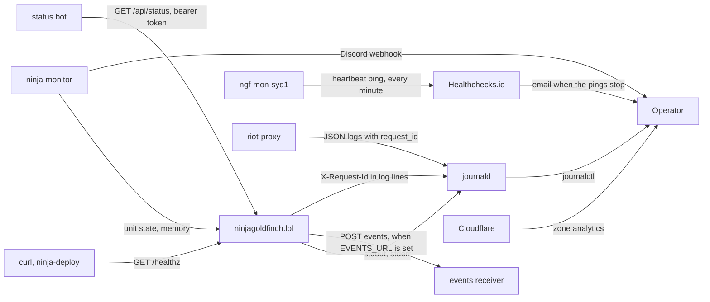

# Observability

What ninjagoldfinch.lol exposes for watching it in production (logs, `/healthz`, `/api/status` with its checks and counters, events on changes of state, the request id it shares with riot-proxy) and what it does not have (a metrics endpoint for scraping, tracing). The complete list of log lines lives in [integration/monitoring-hooks.md](../integration/monitoring-hooks.md); this page explains how the signals fit together and who reads them.

## Signals and their consumers

Where each signal goes and who reads it.



The site pushes one thing: when `EVENTS_URL` is set, it POSTs an event on each change of state (`proxy_unreachable`, `proxy_recovered`, `deployed`) to it (ADR-063, [integration/monitoring-hooks.md](../integration/monitoring-hooks.md#endpoints)). Everything else is read from it: `/healthz` and `/api/status` over HTTP, the journal and the unit on the host, and Cloudflare's analytics, by the operator, the deploy, the owner's status bot (ADR-062) or ninja-monitor. Separately, a heartbeat from `ngf-mon-syd1`, the monitoring host, pings Healthchecks.io, which emails the owner when the pings stop; whether anything probes the site from outside is unverified ([integration/monitoring-hooks.md](../integration/monitoring-hooks.md#from-outside-the-heartbeat-to-healthchecksio)).

## Logs

| Aspect         | Value                                                                                                                                                                                                                                                                                                                                                                                                                                | Source                                                                                                                |
| -------------- | ------------------------------------------------------------------------------------------------------------------------------------------------------------------------------------------------------------------------------------------------------------------------------------------------------------------------------------------------------------------------------------------------------------------------------------ | --------------------------------------------------------------------------------------------------------------------- |
| Mechanism      | `console.error` and `console.warn`; no logging library                                                                                                                                                                                                                                                                                                                                                                               | every `console.*` call under `src/`                                                                                   |
| Format         | Plain text, one line per event plus any error's stack; no JSON, no timestamps of its own (journald adds them)                                                                                                                                                                                                                                                                                                                        | `src/lib/server/proxy.ts:17-19,61-63,128-129`, `src/hooks.server.ts:23,62`, `src/lib/server/timing.ts:79`             |
| Levels         | `warn` for slow analytics calls, slow requests and a full event queue; one `console.log` at start-up, the build's identity; `error` for everything else; no level setting                                                                                                                                                                                                                                                            | `src/lib/server/proxy.ts:61`, `src/lib/server/timing.ts:79`, `src/lib/server/events.ts:243`, `src/hooks.server.ts:23` |
| What is logged | The build's identity at each start, then failures only: non-2xx, timed-out and unreachable riot-proxy calls, unexpected exceptions, degraded sections, unreadable payloads, a failed background patch refresh or start-up warm-up, failed status checks, dropped events and an unusable state directory, analytics calls over 250 ms, requests over 100 ms. Successful requests under 100 ms are not logged by the production server | [integration/monitoring-hooks.md](../integration/monitoring-hooks.md#logs)                                            |
| Where          | Production: journald, `sudo journalctl -u ninjagoldfinch-lol`. Development: the terminal running `just dev`, which also prints one line per request (`200 GET /champions`, observed)                                                                                                                                                                                                                                                 | `README.md:194`                                                                                                       |
| Personal data  | Failed-call lines include the request path, which can contain a PUUID (`/v1/players/{puuid}/matches`) or a Riot ID; profile warning lines name the Riot ID; `slow load` lines name only route ids and spec path templates                                                                                                                                                                                                            | `src/lib/server/proxy.ts:17-19,128-129`, `src/lib/server/profile.ts:93,119`                                           |
| Retention      | journald's settings on the host (not recorded)                                                                                                                                                                                                                                                                                                                                                                                       | [deployment/capacity.md](../deployment/capacity.md#disk)                                                              |

### Correlating with riot-proxy

Every riot-proxy response carries `X-Request-Id`; riot-proxy generates a ULID per request, or keeps the caller's own id if well-formed, and records it as `request_id` in its JSON logs (`riot-proxy:src/http/request_id.rs:1-3`). The site logs that id on every failed call (`proxy <status> <METHOD> <path> request-id=<id>`, `src/lib/server/proxy.ts:13-20`). To follow one failure:

```sh
sudo journalctl -u ninjagoldfinch-lol --since '-1 hour' | grep 'request-id='
sudo journalctl -u riot-proxy | grep '<id>'
```

This was checked against a local riot-proxy v2.7.0 on 2026-10-20 ([runbook.md](./runbook.md#logs)). The site does not send its own `X-Request-Id`, so there is no id for a whole page view: a page that made four calls has up to four unrelated ids. Successful calls are not logged, so their ids are only in riot-proxy's logs.

### Finding slow pages

A request that took over 100 ms, render included, logs one `slow load` line with its route id, its total and each riot-proxy call it made, by spec path, with its own time (`src/lib/server/timing.ts:67-95`, ADR-046):

```sh
sudo journalctl -u ninjagoldfinch-lol --since '-1 hour' | grep 'slow load'
```

```text
slow load /summoner/[riotId] 54ms: GET /v1/players/by-riot-id/{gameName}/{tagLine}/profile 10ms, GET /v1/players/{puuid}/matches 3ms, GET /v1/static/versions 3ms, GET /v1/static/{file} 3ms, …, GET /v1/static/queues 8ms
```

That example was taken against the mock proxy with the threshold set to 0. The call with the largest time is what the page waited on; calls made in parallel overlap, so their times do not add up to the total. A status after a time marks a non-2xx answer, `failed` a call with no answer. Since ADR-048 the `/v1/static/*` calls in that example appear only before the start-up warm-up has finished. Calls made outside a request are not recorded: the start-up warm-up, and the background patch refresh, which runs detached from the request that noticed the stale patch (`outsideLoad`), so that request is not charged for calls it did not wait on. One consequence: a request that arrives during the warm-up and waits on its in-flight fetches does not list them (`src/lib/server/timing.ts:26-60`, `src/lib/server/patch.ts:108-129`). Requests answered from Cloudflare's cache never reach the site, and warm loads usually finish under 100 ms, so the line shows cold and slow loads only ([performance.md](./performance.md)).

## Health endpoint

`GET /healthz` answers `{"ok":true,"version":"…"}` with `Cache-Control: no-store` whenever the process is serving, without touching riot-proxy (`src/routes/healthz/+server.ts:7-9`). `version` is `package.json`'s at build time (ADR-051). It is liveness only. Readiness has no endpoint of its own: `/api/status`'s `riot_proxy` check probes riot-proxy's `/readyz` with the site's key in the background, every `STATUS_CHECK_INTERVAL_S` (ADR-062); by hand, requesting a data page such as `/champions` does the same ([integration/monitoring-hooks.md](../integration/monitoring-hooks.md#endpoints)).

Consumers today: operators with `curl`; each deploy, whose health check waits for it to report the new version before it counts the release as live, and rolls back otherwise (ADR-051, ADR-053, `README.md:88`); staging's smoke test (ADR-060); Playwright waits on it before running tests (`playwright.config.ts:20`). The P5-05 answers say ninja-monitor on `ngf-mon-syd1` fetches it through Cloudflare every minute, but ninja-monitor's public source (`v0.2.3`) has no setting that fetches a URL, so whether anything outside the host requests it is unverified ([integration/monitoring-hooks.md](../integration/monitoring-hooks.md#from-outside-the-heartbeat-to-healthchecksio)).

## Metrics

The site has no Prometheus endpoint. It keeps in-memory counters and gauges, reported in `/api/status`'s `metrics` (ADR-062, `src/lib/server/metrics.ts`): requests and 5xx answered, `/api/…` requests, the pages' riot-proxy calls and their failures, those calls' p50 and p95 times over the last 5 minutes, and the current patch's age (`README.md:106-114`). They run from the process's start and reset on a restart. It also logs slow analytics calls (`src/lib/server/proxy.ts:38-68`) and slow requests (`src/lib/server/timing.ts:67-81`). For the rest:

| Need                          | Where to get it                                                                                                                                                                                                                            |
| ----------------------------- | ------------------------------------------------------------------------------------------------------------------------------------------------------------------------------------------------------------------------------------------ |
| Process CPU and memory        | ninja-monitor; `systemctl status ninjagoldfinch-lol` (Memory, CPU lines)                                                                                                                                                                   |
| Request rate and status codes | Cloudflare's analytics for the zone (edge view, cached and uncached)                                                                                                                                                                       |
| riot-proxy behaviour          | riot-proxy's `/metrics` (Prometheus) on `127.0.0.1:8080`, no auth, blocked on `api.` by the WAF (`riot-proxy:src/telemetry.rs:101-121`, `riot-proxy:docs/design/13-admin-dashboard.md:51`) and its dashboard on `admin.ninjagoldfinch.lol` |
| Cache hit ratio at the edge   | Cloudflare analytics; `cf-cache-status` on single responses                                                                                                                                                                                |

Prometheus and Grafana on `ngf-mon-syd1` are planned, scraping riot-proxy's `/metrics` over WireGuard; the notes mention nothing for the site (`riot-proxy:docs/design/12-object-storage-and-hosting.md:853-855`, `riot-proxy:docs/design/13-admin-dashboard.md:60,69`).

## Tracing

None. The site has no `instrumentation.server.ts` and no OpenTelemetry dependency (`package.json:21-50`). riot-proxy's tracing spans carry the request id, which is the only cross-service correlation.

## ninja-monitor

Watches the `ninjagoldfinch-lol` unit on the host: down after 30 s (repeated every 30 min), memory over 1 GiB, plus host-wide disk, memory and CPU alerts, posting to Discord (`riot-proxy:docs/design/12-object-storage-and-hosting.md:839-845`). It reads the unit's state from its cgroup, not over HTTP (`ninja-monitor:README.md:52-56`, `v0.2.3`). A second instance runs on `ngf-mon-syd1`, watching that host (`riot-proxy:docs/design/12-object-storage-and-hosting.md:839-840,850-851`). A heartbeat from that host pings a Healthchecks.io check every minute, and Healthchecks.io emails the owner when the pings stop, with 5 minutes of grace after the check's period (P5-05). Which process sends the ping, the check's period, and whether anything probes `/healthz` from outside are unverified ([integration/monitoring-hooks.md](../integration/monitoring-hooks.md#from-outside-the-heartbeat-to-healthchecksio)). Responses to each alert: [runbook.md](./runbook.md#ninja-monitor-alerts).

---

**Sources:** `src/lib/server/proxy.ts:L13-L20,L38-L68,L124-L131`, `src/lib/server/timing.ts:L26-L95`, `src/lib/server/patch.ts:L108-L146`, `src/lib/server/events.ts:L243`, `src/lib/server/metrics.ts`, `src/hooks.server.ts:L21-L30,L37-L64`, `src/lib/server/profile.ts:L93,L119`, `src/routes/healthz/+server.ts:L6-L9`, `playwright.config.ts:L18-L20`, `package.json:L22-L46`, `README.md:L86-L114,L194`, `docs/DECISIONS.md` (ADR-046, ADR-051, ADR-053, ADR-060, ADR-062, ADR-063), `riot-proxy:src/http/request_id.rs:L1-L3`, `riot-proxy:src/telemetry.rs:L102-L121`, `riot-proxy:docs/design/12-object-storage-and-hosting.md:L839-L855`, `riot-proxy:docs/design/13-admin-dashboard.md:L51,L60,L69` (riot-proxy at `7531561`), `ninja-monitor:README.md:L52-L56` (`v0.2.3`), `docs/PROGRESS.md` ("P5-05 check")
**Last verified:** 2026-11-09 against commit `8a2bb46`
