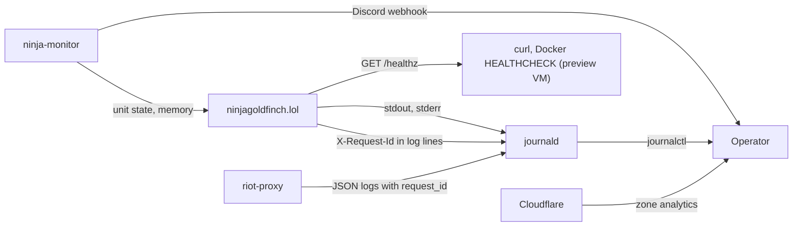

# Observability

What ninjagoldfinch.lol exposes for watching it in production (logs, one health endpoint, the request id it shares with riot-proxy) and what it does not have (metrics, tracing). The complete list of log lines lives in [integration/monitoring-hooks.md](../integration/monitoring-hooks.md); this page explains how the signals fit together and who reads them.

## Signals and their consumers

Where each signal goes and who reads it.



The site pushes nothing anywhere; everything is read from the host or from Cloudflare by the operator or by ninja-monitor.

## Logs

| Aspect         | Value                                                                                                                                                                                                                       | Source                                                                      |
| -------------- | --------------------------------------------------------------------------------------------------------------------------------------------------------------------------------------------------------------------------- | --------------------------------------------------------------------------- |
| Mechanism      | `console.error` and `console.warn`; no logging library                                                                                                                                                                      | every `console.*` call under `src/`                                         |
| Format         | Plain text, one line per event plus any error's stack; no JSON, no timestamps of its own (journald adds them)                                                                                                               | `src/lib/server/proxy.ts:15-17,59-61,126-127`, `src/hooks.server.ts:18`     |
| Levels         | `warn` for slow analytics calls; `error` for everything else; no level setting                                                                                                                                              | `src/lib/server/proxy.ts:59`                                                |
| What is logged | Failures only: non-2xx, timed-out and unreachable riot-proxy calls, unexpected exceptions, degraded sections, unreadable payloads, analytics calls over 250 ms. Successful requests are not logged by the production server | [integration/monitoring-hooks.md](../integration/monitoring-hooks.md#logs)  |
| Where          | Production: journald, `sudo journalctl -u ninjagoldfinch-lol`. Development: the terminal running `just dev`, which also prints one line per request (`200 GET /champions`, observed)                                        | `README.md:100`                                                             |
| Personal data  | Failed-call lines include the request path, which can contain a PUUID (`/v1/players/{puuid}/matches`) or a Riot ID; profile warning lines name the Riot ID                                                                  | `src/lib/server/proxy.ts:15-17,126-127`, `src/lib/server/profile.ts:85,116` |
| Retention      | journald's settings on the host (not recorded)                                                                                                                                                                              | [deployment/capacity.md](../deployment/capacity.md#disk)                    |

### Correlating with riot-proxy

Every riot-proxy response carries `X-Request-Id`; riot-proxy generates a ULID per request, or keeps the caller's own id if well-formed, and records it as `request_id` in its JSON logs (`riot-proxy:src/http/request_id.rs:1-3`). The site logs that id on every failed call (`proxy <status> <METHOD> <path> request-id=<id>`, `src/lib/server/proxy.ts:11-17`). To follow one failure:

```sh
sudo journalctl -u ninjagoldfinch-lol --since '-1 hour' | grep 'request-id='
sudo journalctl -u riot-proxy | grep '<id>'
```

This was checked against a local riot-proxy v2.7.0 on 2026-10-20 ([runbook.md](./runbook.md#logs)). The site does not send its own `X-Request-Id`, so there is no id for a whole page view: a page that made four calls has up to four unrelated ids. Successful calls are not logged, so their ids are only in riot-proxy's logs.

## Health endpoint

`GET /healthz` answers `{"ok":true}` with `Cache-Control: no-store` whenever the process is serving, without touching riot-proxy (`src/routes/healthz/+server.ts:5-6`). It is liveness only. There is no readiness endpoint that checks riot-proxy; requesting a data page such as `/champions` serves that purpose by hand ([integration/monitoring-hooks.md](../integration/monitoring-hooks.md#endpoints)).

Consumers today: operators with `curl`; the preview VM's Docker `HEALTHCHECK` every 30 s (`Dockerfile:22`); Playwright waits on it before running tests (`playwright.config.ts:20`). Whether ninja-monitor calls it is not known (gap in [\_meta/gaps.md](../_meta/gaps.md)).

## Metrics

The site exposes no metrics endpoint and keeps no counters; the only timing it takes is for slow analytics calls (`src/lib/server/proxy.ts:36-66`). What exists instead:

| Need                          | Where to get it                                                                                                                                                                                                                            |
| ----------------------------- | ------------------------------------------------------------------------------------------------------------------------------------------------------------------------------------------------------------------------------------------ |
| Process CPU and memory        | ninja-monitor; `systemctl status ninjagoldfinch-lol` (Memory, CPU lines)                                                                                                                                                                   |
| Request rate and status codes | Cloudflare's analytics for the zone (edge view, cached and uncached)                                                                                                                                                                       |
| riot-proxy behaviour          | riot-proxy's `/metrics` (Prometheus) on `127.0.0.1:8080`, no auth, blocked on `api.` by the WAF (`riot-proxy:src/telemetry.rs:101-121`, `riot-proxy:docs/design/13-admin-dashboard.md:51`) and its dashboard on `admin.ninjagoldfinch.lol` |
| Cache hit ratio at the edge   | Cloudflare analytics; `cf-cache-status` on single responses                                                                                                                                                                                |

Prometheus and Grafana on `ngf-mon-syd1` are planned, scraping riot-proxy's `/metrics` over WireGuard; the notes mention nothing for the site (`riot-proxy:docs/design/12-object-storage-and-hosting.md:846-847`, `riot-proxy:docs/design/13-admin-dashboard.md:60,69`).

## Tracing

None. The site has no `instrumentation.server.ts` and no OpenTelemetry dependency (`package.json:23-52`). riot-proxy's tracing spans carry the request id, which is the only cross-service correlation.

## ninja-monitor

Watches the `ninjagoldfinch-lol` unit on the host: down after 30 s (repeated every 30 min), memory over 1 GiB, plus host-wide disk, memory and CPU alerts, posting to Discord (`riot-proxy:docs/design/12-object-storage-and-hosting.md:832-838`). Responses to each alert: [runbook.md](./runbook.md#ninja-monitor-alerts).

---

**Sources:** `src/lib/server/proxy.ts:L11-L66`, `src/hooks.server.ts:L15-L19`, `src/lib/server/profile.ts:L85,L116`, `src/routes/healthz/+server.ts:L5-L6`, `Dockerfile:L22`, `playwright.config.ts:L18-L20`, `package.json:L23-L52`, `README.md:L100`, `riot-proxy:src/http/request_id.rs:L1-L3`, `riot-proxy:src/telemetry.rs:L101-L121`, `riot-proxy:docs/design/12-object-storage-and-hosting.md:L832-L847`, `riot-proxy:docs/design/13-admin-dashboard.md:L51,L60,L69`
**Last verified:** 2026-11-03 against commit `2948c82`
