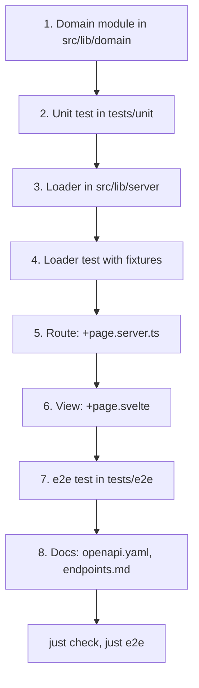

# Adding a page

The files to touch, in order, to add a server-rendered page to ninjagoldfinch.lol, with the existing `/champions` page as the worked example and the tests each step needs. If the page needs a riot-proxy route the site does not call yet, read [adding-a-proxy-call.md](./adding-a-proxy-call.md) first.

## Rules that shape every page

These come from `CLAUDE.md` and are enforced by review, `just check` and the e2e tests:

| Rule                                                                   | Source                                               |
| ---------------------------------------------------------------------- | ---------------------------------------------------- |
| Data loads in `+page.server.ts`; no client-side fetching of proxy data | `CLAUDE.md:57-58`                                    |
| Pages work without client JavaScript; enhance on top                   | `CLAUDE.md:59`                                       |
| Every load sets `Cache-Control` through `src/lib/server/cache.ts`      | `CLAUDE.md:62`                                       |
| Asset URLs only through `src/lib/assets.ts`                            | `CLAUDE.md:63`                                       |
| Svelte 5 runes only; Tailwind utilities with tokens from `src/app.css` | `CLAUDE.md:55-61`                                    |
| Never import `src/lib/server/` from client code                        | `CLAUDE.md:15-17`                                    |
| Legal boilerplate in the footer of every page (the layout does this)   | `CLAUDE.md:24-25`, `src/routes/+layout.svelte:43-48` |
| No MMR or ELO estimates; no custom-game history                        | `CLAUDE.md:24-25`                                    |
| Every PR ships tests for what it adds                                  | `CLAUDE.md:10`                                       |

## The order of work

Each layer only depends on the ones before it, so build and test them in this order.



The diagram is the checklist below; the numbered steps say what each file must contain.

## Worked example: `/champions`

### 1. Domain functions

Put everything that shapes data and has no I/O in `src/lib/domain/`, one module per concern (`CLAUDE.md:35`). For `/champions` that is `src/lib/domain/champion-stats.ts`: `parseChampionFilter` reads the query, `championQuery` builds the canonical query string, `proxyQuery` turns the filter into riot-proxy's query, and `toChampionTable` shapes the response (imported at `src/routes/champions/+page.server.ts:2` and `src/lib/server/champions.ts:1-7`).

### 2. Unit-test the domain module

Each domain module has a test in `tests/unit/` named after it (here `tests/unit/champion-stats.test.ts`). Vitest picks up `tests/unit/**/*.test.ts` (`vite.config.ts:24-36`) and requires every test to make at least one assertion (`vite.config.ts:23`).

### 3. The loader

A loader in `src/lib/server/` makes the riot-proxy calls through the one client, `proxy` from `src/lib/server/proxy.ts`, and accepts an injected client so tests can replace it (`src/lib/server/champions.ts:33-36`). Decide for each call whether the page can live without it:

- **Essential:** check `response.ok` and call `toHttpError(response, error)`, which turns riot-proxy's failure into the page's 404, 429 or 503 (`src/lib/server/champions.ts:49`, `src/lib/server/errors.ts:16-39`).
- **Optional:** wrap the call in `optional(...)`, so a throw (unreachable, timed out) becomes a 503 response for that call alone, then degrade (`src/lib/server/champions.ts:41-43,50-51`, `src/lib/server/errors.ts:54-58`).

Run independent calls in parallel with `Promise.all`, and chain a call only after the one it needs: `/champions` asks for the table, the patch list, and the current patch followed by its Data Dragon names, all together (`src/lib/server/champions.ts:37-48`, SPD-08). A chain started before an `await` that can fail the page goes through `early()` (`src/lib/server/errors.ts:60-68`); `tests/unit/cold-path.test.ts` checks the order. Shared lookups such as the current patch and Data Dragon names come from `currentPatch` and `staticNames`, which hold their results in memory ([data/caching.md](../data/caching.md)).

### 4. Test the loader with fixtures

Build a client from `createProxyClient` with a fetch that answers from `tests/fixtures/`, override single paths to simulate failures, and record what was asked (`tests/unit/champions-loader.test.ts:9-29`; the same pattern is in `tests/unit/match-loader.test.ts:24-37`). Clear the in-memory holds in `beforeEach` with `clearStaticNames()` and `clearPatchVersions()`. Test at least: the happy path, each optional call failing, the essential call failing with 404 and 503. If the page needs a response no fixture has, add one ([testing.md](./testing.md#fixtures)).

### 5. The route

`src/routes/<path>/+page.server.ts` exports `load`. It parses `params` and `url`, redirects to the canonical URL if needed, calls the loader, and sets the cache policy:

```ts
export const load: PageServerLoad = async ({ url, untrack, setHeaders }) => {
	const filter = parseChampionFilter(url.searchParams);
	const query = untrack(() => championQuery(filter, parseSort(url.searchParams.get('sort'))));
	if (untrack(() => url.search) !== query) redirect(307, url.pathname + query);

	const page = await loadChampions(filter);
	// A page with a part missing is not kept at the edge.
	setHeaders(cacheControl(page.complete ? 'analytics' : 'none'));
	return { filter, ...page };
};
```

(`src/routes/champions/+page.server.ts:7-20`.) Pick a policy from `CACHE_POLICIES` (`src/lib/server/cache.ts:5-16`) or add one there with a test in `tests/unit/cache.test.ts`. If the page has optional calls, have the loader return whether they all loaded (`complete`, `src/lib/server/champions.ts:53`) and send `none` when one failed, so the gap is not cached (ADR-045). You do not need to handle errors, POSTs or redirects: `src/hooks.server.ts:8-19` overrides the header to `no-store` for non-GET requests and errors, to `notFound` for 404s, and gives `no-store` to any response without one, such as a redirect thrown before `setHeaders`.

A path that only redirects uses `+server.ts` with a `GET` handler instead (for example `src/routes/match/[region]/[matchId]/+server.ts:8-11`).

### 6. The view

`+page.svelte` takes `data` with `$props()` and derives everything else with `$derived` (`src/routes/champions/+page.svelte:20-27`). Image URLs come from `src/lib/assets.ts` (`championIconUrl`, `itemIconUrl`, …). Colours come from the `--color-*` tokens in `src/app.css:6-16` through Tailwind classes such as `text-accent` or `border-border`. Filters are plain `<form method="GET">` so they work without JavaScript. The layout adds the header, the search and the legal footer (`src/routes/+layout.svelte:24-49`); do not repeat them.

If the page has Data Dragon names, return `championNames` from the load and the header search suggests champions (`src/routes/+layout.svelte:12-17`).

### 7. End-to-end test

Add a file in `tests/e2e/` or extend one. Existing files test each page twice: with `test.use({ javaScriptEnabled: false })` to prove server rendering, and with JavaScript for enhancements (`tests/e2e/match.test.ts:6-7`). Assert the legal footer is present (`tests/e2e/champions.test.ts:5,49`). The e2e run uses the mock proxy, so every riot-proxy path the page requests needs a fixture or the mock answers 500 (`tests/mock-proxy/mock.ts:38-43`).

### 8. Documentation

Add the route to [api/openapi.yaml](../api/openapi.yaml), [api/endpoints.md](../api/endpoints.md) and the route table in [\_meta/inventory.md](../_meta/inventory.md#4-http-routes-master-list); see [\_meta/doc-maintenance.md](../_meta/doc-maintenance.md) for what else to touch. Record any design choice as an ADR in `docs/DECISIONS.md` (`CLAUDE.md:28-29`).

### 9. Gate and ship

```sh
just check
just e2e
```

Then commit on a task branch (`<type>/<task-id>-<slug>`) with a scoped Conventional Commit and a `Task:` footer (`CLAUDE.md:64-65`); see [code-style-and-conventions.md](./code-style-and-conventions.md) and [release-process.md](./release-process.md).

---

**Sources:** `CLAUDE.md:L8-L68`, `src/routes/champions/+page.server.ts:L1-L20`, `src/routes/champions/+page.svelte:L1-L40`, `src/lib/server/champions.ts:L1-L62`, `src/lib/server/errors.ts:L16-L68`, `src/lib/server/cache.ts:L5-L16`, `src/hooks.server.ts:L8-L19`, `src/routes/+layout.svelte:L1-L49`, `src/routes/match/[region]/[matchId]/+server.ts:L8-L11`, `src/app.css:L6-L16`, `src/lib/assets.ts`, `vite.config.ts:L22-L37`, `tests/unit/champions-loader.test.ts:L1-L29`, `tests/unit/match-loader.test.ts:L24-L42`, `tests/e2e/match.test.ts:L1-L10`, `tests/e2e/champions.test.ts:L5,L49`, `tests/mock-proxy/mock.ts:L27-L48`
**Last verified:** 2026-11-03 against commit `5fede17`
