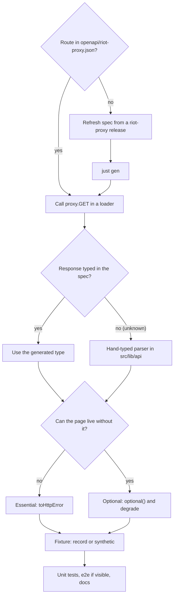

# Adding a riot-proxy call

How to make ninjagoldfinch.lol use a riot-proxy route it does not call yet: check the route exists in the committed spec, type it, call it through the one client, decide how it fails, and give the tests a fixture. The site never calls Riot; this page replaces the generic "adding a Riot call".

## Before you start

- The route, its parameters, fields, headers and error codes must come from `openapi/riot-proxy.json`. If riot-proxy lacks what you need, stop and ask; do not work around it, and never call Riot or Data Dragon from the server (`CLAUDE.md:18-22`).
- The committed spec is riot-proxy `2.7.0` with 70 paths (`openapi/riot-proxy.json`, `info.version`). If the route arrived in a later riot-proxy release, refresh the spec first (step 1).



Each box is one of the numbered steps below.

## 1. Refresh the spec (only if the route is missing)

Download the release binary, check it against `sha256sums`, print its spec into `openapi/riot-proxy.json`, then regenerate the types. The exact commands are in `README.md:56-63`:

```sh
repo=$PWD; v=<version>; cd "$(mktemp -d)"
curl -fsSLO https://github.com/NinjaGoldfinch/riot-proxy/releases/download/v$v/riot-proxy-linux-amd64
curl -fsSLO https://github.com/NinjaGoldfinch/riot-proxy/releases/download/v$v/sha256sums
sha256sum --ignore-missing -c sha256sums && chmod +x riot-proxy-linux-amd64
./riot-proxy-linux-amd64 spec | head -c -1 > "$repo/openapi/riot-proxy.json"
cd "$repo" && just gen
```

- `head -c -1` strips the trailing newline, so the file stays byte-identical to what riot-proxy serves at `/openapi.json`; `openapi/` is excluded from Prettier for the same reason (`README.md:62,65`, `.prettierignore:15-16`).
- `just gen` rewrites `src/lib/api/schema.d.ts` (`justfile:15-17`). Never edit that file by hand (`CLAUDE.md:23`); `just check` fails if it drifts from the spec (`justfile:22`).
- A spec bump is its own task and PR, like `chore(api): riot-proxy spec v2.7.0 from the release (#66)` in the git log. Update the version and sha256 in `README.md:65` and the "verified against" line in [integration/contract.md](../integration/contract.md).

## 2. Call it from a loader

Loaders in `src/lib/server/` call the typed client `proxy` (`src/lib/server/proxy.ts:153-154`). openapi-fetch checks the path template and parameters against `paths` from the generated types:

```ts
const [matchResponse, timelineResponse, { versions, names, shards }] = await Promise.all([
	client.GET('/v1/lol/matches/{region}/{matchId}', { params: { path } }),
	optional(client.GET('/v1/lol/matches/{region}/{matchId}/timeline', { params: { path } })),
	lookups
]);
if (!matchResponse.response.ok) toHttpError(matchResponse.response, matchResponse.error);
```

(`src/lib/server/match.ts:57-62`.) Take the client as an injectable parameter defaulting to `proxy`, so tests can pass their own (`src/lib/server/match.ts:34-38`).

Start calls that do not depend on each other together, and chain a call only after the one it needs. `lookups` above is the patch versions followed by the Data Dragon lookups and stat shards for that patch; none of them needs the match, so the chain runs alongside it rather than after it (SPD-08, `src/lib/server/match.ts:42-56`). If a chain is started before an `await` that can fail the page, as the profile's patch lookups are started before its profile call, wrap it in `early()`: that marks its failure handled at once, so a page that fails first leaves no unhandled rejection, while awaiting it still throws (`src/lib/server/errors.ts:60-68`, `src/lib/server/profile.ts:76-83`). `tests/unit/cold-path.test.ts` checks the order for the profile, match and champions loaders.

What the client already does for you, so do not repeat it:

| Behaviour                                                                                                                                                                                                  | Source                            |
| ---------------------------------------------------------------------------------------------------------------------------------------------------------------------------------------------------------- | --------------------------------- |
| Sends `Authorization: Bearer <PROXY_KEY>` when a key is set                                                                                                                                                | `src/lib/server/proxy.ts:137-148` |
| Deadline per call: 5 s for `/v1/lol/analytics/*` and `/v1/static/*`, 30 s for everything else; a timeout or an unreachable riot-proxy throws a 503 and is logged as `proxy timeout` or `proxy unreachable` | `src/lib/server/proxy.ts:69-135`  |
| Logs every non-2xx with riot-proxy's `X-Request-Id`                                                                                                                                                        | `src/lib/server/proxy.ts:7-20`    |
| Logs analytics calls slower than 250 ms with `X-Cache`                                                                                                                                                     | `src/lib/server/proxy.ts:37-67`   |
| Records the call's time by its spec path for the request that made it; a request over 100 ms logs them all on one `slow load` line                                                                         | `src/lib/server/timing.ts:33-52`  |

The middleware runs in this order: `refuseDotSegments` (refuses a `.` or `..` path parameter), `timeCalls`, `logFailures`, `logSlowAnalytics` (`src/lib/server/proxy.ts:149`). A new call needs nothing more to appear on the `slow load` line, under its spec path template (ADR-046).

If the new route sits under a new path prefix and should have the short budget, change `proxyBudget` and its test in `tests/unit/proxy.test.ts:128-133`. There are no retries in the site; riot-proxy does its own retrying of Riot ([architecture/concurrency-and-rate-limiting.md](../architecture/concurrency-and-rate-limiting.md)).

## 3. Type the response

- **Typed in the spec:** use the generated type from `components['schemas']`, as `src/lib/api/riot.ts` does for `AccountDto`, `SummonerDTO` and `LeagueEntryDTO` (ADR-018).
- **`unknown` in the spec:** riot-proxy passes some Riot payloads through without a schema; match-v5 matches and timelines are `unknown`. Write a parser in `src/lib/api/` that types only the fields the site reads and checks them, returning `undefined` on a payload it cannot read (`src/lib/api/match.ts:1-4`, ADR-006, ADR-023). A loader treats an unreadable essential payload as 503 and logs it (`src/lib/server/match.ts:64-68`).

No `any` and no non-null `!` on proxy data (`CLAUDE.md:60`).

## 4. Decide how it fails

| Kind      | Code                                                      | Visitor sees                  |
| --------- | --------------------------------------------------------- | ----------------------------- |
| Essential | `if (!r.response.ok) toHttpError(r.response, r.error)`    | 404, 429 or 503 page          |
| Optional  | `optional(client.GET(...))`, then branch on `response.ok` | The page without that section |

`toHttpError` maps riot-proxy's `NOT_FOUND` and `VALIDATION` to 404, `QUOTA_EXCEEDED` and `RATE_LIMITED` (or any 429) to 429 with `retryAfter`, and everything else to 503; raw proxy messages are never shown (`src/lib/server/errors.ts:16-33`). The full table is in [api/errors.md](../api/errors.md).

## 5. Give the tests a fixture

Every path the code requests needs a fixture, or the mock proxy answers 500 (`tests/mock-proxy/mock.ts:27-43`).

- **Record** one from a riot-proxy you can reach (spends Riot rate limit): `just fixture <name> '<path exactly as the client sends it>'` (`justfile:34-36`, `README.md:71-77`). The recorder replaces `puuid`, `summonerId` and `metadata.participants` with `fixture-puuid-…` placeholders and keeps only `content-type`, `x-cache`, `x-cache-age`, `x-request-id` and `retry-after` (`tests/record-fixture.ts:41-78`, `tests/redact.ts:1-38`). Trim large Data Dragon files with `--keep`.
- **Write a synthetic one** for states you cannot record on demand, named `synthetic-*.json`, with a `_note` saying it is not a recording (`README.md:79`, ADR-017; example `tests/fixtures/synthetic-match-rate-limited.json`).

`tests/unit/fixtures-spec.test.ts` fails if a 200 fixture lacks a field the spec requires (`tests/unit/fixtures-spec.test.ts:84-95`). Check the file has no `rpx_` or `RGAPI-` strings before staging; the pre-commit hook refuses them (`.githooks/pre-commit:10-23`).

## 6. Tests and docs

1. Unit-test the loader with an injected client answering from fixtures, plus overrides for each failure (pattern in `tests/unit/match-loader.test.ts:24-37,106-129`).
2. Add or extend an e2e test if the data is visible ([testing.md](./testing.md)).
3. Add the call to the outbound table in [\_meta/inventory.md](../_meta/inventory.md#5-outbound-network-calls), [integration/contract.md](../integration/contract.md) and [integration/service-communication.md](../integration/service-communication.md).
4. Run `just check` and `just e2e`.

---

**Sources:** `CLAUDE.md:L18-L23,L60`, `README.md:L56-L79`, `.prettierignore:L15-L16`, `justfile:L15-L36`, `openapi/riot-proxy.json` (`info.version` 2.7.0), `src/lib/server/proxy.ts:L7-L154`, `src/lib/server/timing.ts:L33-L52`, `src/lib/server/match.ts:L34-L68`, `src/lib/server/errors.ts:L16-L68`, `src/lib/server/profile.ts:L76-L83`, `tests/unit/cold-path.test.ts`, `src/lib/api/match.ts:L1-L4`, `src/lib/api/riot.ts:L1-L15`, `tests/mock-proxy/mock.ts:L27-L43`, `tests/record-fixture.ts:L41-L78`, `tests/redact.ts:L1-L38`, `tests/unit/fixtures-spec.test.ts:L84-L95`, `tests/unit/proxy.test.ts:L107-L112`, `tests/unit/match-loader.test.ts:L24-L37`, `.githooks/pre-commit:L10-L23`, `docs/DECISIONS.md` (ADR-006, ADR-017, ADR-018, ADR-023, ADR-046)
**Last verified:** 2026-11-03 against commit `e183749`
