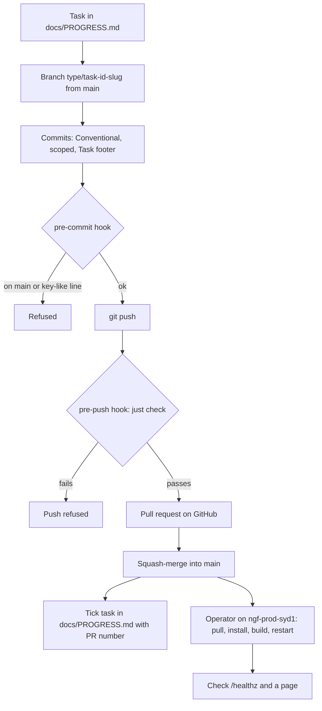

# Release process

How a change to ninjagoldfinch.lol travels from a task branch to production. There is no CI, no versioned release and no deploy automation: the local `just check` is the gate, `main` is what ships, and an operator deploys it by hand on the production host.

## Versioning and tags

- **No release versions.** `package.json:4` holds `"version": "0.0.1"` and is never bumped; there are no `vX.Y.Z` tags. Production runs whatever commit of `main` was last pulled.
- **Phase tags** mark the end of a plan phase after its exit check passes: `phase-P0` to `phase-P4` (all 2026-10-09/10, `git tag -n1`). The rule is in `CLAUDE.md:70-74`: paste the exit check into `docs/PROGRESS.md`, tag `phase-P<n>`, and pause for owner review. Later work series (SPD, VS, FIX) record their exit checks in `docs/PROGRESS.md` without a tag (`docs/PROGRESS.md:221`).
- **Changelog.** There is no `CHANGELOG`. The per-task log is `docs/PROGRESS.md`, where each ticked task carries its PR number (`CLAUDE.md:28-29`, for example `docs/PROGRESS.md:59-61`), and design decisions are in `docs/DECISIONS.md`.

## From branch to production



Every step after the hooks is manual; the next sections give the commands.

### 1. Branch and commit

1. Start from an up-to-date `main` and create a branch named `<type>/<task-id>-<slug>` (`CLAUDE.md:65`), for example `feat/VS-03-lane-opponent`.
2. Commit with a scoped Conventional Commit and a `Task:` footer (`CLAUDE.md:64`), describing the change only, with no tooling attribution (`CLAUDE.md:66-68`). Details in [code-style-and-conventions.md](./code-style-and-conventions.md#commits-branches-and-prs).
3. The pre-commit hook refuses a commit on `main` and any staged added line matching `(rpx_|RGAPI-)[A-Za-z0-9_-]` (`.githooks/pre-commit:4-23`).

One task is one branch and one PR; tasks are never batched (`CLAUDE.md:8-9`).

### 2. Gate and push

```sh
just check            # also run by the pre-push hook
just e2e              # not in the hook; run it for anything a page shows
git push -u origin <branch>
```

`.githooks/pre-push` runs `exec just check`, so a failing gate stops the push (`.githooks/pre-push:1-3`). Pushing from a linked git worktree is safe since RV-01 ([development-setup.md](./development-setup.md#2-run-the-gate)). GitHub does not enforce branch protection on this private repo (the API answers 403 for the plan), so the local hook is the only guard on `main` (ADR-003, `docs/DECISIONS.md:31-39`).

### 3. Pull request and merge

Open a PR against `main`, then squash-merge it (`CLAUDE.md:8`). Every PR ships tests for what it changes (`CLAUDE.md:10`). After merging, tick the task in `docs/PROGRESS.md` with the PR number, and record any decision as an ADR in `docs/DECISIONS.md` (`CLAUDE.md:28-29`).

If the PR changes the riot-proxy spec, it is its own task: `chore(api): riot-proxy spec v<version> from the release` (commits `4859ae7`, `d452f64`), following `README.md:47-67`. Deploy the riot-proxy release before or with the site change that needs it.

### 4. Deploy to production

On `ngf-prod-syd1`, as a user with sudo (`README.md:104-114`):

```sh
cd /opt/ninjagoldfinch-lol
sudo -H -u ninjagoldfinch-lol git pull
sudo -H -u ninjagoldfinch-lol pnpm install --frozen-lockfile
sudo -H -u ninjagoldfinch-lol env ORIGIN=https://ninjagoldfinch.lol pnpm build
sudo systemctl restart ninjagoldfinch-lol
```

- `ORIGIN` goes on the build command because the origin is fixed at build time; adapter-node 6 does not read it at runtime, and form posts such as Refresh are accepted only from that origin (`vite.config.ts:16-19`, ADR-014, `README.md:114`).
- **The build is not isolated from the running server.** adapter-node deletes `build/` before writing the new one (`node_modules/@sveltejs/adapter-node/index.js:17`, adapter-node 6.0.0). The running server streams static files from the paths it recorded at boot and imports route modules lazily (`build/server/manifest.js`, `build/server/adapter-node-handler.js:379-404`), so between the build and the restart some requests can fail. Run the build and the restart back to back.
- `Restart=always` with `RestartSec=2` brings the service back if it exits (owner-supplied unit, [inventory section 14](../_meta/inventory.md#14-owner-supplied-evidence-not-in-any-repo)). Nothing in the repo measures the restart's downtime. Cloudflare's edge keeps serving cached pages within their `s-maxage` and `stale-while-revalidate` windows ([data/caching.md](../data/caching.md)).

> **TODO (unverified):** After a deploy, HTML still cached at the edge (up to two days for match pages) names the previous build's hashed `/_app/immutable/` files, which the new build has deleted from the origin. Whether Cloudflare still holds those files (they are sent with `public,max-age=31536000,immutable`) was not checked. Check with `curl -sI https://ninjagoldfinch.lol/_app/immutable/<old file>` after a deploy and read `cf-cache-status`.

### 5. Verify

```sh
git -C /opt/ninjagoldfinch-lol log -1 --oneline            # the commit now deployed
curl -s http://127.0.0.1:3000/healthz                      # {"ok":true}
sudo journalctl -u ninjagoldfinch-lol -n 50 --no-pager      # no start-up errors
curl -sI https://ninjagoldfinch.lol/champions | head -5     # through the Tunnel
```

`/healthz` answers without touching riot-proxy, so also load one page that does (`src/routes/healthz/+server.ts:5-6`). If the server refused to start, the journal shows the env validation message, for example `PROXY_KEY is required when NODE_ENV=production` (`src/lib/server/env.ts:51`). Rolling back is in [deployment/upgrade-and-rollback.md](../deployment/upgrade-and-rollback.md).

## The preview VM (dormant)

The LAN preview VM deployed a ref with `ninjagoldfinch-update [ref]`: fetch with a read-only deploy key, `git checkout --detach`, `docker compose -f deploy/compose.yaml up -d --build`, prune old images (`deploy/proxmox/ninjagoldfinch-update:1-48`). The VM no longer exists (owner, 2026-10-19); see [deployment/preview-vm.md](../deployment/preview-vm.md).

## What does not exist

| Not present                                      | Why / status                                                                                  |
| ------------------------------------------------ | --------------------------------------------------------------------------------------------- |
| GitHub Actions or any CI                         | Forbidden by `CLAUDE.md:11-12`; `just check` is the gate                                      |
| A deploy script or unit file in the repo         | ADR-038: "none of them is in the repo as a script or unit file yet" (`docs/DECISIONS.md:513`) |
| Release tags, artefacts or images for production | Production builds from a checkout on the host (ADR-038)                                       |
| Automatic rollback                               | Manual, by checking out the previous commit and rebuilding                                    |

---

**Sources:** `package.json:L4`, `CLAUDE.md:L8-L12,L28-L29,L64-L74`, `.githooks/pre-commit:L4-L23`, `.githooks/pre-push:L1-L3`, `docs/DECISIONS.md:L31-L39,L500-L516`, `docs/PROGRESS.md:L59-L61,L221`, `README.md:L47-L67,L104-L114`, `vite.config.ts:L16-L19`, `src/routes/healthz/+server.ts:L5-L6`, `node_modules/@sveltejs/adapter-node/index.js:L12-L17`, `build/server/adapter-node-handler.js:L379-L404` (generated), `src/lib/server/env.ts:L47-L55`, `deploy/proxmox/ninjagoldfinch-update:L1-L48`, `git tag -n1`, `git log --oneline`, owner-supplied unit (inventory section 14)
**Last verified:** 2026-11-03 against commit `8cc2076`
