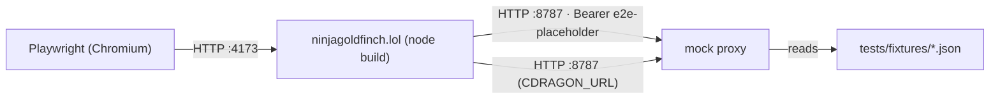

# Testing

How ninjagoldfinch.lol is tested: the unit tests in `just check`, the browser tests in `just e2e`, the deploy-script test, and how riot-proxy is replaced by fixtures so no test reaches riot-proxy or Riot.

## Layout

| Path                                         | What                                                                                                                        | Run by              |
| -------------------------------------------- | --------------------------------------------------------------------------------------------------------------------------- | ------------------- |
| `tests/unit/*.test.ts`                       | 41 Vitest files: domain modules, loaders, cold-path call order, proxy client, load timing, env rules, hooks, mock, fixtures | `just check`        |
| `tests/unit/fixtures.ts`                     | Helpers: `fixtureBody(path)`, recorded paths, `recordedNames()`                                                             | imported by tests   |
| `tests/e2e/*.test.ts`                        | 5 Playwright files: `routes`, `match`, `champion-page`, `champions`, `layout`                                               | `just e2e`          |
| `tests/mock-proxy/`                          | `mock.ts` (fixture loader and HTTP server), `server.ts` (CLI, default port 8787)                                            | Playwright, by hand |
| `tests/fixtures/*.json`                      | 50 fixtures: recorded or synthetic riot-proxy responses, and one CommunityDragon file                                       | mock and unit tests |
| `tests/fixtures/builds/`                     | riot-proxy's golden build fixtures, copied unchanged; not served by the mock                                                | unit tests          |
| `tests/record-fixture.ts`, `tests/redact.ts` | Fixture recorder and its redaction                                                                                          | `just fixture`      |
| `deploy/proxmox/test.sh`                     | Tests the preview VM scripts                                                                                                | `just check`        |

## Commands

| Command                                                       | Does                                                           | Source            |
| ------------------------------------------------------------- | -------------------------------------------------------------- | ----------------- |
| `just check`                                                  | Full gate, unit tests included                                 | `justfile:19-28`  |
| `pnpm vitest run`                                             | Unit tests only                                                | `package.json:18` |
| `pnpm vitest run tests/unit/proxy.test.ts`                    | One file                                                       | Vitest            |
| `pnpm vitest`                                                 | Watch mode                                                     | Vitest            |
| `just e2e`                                                    | Builds, then runs Playwright against `node build` and the mock | `justfile:30-32`  |
| `pnpm playwright test tests/e2e/match.test.ts -g "bot laner"` | One file or test by title                                      | Playwright        |
| `bash deploy/proxmox/test.sh`                                 | Deploy-script test alone                                       | `justfile:28`     |

Results on 2026-10-20 at `e7c395c`: unit `Test Files 34 passed (34)`, `Tests 332 passed (332)`; e2e `81 passed (31.9s)`. On 2026-11-03, with RV-03: `Test Files 35 passed (35)`, `Tests 341 passed (341)`.

## Unit tests

Vitest runs one project, `server`, in the Node environment over `tests/unit/**/*.test.ts`, and `expect.requireAssertions` fails any test that asserts nothing. Node runs with `--expose-gc`, so a test can call `gc()` (`vite.config.ts:22-37`). Tests import app code through the `#lib/*` alias (`package.json:45-47`).

What is covered:

- **Domain modules.** Every module in `src/lib/domain/` (15) is imported by at least one test file, as `CLAUDE.md:35` requires.
- **Loaders.** `profile`, `match-loader`, `champions-loader` and `champion-page-loader` tests build a real client with `createProxyClient(base, key, fetch)` whose `fetch` answers from fixtures, override single paths to simulate failures, and record which paths were asked (`tests/unit/match-loader.test.ts:24-37`). They call `clearStaticNames()` and `clearPatchVersions()` in `beforeEach` because those holds live in module memory (`tests/unit/match-loader.test.ts:39-42`).
- **Cold-path call order.** `cold-path.test.ts` delays one path by 30 ms in a fixture-answering client and records when each call starts and ends. It checks that the current patch and Data Dragon lookups start before the profile, match or champion table answers, that the stat shards start before the match answers, that the match page still waits for the profile, and that a profile which 404s before a failing patch call leaves no unhandled rejection (SPD-08, `tests/unit/cold-path.test.ts:18-117`).
- **Proxy client.** Bearer header on and off, dot-segment refusal, failure and slow-call logging, deadlines (`tests/unit/proxy.test.ts`). The deadline test uses fake timers, so it does not depend on wall-clock time (`tests/unit/proxy.test.ts:135-150`).
- **Load timing.** `timing.test.ts` runs `timeLoad` with a threshold of -1 (every load is over it) around a real client and checks the `slow load` line: route id, each call by spec path in order, a status for a non-2xx and `failed` for no answer, `(data)`, `(no route)`, `no riot-proxy calls`, no player name and no `x-cache`, nothing under the threshold, a load that throws still logged, and two concurrent loads kept apart (`tests/unit/timing.test.ts`). `hooks.test.ts` checks that `handle` logs a slow request under its route id (ADR-046).
- **Error mapping, cache policy, hooks, env rules.** `errors.test.ts`, `cache.test.ts`, `hooks.test.ts`, `env.test.ts`.
- **`.env.example` drift.** `env-example.test.ts` checks that `.env.example` lists exactly the variables `src/env.ts` declares plus `HOST`, `ORIGIN` and `PORT` (`tests/unit/env-example.test.ts:9-19`).
- **The mock itself.** `mock-proxy.test.ts` runs the real client against the mock server on a random port, which proves the client's path encoding matches the recorded paths (`tests/unit/mock-proxy.test.ts:1-30`).
- **Fixtures against the spec.** `fixtures-spec.test.ts` resolves each recorded 200 body's schema in `openapi/riot-proxy.json` and fails on any required field missing, so a spec bump that adds a required field breaks the tests until the fixtures catch up. It also checks that every build's `winRateLow` is the Wilson lower bound (`tests/unit/fixtures-spec.test.ts:84-120`).

### Deadlines and garbage collection

"fires the deadline on a call nothing else holds, through garbage collections" fires 20 calls at a fetch that never answers, with a 20 ms budget, while calling `gc()` every 1 ms, and expects every call to end as a 503 (`tests/unit/proxy.test.ts:154-169`). It guards the RV-03 fix: the old `withTimeout` handed its abort signal to `new Request(…, { signal })`, which holds it only weakly, so a call nothing else held could be collected before the abort reached it and never settle. That was the cause of the test that used to time out at 5 s in some full-suite runs, and of a match page that never finished against a hung riot-proxy. It fails at once if `--expose-gc` is missing.

## How riot-proxy is mocked

No test talks to riot-proxy or Riot. Playwright starts two servers and points one at the other.

The site runs as the production server with `NODE_ENV=production`, `ORIGIN=http://localhost:4173`, `PROXY_URL` and `CDRAGON_URL` both set to the mock, and the placeholder key `e2e-placeholder` (`playwright.config.ts:3-31`). Image URLs in the HTML point at Data Dragon CDN and CommunityDragon; tests assert the URLs (`tests/e2e/match.test.ts:36-39`), not that the images load.

The mock (`tests/mock-proxy/mock.ts`):

- loads every `*.json` directly in `tests/fixtures/` (not `builds/`) (`mock.ts:13-17`);
- answers a request whose method and full path and query match exactly, with the recorded status, headers and body (`mock.ts:19-25,45-46`);
- answers anything else with 500 and logs `mock-proxy: no fixture for GET <path>`, so a missing fixture fails loudly instead of looking like "not found" (`mock.ts:27-43`).

## Fixtures

Each fixture is `{ request: { method, path }, response: { status, headers, body } }`, with an optional `_note` (`tests/mock-proxy/mock.ts:5-9`).

| Kind      | Name                            | How it is made                                                                                             |
| --------- | ------------------------------- | ---------------------------------------------------------------------------------------------------------- |
| Recorded  | e.g. `match-oc1-712351051.json` | `just fixture <name> '<path>' [--keep ids]` against `PROXY_URL`; spends Riot rate limit (`justfile:34-36`) |
| Synthetic | `synthetic-*.json`              | Hand-written for states that cannot be recorded on demand, with a `_note` (ADR-017)                        |
| Builds    | `builds/*.json`                 | Copied from riot-proxy's `tests/fixtures/builds/` (`tests/fixtures/builds/README.md`)                      |

The recorder (`tests/record-fixture.ts`):

- reads `PROXY_URL` and `PROXY_KEY` from the environment or `.env`, and sends the key only to riot-proxy, never to a full CommunityDragon URL (`tests/record-fixture.ts:37-48`);
- keeps only the headers the site reads: `content-type`, `x-cache`, `x-cache-age`, `x-request-id`, `retry-after` (`tests/record-fixture.ts:41`);
- replaces every `puuid`, every `summonerId` and match `metadata.participants` with `fixture-puuid-<hash>` or `fixture-summoner-<hash>`, in the body and in the recorded path, so separately recorded fixtures agree (`tests/redact.ts:1-38`, `tests/record-fixture.ts:63-64`);
- with `--keep id,…`, trims Data Dragon files or lists to the entries other fixtures use (`tests/record-fixture.ts:52-61`).

Fixtures must contain no `rpx_` or `RGAPI-` strings (`CLAUDE.md:13-14`); the pre-commit hook refuses staged lines that match `(rpx_|RGAPI-)[A-Za-z0-9_-]` (`.githooks/pre-commit:12-23`). `fixtures-redacted.test.ts` checks every fixture file whole: no key, no 78-character raw PUUID, and every `puuid`, `summonerId` and `metadata.participants` entry a placeholder (`fixture-…` or `bld-fixture-…`) (RV-13).

## Browser tests

`tests/e2e/` covers each page twice: in a `test.describe` with `javaScriptEnabled: false`, proving the server-rendered page is complete, and again with JavaScript for enhancements such as popups and tabs (`tests/e2e/match.test.ts:6-7`, `tests/e2e/routes.test.ts:11-12`). Tests find elements by role and accessible name, assert the legal footer on each page type (`tests/e2e/routes.test.ts:3,21`), and check layout at several widths (`tests/e2e/match.test.ts:484`).

Chromium needs its system packages, fonts included; without them text lays out at zero height and visibility checks fail (`README.md:16-17`).

## Deploy-script test

`deploy/proxmox/test.sh` exercises the preview VM scripts in a temporary directory, including `ninjagoldfinch-update` following a moved tag and pruning a deleted one, with throwaway git repositories (`deploy/proxmox/test.sh:51-88`). It prints `deploy test: ok`. It runs `git init`, `commit` and `tag`, after unsetting the location variables git exports to hooks; `tests/unit/deploy-test.test.ts` runs it with `GIT_DIR` set and checks that repository is untouched (RV-01).

## Coverage expectations

There is no coverage tool or threshold: no coverage provider in `package.json` and no `coverage` block in `vite.config.ts`. The expectations are rules, not numbers:

- every PR ships tests for the behaviour it adds or changes (`CLAUDE.md:10`);
- every domain module has a unit test (`CLAUDE.md:35`);
- each page has an e2e test with JavaScript off;
- each riot-proxy path a page requests has a fixture, or the e2e run fails.

## What is not tested

- Nothing runs against a real riot-proxy; drift between riot-proxy and the committed spec is caught only when the spec is refreshed ([adding-a-proxy-call.md](./adding-a-proxy-call.md#1-refresh-the-spec-only-if-the-route-is-missing)).
- Cloudflare's behaviour (edge cache, Tunnel) and the systemd unit are not tested.

---

**Sources:** `justfile:L19-L36`, `package.json:L10-L20,L45-L47`, `vite.config.ts:L22-L37`, `playwright.config.ts:L3-L31`, `tests/mock-proxy/mock.ts:L1-L48`, `tests/unit/fixtures-redacted.test.ts:L1-L52`, `tests/mock-proxy/server.ts:L1-L12`, `tests/record-fixture.ts:L1-L82`, `tests/redact.ts:L1-L38`, `tests/unit/match-loader.test.ts:L24-L42`, `tests/unit/mock-proxy.test.ts:L1-L30`, `tests/unit/fixtures-spec.test.ts:L84-L120`, `tests/unit/proxy.test.ts:L120-L169`, `tests/unit/timing.test.ts`, `tests/unit/cold-path.test.ts:L18-L117`, `tests/unit/hooks.test.ts:L64-L83`, `tests/unit/env-example.test.ts:L1-L19`, `src/lib/server/proxy.ts:L82-L135`, `tests/e2e/routes.test.ts:L1-L21`, `tests/e2e/match.test.ts:L1-L10,L484`, `tests/fixtures/builds/README.md`, `deploy/proxmox/test.sh:L46-L82`, `.githooks/pre-commit:L12-L23`, `CLAUDE.md:L10-L14,L35`, `README.md:L16-L17`
**Last verified:** 2026-11-03 against commit `5fede17`
